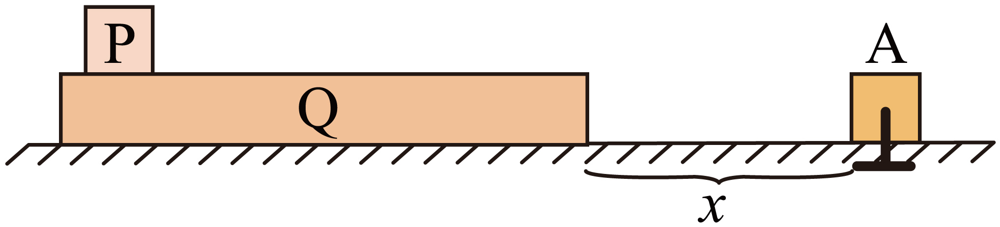

# Physics - 题目 2982

**ID**: cfaeda3a22314d30937c5268f0f6eea8
**年级**: Grade 12
**难度**: Medium-Hard
**题型**: Calculation

## 题目
如图所示，质量 ${\rm M=2{\rm{k}}{\rm{g}}}$ 的木板 ${\rm {\rm{Q}}}$ 静止在光滑水平地面上，距其右端 ${\rm x}$ （未知且可调）处有一铆钉固定的滑块 ${\rm {\rm{A}}}$ 。​​​​​​​‌一质量 ${\rm m=1{\rm{k}}{\rm{g}}}$ 的小滑块 ${\rm {\rm{P}}}$ （可视为质点）静止于木板左端。现水平向右迅速敲击小滑块 ${\rm {\rm{P}}}$ ，使其瞬间获得 ${\rm v{{}_{0}}=8{\rm{m}}/{\rm{s}}}$ 的初速度沿木板向右运动。已知重力加速度大小为 ${\rm g=10\{\rm{m}}/{\rm{s}}{{}^{2}}}$ ，滑块与木板间的动摩擦因数为 ${\rm μ=0.4}$ ，整个过程中滑块 ${\rm {\rm{P}}}$ 未滑离木板 ${\rm {\rm{Q}}}$ ，木板与右侧滑块 ${\rm {\rm{A}}}$ 的碰撞中没有机械能损失且碰撞时间极短可忽略。（1）若碰撞数次后滑块 ${\rm {\rm{P}}}$ 、木板 ${\rm {\rm{Q}}}$ 最终均静止，求为确保滑块 ${\rm {\rm{P}}}$ 不滑离木板 ${\rm {\rm{Q}}}$ ，木板的最短长度；（2）若 ${\rm x=0.25{\rm{m}}}$ ，将 ${\rm {\rm{A}}}$ 的钉去掉，滑块 ${\rm {\rm{A}}}$ 与水平面无摩擦，且 ${\rm m{{}_{{\rm{A}}}}=2{\rm{k}}{\rm{g}}}$ ，求木板与物块 ${\rm {\rm{A}}}$ 碰撞的次数及碰后滑块 ${\rm {\rm{P}}}$ 、木板 ${\rm {\rm{Q}}}$ 、物块 ${\rm {\rm{A}}}$ 最终速度的大小；（3）若小滑块 ${\rm {\rm{P}}}$ 的质量为 ${\rm m{{}_{{\rm{P}}}}=2\{\rm{k}}{\rm{g}}}$ ， ${\rm {\rm{Q}}}$ 的质量为 ${\rm M{{}_{{\rm{Q}}}}=1\{\rm{k}}{\rm{g}}}$ ，滑块 ${\rm {\rm{A}}}$ 用铆钉固定在距 ${\rm {\rm{Q}}}$ 右侧 ${\rm x{{}_{0}}=6\{\rm{m}}}$ 处，多次碰撞后 ${\rm {\rm{P}}}$ 、 ${\rm {\rm{Q}}}$ 最终都静止，求整个过程中木板 ${\rm {\rm{Q}}}$ 的总路程。

## 解答

1. （1）木板与右侧滑块 ${\rm {\rm{A}}}$ 的碰撞中没有机械能损失且碰撞时间极短可忽略，由动量守恒与机械能守恒可得，每次碰撞后，木板速度大小不变，方向反向。若碰撞数次后滑块 ${\rm {\rm{P}}}$ 、木板 ${\rm {\rm{Q}}}$ 最终均静止，由滑块 ${\rm {\rm{P}}}$ 在木板上一直做匀减速运动，根据能量守恒
2. ${\rm μm}gL=\frac {1}{2}mv{{}_{0}^{2}}$
3. 解得木板 ${\rm {\rm{Q}}}$ 的最短长度
4. ${\rm L=8{\rm{m}}}$
5. （2）木板 ${\rm {\rm{Q}}}$ 、物块 ${\rm {\rm{A}}}$ 每次碰撞时，由动量守恒与机械能守恒可得
6. ${\rm Mv{{}_{{\rm{Q}}}}+m{{}_{{\rm{A}}}}v{{}_{{\rm{A}}}}=Mv{{}_{{\rm{Q}}}}{{}^{\prime }}+m{{}_{{\rm{A}}}}v{{}_{{\rm{A}}}}{{}^{\prime }}}$ ， ${\rm \frac {1}{2}Mv{{}_{{\rm{Q}}}^{2}}+\frac {1}{2}m{{}_{{\rm{A}}}}v{{}_{{\rm{A}}}^{2}}=\frac {1}{2}Mv^{′}{{}_{{\rm{Q}}}^{{\rm{2}}}}+\frac {1}{2}m{{}_{{\rm{A}}}}v^{′}{{}_{{\rm{A}}}^{2}}}$
7. 解得
8. ${\rm v{{}_{{\rm{Q}}}}{{}^{\prime }}=v{{}_{{\rm{A}}}}}$ ， ${\rm v{{}_{{\rm{A}}}}{{}^{\prime }}=v{{}_{{\rm{Q}}}}}$
9. 即木板 ${\rm {\rm{Q}}}$ 、物块 ${\rm {\rm{A}}}$ 每次碰撞后，交换速度。故第一次碰撞前，木板 ${\rm {\rm{Q}}}$ 向物块 ${\rm {\rm{A}}}$ 匀加速直线运动，木板 ${\rm {\rm{Q}}}$ 加速度
10. ${\rm a=\frac {{\rm μm}g}{M}=2{{\rm{m}}}/{{\rm{s}}{{}^{{\rm{2}}}}}}$
11. 木板 ${\rm {\rm{Q}}}$ 速度
12. ${\rm v{{}_{{\rm{Q}}{\rm{1}}}}=\sqrt {2ax}=1{{\rm{m}}}/{{\rm{s}}}}$
13. 由动量守恒
14. ${\rm mv{{}_{0}}=Mv{{}_{{\rm{Q}}{\rm{1}}}}+mv{{}_{1}}}$
15. 滑块 ${\rm {\rm{P}}}$ 的速度
16. ${\rm v{{}_{1}}=6{{\rm{m}}}/{{\rm{s}}}}$
17. 第一次碰撞后，木板 ${\rm {\rm{Q}}}$ 、物块 ${\rm {\rm{A}}}$ 的速度分别为
18. ${\rm v{{}_{{\rm{Q}}{\rm{1}}}}{{}^{\prime }}=0}$ ， ${\rm v{{}_{{\rm{A}}{\rm{1}}}}{{}^{\prime }}=1{{\rm{m}}}/{{\rm{s}}}}$
19. 木板 ${\rm {\rm{Q}}}$ 向物块 ${\rm {\rm{A}}}$ 匀加速直线运动，到第二次碰撞前，由位移关系
20. ${\rm v{{}_{{\rm{A}}{\rm{1}}}}{{}^{\prime }}t=\frac {1}{2}at{{}^{2}}=\frac {v{{}_{{\rm{Q}}{\rm{2}}}}}{2}t}$
21. 木板 ${\rm {\rm{Q}}}$ 的速度为
22. ${\rm v{{}_{{\rm{Q}}{\rm{2}}}}=2{{\rm{m}}}/{{\rm{s}}}}$
23. 第二次碰撞后，木板 ${\rm {\rm{Q}}}$ 、物块 ${\rm {\rm{A}}}$ 的速度分别为
24. ${\rm v{{}_{{\rm{Q}}{\rm{2}}}}{{}^{\prime }}=1{{\rm{m}}}/{{\rm{s}}}}$ ， ${\rm v{{}_{{\rm{A}}{\rm{2}}}}{{}^{\prime }}=2{{\rm{m}}}/{{\rm{s}}}}$
25. 由动量守恒
26. ${\rm mv{{}_{0}}=Mv{{}_{{\rm{Q}}{\rm{2}}}}{{}^{\prime }}+m{{}_{{\rm{A}}}}v{{}_{{\rm{A}}{\rm{2}}}}{{}^{\prime }}+mv{{}_{2}}}$
27. 滑块 ${\rm {\rm{P}}}$ 的速度
28. ${\rm v{{}_{2}}=2{{\rm{m}}}/{{\rm{s}}}}$
29. 木板 ${\rm {\rm{Q}}}$ 向物块 ${\rm {\rm{A}}}$ 匀加速直线运动，直到滑块 ${\rm {\rm{P}}}$ 、木板 ${\rm {\rm{Q}}}$ 共速
30. ${\rm mv{{}_{0}}=\left ({M+m}\right )v^{′}+m{{}_{{\rm{A}}}}v{{}_{{\rm{A}}{\rm{2}}}}{{}^{\prime }}}$
31. 滑块 ${\rm {\rm{P}}}$ 、木板 ${\rm {\rm{Q}}}$ 的共同速度为
32. ${\rm v^{′}=\frac {4}{3}{{\rm{m}}}/{{\rm{s}}}}$
33. 若能发生第三次碰撞，由位移关系
34. ${\rm v{{}_{{\rm{A}}{\rm{2}}}}{{}^{\prime }}t=v{{}_{{\rm{Q}}{\rm{2}}}}{{}^{\prime }}t^{′}+\frac {1}{2}at^{′}{{}^{2}}}$ ， ${\rm v{{}_{{\rm{Q}}{\rm{3}}}}=v{{}_{{\rm{Q}}{\rm{2}}}}{{}^{\prime }}+at^{′}}$
35. 木板 ${\rm {\rm{Q}}}$ 的速度为
36. ${\rm v{{}_{{\rm{Q}}{\rm{3}}}}=3{{\rm{m}}}/{{\rm{s}}}＞v^{′}}$
37. 所以不能发生第三次碰撞。即木板与物块 ${\rm {\rm{A}}}$ 碰撞的次数为2次，滑块 ${\rm {\rm{P}}}$ 、木板 ${\rm {\rm{Q}}}$ 、物块 ${\rm {\rm{A}}}$ 最终速度的大小分别为 ${\rm \frac {4}{3}{{\rm{m}}}/{{\rm{s}}}}$ ， ${\rm \frac {4}{3}{{\rm{m}}}/{{\rm{s}}}}$ ， ${\rm 2{{\rm{m}}}/{{\rm{s}}}}$ 。
38. （3）第一次碰撞前，木板 ${\rm {\rm{Q}}}$ 向物块 ${\rm {\rm{A}}}$ 匀加速直线运动，木板 ${\rm {\rm{Q}}}$ 加速度
39. ${\rm a^{′}=\frac {{\rm μm}{{}_{{\rm{P}}}}g}{M{{}_{{\rm{Q}}}}}=8{{\rm{m}}}/{{\rm{s}}{{}^{{\rm{2}}}}}}$
40. 木板 ${\rm {\rm{Q}}}$ 速度
41. ${\rm v{{}_{{\rm{Q}}{\rm{3}}}}=\sqrt {2a^{′}x{{}_{0}}}=4\sqrt {6}{{\rm{m}}}/{{\rm{s}}}＞v{{}_{0}}}$
42. 故木板 ${\rm {\rm{Q}}}$ 先匀加速到与滑块 ${\rm {\rm{P}}}$ 共速
43. ${\rm m{{}_{{\rm{P}}}}v{{}_{0}}=\left ({m{{}_{{\rm{P}}}}+M{{}_{{\rm{Q}}}}}\right )v{{}_{共1}}}$
44. 再匀速运动至物块 ${\rm {\rm{A}}}$ 所在位置并与其发生碰撞，第一次碰撞后，木板 ${\rm {\rm{Q}}}$ 速度反向，大小不变，加速度不变，向左运动位移为
45. ${\rm x{{}_{1}}=\frac {v{{}_{共1}^{2}}}{2a^{′}}=\frac {16}{9}{\rm{m}}}$
46. 然后向右匀加速运动直到与滑块 ${\rm {\rm{P}}}$ 共速
47. ${\rm m{{}_{{\rm{P}}}}v{{}_{共1}}-M{{}_{{\rm{Q}}}}v{{}_{共1}}=\left ({m{{}_{{\rm{P}}}}+M{{}_{{\rm{Q}}}}}\right )v{{}_{共2}}}$
48. 再匀速运动至物块 ${\rm {\rm{A}}}$ 所在位置并与其发生碰撞，第二次碰撞后，木板 ${\rm {\rm{Q}}}$ 速度反向，大小不变，加速度不变，向左运动位移为
49. ${\rm x{{}_{2}}=\frac {v{{}_{共2}^{2}}}{2a^{′}}=\frac {16}{81}{\rm{m}}}$
50. 木板 ${\rm {\rm{Q}}}$ 的总路程
51. ${\rm s=6{\rm{m}}+\frac {16}{9}\times 2{\rm{m}}+\frac {16}{81}\times 2{\rm{m}}+\ldots =6{\rm{m}}+32\left [\left ({\frac {1}{9}}\right )+\left ({\frac {1}{9}}\right ){{}^{2}}+\left ({\frac {1}{9}}\right ){{}^{3}}+\ldots \right ]{\rm{m}}=10{\rm{m}}}$

## 知识点

**中文**:
  - 动量守恒与板块模型相结合
  - 动量守恒中的多次碰撞问题
  - 求解弹性碰撞问题

**English**:
  - Momentum Conservation with Plate Models
  - Multiple Collisions in Momentum Conservation
  - Solving Elastic Collision Problems

---
