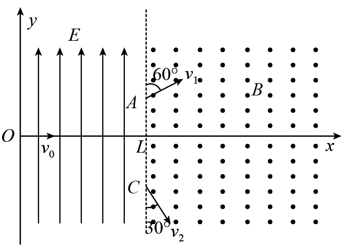

# Physics - 题目 2820

**ID**: d019f9f880e849fe97be996044bee068
**年级**: Grade 12
**难度**: Medium-Hard
**题型**: Calculation

## 题目
如图所示，在xOy平面内，0<x<L的区域内有一沿y轴正方向的匀强电场，x>L的区域内有一方向垂直于xOy平面向外的匀强磁场，某时刻，一带正电的粒子从坐标原点以沿x轴正方向的初速度v_{0}进入电场，之后的某一时刻，另一带等量负电的粒子以同样的初速度从坐标原点进入电场，正、负粒子从电场进入磁场时速度方向与电场和磁场边界的夹角分别为60°和30°，两粒子在磁场中分别运动半周后在某点相遇．两粒子的重力以及两粒子之间的相互作用都可忽略不计。​​​​​​​‌求：（1）正粒子从O点运动到A所用的时间；（2）正、负粒子的质量之比m_{l}:m_{2}；（3）两粒子先后进入电场的时间差。

## 解答

1. （1）x方向做匀速直线运动，所用时间为 $t=\frac {L}{v{{}_{0}}}$ ①。
2. （2）设粒子初速度为 $v{{}_{0}}$ ，进磁场方向与边界的夹角为θ，则有 $v{{}_{y}}=\frac {v{{}_{0}}}{{\tan}θ}$ ②， $v{{}_{y}}=a\cdot t$ ③， $qE=ma$ ④，
3. 由②③④得 $m=\frac {qEt}{v{{}_{0}}}{\tan}θ$ ，
4. 解得 $\frac {m{{}_{1}}}{m{{}_{2}}}=\frac {{\tan}60{^{\circ }}}{{\tan}30{^{\circ }}}=\frac {3}{1}$ 。
5. （3）作出粒子的运动轨迹，如图所示：
6. 
7. 正粒子在电场运动的竖直位移为 $y{{}_{1}}=\frac {v{{}_{y}}}{2}t$ ，
8. 结合①②得 $y{{}_{1}}=\frac {\sqrt {3}}{6}L$ ，
9. 同理得 $y{{}_{2}}=\frac {\sqrt {3}}{2}L$ ，
10. 设两粒子在磁场中运动半径为 $r{{}_{1}}$ 、 $r{{}_{2}}$ 由几何关系得 $2r{{}_{1}}=(y{{}_{1}}+y{{}_{2}})\sin 60{^{\circ }}$ ， $2r{{}_{2}}=(y{{}_{1}}+y{{}_{2}})\sin 30{^{\circ }}$ ，
11. 两粒子在磁场中运动时间均为半个周期，则有 $t{{}_{1}}=\frac {\mathrm{π}r{{}_{1}}}{v{{}_{1}}}$ ， $t{{}_{2}}=\frac {\mathrm{π}r{{}_{2}}}{v{{}_{2}}}$ ， $v{{}_{0}}=v{{}_{1}}\sin 60{^{\circ }}$ ， $v{{}_{0}}=v{{}_{2}}\sin 30{^{\circ }}$ ，
12. 由于两粒子在电场中运动时间相同，所以进电场时间差即为磁场中相遇前的时间差为 $Δt=t{{}_{1}}-t{{}_{2}}$ ，
13. 解得 $Δt=\frac {\sqrt {3}\mathrm{π}L}{6v{{}_{0}}}$ 。

## 知识点

**中文**:
  - 带电粒子在组合场中的运动

**English**:
  - Motion in Combined Fields

---
