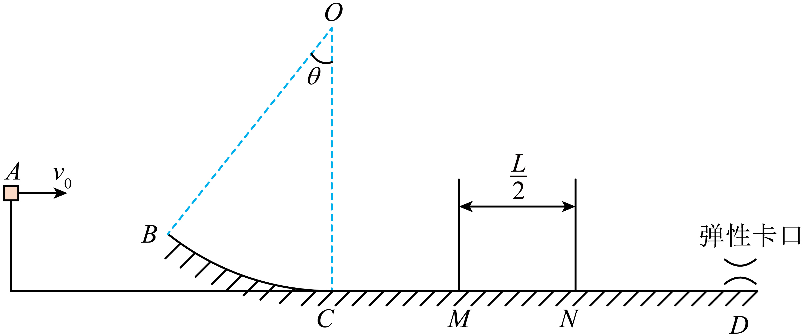

# Physics - 题目 2710

**ID**: d3222033e3154517b0bf109e4dc586b0
**年级**: Grade 12
**难度**: Medium-Hard
**题型**: Calculation

## 题目
如图所示，质量为m的小物块（视为质点）从某一高度处的A点以 $v{{}_{0}}=\frac {4}{5}\sqrt {gL}$ 的初速度水平抛出，恰好沿切线方向从B点进入一由圆弧轨道BC和水平轨道CD组成的轨道，圆弧轨道BC与水平轨道CD相切于C处，圆弧BC所对应的圆心角 $θ=37{}\degree $ ，半径为 $\frac {5}{6}L$ 。​​​​​​​‌水平轨道CD上宽度为 $\frac {L}{2}$ 的M、N之间存在一个特殊区域，小物块进入M、N之间就会受到一个大小为 $F=mg$ 恒定向右的作用力。平台MN两点间粗糙，其余部分光滑，M、N的右侧有一个弹性卡口，当小物块到达弹性卡口处的速度大于 $\frac {5}{6}\sqrt {3gL}$ 时可通过，速度不大于 $\frac {5}{6}\sqrt {3gL}$ 时被反弹，反弹后的动能为反弹前的 $\frac {1}{3}$ 。已知重力加速度为 ${\rm \mathit{g}，}\sin 37\mathrm{°}=0.6$ ， ${\cos}37\mathrm{°}=0.8$ 。求：（1）小物块通过B点时的速度大小 $v{{}_{B}}$ ；（2）小物块滑到圆弧轨道的C点时，小滑块对圆弧轨道的压力大小 $F{{}_{{\rm{N}}}}$ ；（3）若小物块与M、N之间的动摩擦因数 $μ{{}_{1}}=0.2$ ，小物块在M、N间通过的路程；（4）若小物块与M、N之间的动摩擦因数 $μ{{}_{2}}=0.25$ ，小物块在M、N间通过的路程。

## 解答

1. （1）在B点 $v{{}_{B}}=\frac {v{{}_{0}}}{{\cos}θ}$
2. 解得 $v{{}_{B}}=\sqrt {gL}$
3. （2）小物块由B滑到圆弧轨道的C点 $mg\cdot \frac {5}{6}L\left ({1-{\cos}θ}\right )=\frac {1}{2}mv{{}_{C}^{2}}-\frac {1}{2}mv{{}_{B}^{2}}$
4. 解得 $v{{}_{C}}=\frac {2}{3}\sqrt {3gL}$
5. 物块在C点 $F^{′}{{{}_{{\rm{N}}}}}-mg=m\frac {v{{}_{C}^{2}}}{\frac {5}{6}L}$
6. 解得 $F^{′}{{{}_{{\rm{N}}}}}=\frac {13}{5}mg$
7. 由牛顿第三定律可得，物块对轨道的压力 $F{{}_{{\rm{N}}}}=F^{′}{{{}_{{\rm{N}}}}}=\frac {13}{5}mg$
8. （3）当 $μ{{}_{1}}=0.2$ 时，小物块由C运动到N点 $\left ({mg-μ{{}_{1}}mg}\right )\frac {L}{2}=\frac {1}{2}mv{{}_{N}^{2}}-\frac {1}{2}mv{{}_{C}^{2}}$
9. 解得 $v{{}_{N}}=\sqrt {\frac {32gL}{15}}$
10. 因为 $v{{}_{N}}=\sqrt {\frac {32gL}{15}}>\frac {5}{6}\sqrt {3gL}$ ，所以小物块可通过弹性卡口，小物块在M、N间通过的路程 $s{{}_{1}}=\frac {1}{2}L$
11. （4）当 $μ{{}_{2}}=0.25$ 时，小物块由C运动到N点 $\left ({mg-μ{{}_{2}}mg}\right )\frac {L}{2}=\frac {1}{2}mv{{}_{N1}^{2}}-\frac {1}{2}mv{{}_{C}^{2}}$
12. 解得 $v{{}_{N1}}=\frac {5}{6}\sqrt {3gL}$
13. 小物块将在弹性卡口处反弹，设小物块第1次反弹后在M、N区域向左运动的最大位移为 $x{{}_{1}}$
14. 所以 $-\left ({mg+μ{{}_{2}}mg}\right )x{{}_{1}}=0-\frac {1}{3}\times \frac {1}{2}mv{{}_{N1}^{2}}$
15. 解得 $x{{}_{1}}=\frac {5}{18}L$
16. 由 $F>μ{{}_{2}}mg$ 可知，小物块不能在MN之间静止，设小物块第1次反弹后从N向右离开时的速度为 $v^{′}{{{}_{N1}}}$
17. 所以 $\left ({mg-μ{{}_{2}}mg}\right )x{{}_{1}}=\frac {1}{2}mv^{′}{{{}_{N1}^{2}}}-0$
18. 解得 $v^{′}{{{}_{N1}}}=\frac {1}{6}\sqrt {15gL}$
19. 设第2次反弹后在MN区域向左运动的最大位移为 $x{{}_{2}}$
20. 所以 $-\left ({mg+μ{{}_{2}}mg}\right )x{{}_{2}}=0-\frac {1}{3}\times \frac {1}{2}mv^{′}{{{}_{N1}^{2}}}$
21. 解得 $x{{}_{2}}=\frac {1}{18}L=\frac {1}{5}x{{}_{1}}$
22. 设第2次反弹后从N向右离开时的速度为 $v^{′}{{{}_{N2}}}$
23. 所以 $\left ({mg-μ{{}_{2}}mg}\right )x{{}_{2}}=\frac {1}{2}mv^{′}{{{}_{N2}^{2}}}-0$
24. 设第3次反弹后在MN区域向左运动的最大位移为 $x{{}_{3}}$
25. 所以 $-\left ({mg+μ{{}_{2}}mg}\right )x{{}_{3}}=0-\frac {1}{3}\times \frac {1}{2}mv^{′}{{{}_{N2}^{2}}}$
26. 解得 $x{{}_{3}}=\frac {1}{90}L=\frac {1}{5}x{{}_{2}}$
27. 由上可知，小物块第n次反弹后在MN中向左运动的最大位移 $x{{}_{n}}={\left({\frac {1}{5}}\right)^{n-1}}x{{}_{1}}$
28. 小物块在MN间通过的路程 $s{{}_{2}}=\frac {L}{2}+2\left ({x{{}_{1}}+x{{}_{2}}+x{{}_{3}}+\cdot \cdot \cdot }\right )$
29. 解得 $s{{}_{2}}=\frac {43}{36}L$

## 知识点

**中文**:
  - 平抛运动与斜面、圆轨道相结合问题
  - 竖直面内圆周运动问题
  - 应用动能定理求解多阶段、多过程问题

**English**:
  - Horizontal Projectile on Inclined Planes and Circular Tracks
  - Circular Motion in Vertical Plane
  - Multi-stage/Multi-process Problems

---
