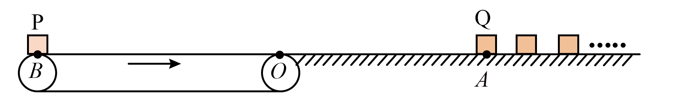

# Physics - 题目 2438

**ID**: d7aac5eb19554533999005f4c3e9fab6
**年级**: Grade 12
**难度**: Medium-Hard
**题型**: Calculation

## 题目
如图，一表面粗糙的水平传送带顺时针匀速转动，它的右端与地面平滑相接于O点。​​​​​​​‌水平地面上A点与O点的距离为 $x{{}_{0}}=7{\rm{m}}$ 。A点处放有一质量为 $M=2{\rm{k}}{\rm{g}}$ 物块Q，在其右侧每间隔 $Δx=0.9{{1}}{\rm{m}}$ 处放有一个与Q完全相同的物块，依次放若干个。现将一质量为 $m=1{\rm{k}}{\rm{g}}$ 的物块P轻放在传送带左端B点处，经过一段时间后从O点滑离传送带。已知物块P与传送带间的动摩擦因数为 $μ{{}_{0}}=0.4{\rm ，P}$ 从O点滑到A点的过程中动能减小了14J，P在A点处与Q发生正碰后又在地面上滑行 $s=1{\rm{m}}$ 后停止运动。所有物块均可视为质点，它们与地面间的动摩擦因数均相同，且物块间的碰撞均为弹性碰撞，重力加速度大小g取10m/s^{2}。求：（1）物块与地面间的动摩擦因数；（2）传送带上B、O两点间最小距离；（3）最后一次碰撞中的被碰物块在地面上滑行的时间。

## 解答

1. （1）由于P物块从O滑到A点的过程中 ${\rm{Δ}}E{{}_{{\rm{k}}}}=-14{\rm{J}}$
2. 根据动能定理有 $-{\rm μm}gx{{}_{0}}={\rm{Δ}}E{{}_{{\rm{k}}}}$
3. 解得 $μ=0.2$
4. （2）由于物块P的质量m小于物块Q的质量M，且物块间发生弹性碰撞，所以P与Q碰撞后速度反向。设P运动到A点时速度为v，碰撞后P的速度大小为v_{1}，Q的速度为v_{2}。由于碰撞后P在地面上滑行s=1m后停止运动，根据动能定理有 $-{\rm μm}gs=0-\frac {1}{2}mv{{}_{1}^{2}}$
5. 解得 $v{{}_{1}}=2{\rm{m}}/{\rm{s}}$
6. 设以碰撞前物块P运动的方向为正，由于P与Q间碰撞为弹性碰撞，则有 $mv+0=-mv{{}_{1}}+Mv{{}_{2}}$ ， $\frac {1}{2}mv{^{2}}+0=\frac {1}{2}mv{{}_{1}^{2}}+\frac {1}{2}Mv{{}_{2}^{2}}$
7. 联立解得 $v{{}_{2}}=4{\rm{m}}/{\rm{s}}$ ， $v=6{\rm{m}}/{\rm{s}}$
8. 设物块P滑至O点时速度为v_{0}，有 $\frac {1}{2}mv{^{2}}-\frac {1}{2}mv{{}_{0}^{2}}={\rm{Δ}}E{{}_{{\rm{k}}}}$
9. 解得 $v{{}_{0}}=8{\rm{m}}/{\rm{s}}$
10. 当物块P在传送带上一直加速运动到O点速度恰好为v_{0}时，B、O两点间距离最小。根据动能定理有 $μ{{}_{0}}mgL=\frac {1}{2}mv{{}_{0}^{2}}-0$
11. 解得 $L=8{\rm{m}}$
12. （3）物块Q被碰后获得一个向右的速度，此后，物块Q减速运动 $Δx$ 后与其右侧第一个物块发生弹性碰撞，由于Q与右侧物块均相同，弹性碰撞后速度交换，则物块Q将停止运动，其右侧第一个物块将向右减速运动 $Δx$ 后与下一个物块发生弹性碰撞，以此类推。最终所有物块均静止，碰撞过程中没有机械能损失。因此P与Q碰撞后，Q获得的动能全部转化为摩擦生热。根据能量守恒，有 $μMgL{{}_{x}}=\frac {1}{2}Mv{{}_{2}^{2}}$
13. 解得 $L{{}_{x}}=4{\rm{m}}$
14. 所以Q被碰后，物块间还会发生4次碰撞，Q右侧的第4个物块最后运动起来，其位移大小为 $x=L{{}_{x}}-4Δx=0.36{\rm{m}}$
15. 对于Q右侧的第4个物块，最终速度减为0，根据逆向过程分析有 $x=\frac {1}{2}at{^{2}}$
16. 根据牛顿第二定律有 $μMg=Ma$
17. 联立解得 $t=0.6{\rm{s}}$

## 知识点

**中文**:
  - 传送带模型中的能量守恒问题
  - 动量和能量的综合应用

**English**:
  - Energy Conservation in Conveyor Belt Models
  - Integration of Momentum and Energy

---
