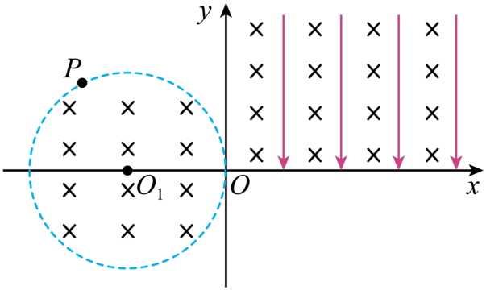

# Physics - 题目 1752

**ID**: d88b8b38b2034069870fbdcbf37c1070
**年级**: Grade 12
**难度**: Medium-Hard
**题型**: Calculation

## 题目
如图所示的xOy坐标平面，在第二、三象限存在半径为R的圆形匀强磁场区域，圆心位于 $O{{}_{1}}$ （﹣R，0）位置，磁感应强度大小为B，方向垂直xOy坐标平面向里，电场方向沿y轴负方向，匀强磁场的大小和方向与第二、三象限的磁场均相同。​​​​​​​‌圆形磁场边界上有一个P点，P点与y轴的距离为 $\frac {3R}{2}$ 。一个质量为m、电荷量为q（ $q>0$ ）的粒子从P点垂直磁场方向射入圆形匀强磁场区域，恰好从坐标原点O沿x轴正方向进入正交的电磁场区域。已知电场强度大小为 $E=\frac {\sqrt {3}qB{^{2}}R}{2m}$ ，不计粒子所受重力，求：(1)带电粒子从P点垂直进入圆形匀强磁场时的速度大小；(2)带电粒子在第一象限距x轴的最大距离；(3)带电粒子在第一象限的轨迹与x轴相切点的坐标。

## 解答

1. （1）带电粒子垂直磁场方向进入圆形匀强磁场做匀速圆周运动，轨迹如图1所示。
2. 
3. 设OP与x轴负方向的夹角为α，由几何关系得OP=2Rcosα
4. 根据题设条件有 $\frac {3}{2}R=OP{\cos}α$
5. 解得 ${\rm \mathit{α}=30°，}OP=\sqrt {3}R$
6. 由几何关系可知 $\vartriangle OPO{{}_{2}}$ 为等边三角形，则轨迹半径： $r{{}_{1}}=OP=\sqrt {3}R$
7. 根据洛伦兹力提供向心力得 $qv{{}_{0}}B=m\frac {v{{}_{0}^{2}}}{r{{}_{1}}}$
8. 解得  $v{{}_{0}}=\frac {\sqrt {3}qBR}{m}$
9. （2）将速度 $v{{}_{0}}$ 分解，设某一分速度v_{1}使粒子受到的洛伦兹力与电场力平衡，即 $qv{{}_{1}}B=qE$
10. 又由题设条件 $E=\frac {\sqrt {3}qB{^{2}}R}{2m}$
11. 联立，解得 $v{{}_{1}}=\frac {v{{}_{0}}}{2}=\frac {\sqrt {3}qBR}{2m}$
12. 由左手定则知速度v_{1}方向沿x轴正方向，与v_{0}方向相同，令 $v{{}_{0}}=v{{}_{1}}+v{{}_{2}}$
13. 代入数据解得 $v{{}_{2}}=v{{}_{1}}=\frac {\sqrt {3}qBR}{2m}$
14. v_{2}方向也与v_{0}方向相同，所以带电粒子的运动可以分解为速度为v_{1}的匀速直线运动与速度为v_{2}的逆时针方向的匀速圆周运动的合运动，轨迹如图2所示，
15. 
16. 粒子做匀速圆周运动，由牛顿第二定律得 $qv{{}_{2}}B=m\frac {v{{}_{2}^{2}}}{r{{}_{2}}}$
17. 带电粒子将做旋轮线运动，图中实线表示它的轨迹，M点为粒子距x轴的最远点。在这一点粒子的速度 $v{{}_{M}}=v{{}_{1}}-v{{}_{2}}=0$
18. 它到x轴的最大距离 $y{{}_{{\rm{m}}}}=2r{{}_{2}}$
19. 联立，解得 $y{{}_{{\rm{m}}}}=\sqrt {3}R$
20. （3）粒子在第一象限的运动周期 $T=\frac {2πm}{qB}$
21. Q点为粒子运动轨迹与x轴的相切点，Q点坐标 $x{{}_{Q}}=v{{}_{1}}T$
22. 联立，解得 $x{{}_{Q}}=\sqrt {3}πR$
23. 根据运动的周期性，粒子与x轴相切点的坐标 $x=nx{{}_{Q}}=\sqrt {3}nπR\left ({n=1,2,3，\cdots }\right )$

## 知识点

**中文**:
  - 带电粒子在叠加场中的运动

**English**:
  - Motion in Superimposed Fields

---
