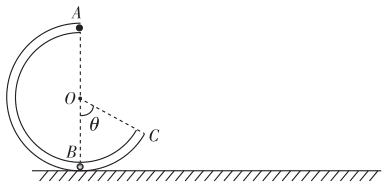

# Physics - 题目 2903

**ID**: daa1fe1ff7d3487f973fbc8f1ee63e9c
**年级**: Grade 12
**难度**: Medium-Hard
**题型**: Calculation

## 题目
如图所示，圆心为 $O$ 、半径为 $R$ 的部分圆形光滑细管 $ABC$ 竖直固定在地面上， $\mathrm{A}$ 、 $B$ 分别为细管的最高点、最低点， $OC$ 与竖直方向的夹角为 $θ$ ，细管内最低点静止质量为 $m$ 的小球Q。​​​​​​​‌质量为 $3m$ 的小球P从 $\mathrm{A}$ 点由静止释放，沿细管滑下，在最低点与Q发生弹性碰撞，小球 $P$ 恰好未从 $C$ 点飞出。P与Q均可看作质点，重力加速度为 $g$ ，求：(1) $OC$ 与竖直方向夹角 $θ$ 的大小；(2)小球Q从 $C$ 点飞出后，距离地面的最大高度；(3)若小球Q从 $C$ 点飞出后，受到水平向右、大小为 $mg$ 的恒定风力，小球在落地前的最小动能为多少。

## 解答

1. （1）设P球滑到 $B$ 点的速度为 $v{{}_{0}}$ ，碰撞后的速度为 $v{{}_{1}}$ ， $Q$ 碰撞后的速度为 $v{{}_{2}}$ ， $P$ 由 $\mathrm{A}$ 到 $B$ ，由动能定理
2. $3mg\times 2R=\frac {1}{2}3mv{{}_{0}^{2}}-0$
3. 在 $B$ 处， $P$ 、 $Q$ 发生弹性碰撞
4. $3mv{{}_{0}}=3mv{{}_{1}}+mv{{}_{2}}$
5. $\frac {1}{2}3mv{{}_{0}^{2}}=\frac {1}{2}3mv{{}_{1}^{2}}+\frac {1}{2}mv{{}_{2}^{2}}$
6. 解得
7. $v{{}_{1}}=\frac {v{{}_{0}}}{2}$ ， $v{{}_{2}}=\frac {3}{2}v{{}_{0}}{\rm \mathit{P}}$ 恰好未从 $C$ 点飞出， $P$ 由 $B$ 到 $C$ ，由动能定理
8. $-3mgR\left ({1-{\cos}θ}\right )=0-\frac {1}{2}3mv{{}_{1}^{2}}$
9. 解得
10. ${\cos}θ=\frac {1}{2}$
11. 故
12. $θ=60\degree $
13. （2）Q由 $B$ 到 $C$
14. $-mgR\left ({1-{\cos}θ}\right )=\frac {1}{2}mv{{}_{c}^{2}}-\frac {1}{2}mv{{}_{2}^{2}}$
15. 解得
16. $v{{}_{c}}=2\sqrt {2gR}{\rm \mathit{Q}}$ 从 $C$ 点飞出到最高点，由动能定理
17. $-mgh{{}_{2}}=\frac {1}{2}m{\left({v{{}_{c}}{\cos}θ}\right)^{2}}-\frac {1}{2}mv{{}_{c}^{2}}$
18. 解得
19. $h{{}_{2}}=3R$
20. 故最大高度为 $h=\frac {R}{2}+3R=3.5R$ ；
21. （3）当重力与风力的合力与速度垂直时，Q动能最小，此时速度最小为
22. $v{{}_{{\rm \min }}}=v{{}_{c}}{\cos}15\degree $
23. 由 $E{{}_{{\rm{k}}{\rm \min }}}=\frac {1}{2}mv{{}_{{\rm \min }}^{2}}$ ，得
24. $E{{}_{K{\rm \min }}}=\left ({2+\sqrt {3}}\right )mgR$

## 知识点

**中文**:
  - 求解弹性碰撞问题

**English**:
  - Solving Elastic Collision Problems

---
