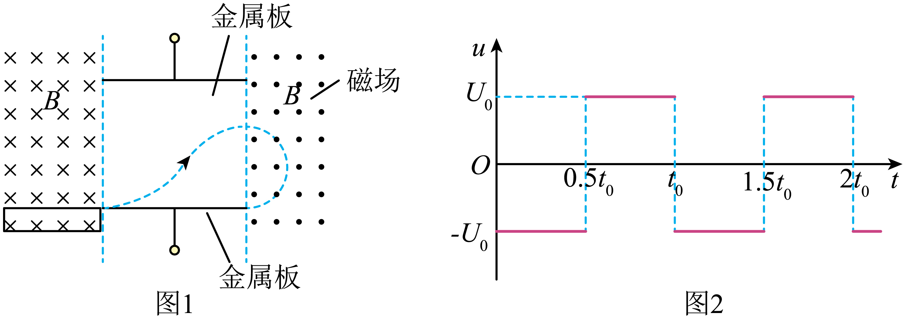

# Physics - 题目 846

**ID**: dab6cd1c320749c5ac5d4ad87be6e16e
**年级**: Grade 12
**难度**: Medium-Hard
**题型**: Calculation

## 题目
通过电磁场控制带电粒子的运动是现代化的重要技术。​​​​​​​‌如图1所示，两块平行正对金属板水平放置，两侧分布着以虚线为边界垂直纸面向里和向外的匀强磁场，磁感应强度大小均为 $B$ ，左侧靠近下方金属板边缘有一个粒子输送管道，管道不仅可以屏蔽管外磁场的影响，而且可以对带电粒子起到匀加速作用。已知上、下两金属板间加上如图2所示矩形交变电压，电压大小为 $U{{}_{0}}$ ，周期为 $t{{}_{0}}$ ，一带电粒子在 $t=0$ 时从管道左侧无初速度释放，经管道加速后，在 $t=t{{}_{0}}$ 时刻离开管道进入金属板之间区域，在 $t=2t{{}_{0}}$ 时刻离开金属板之间区域，又在 $t=3t{{}_{0}}$ 时刻从下金属板右侧边缘水平向左进入金属板之间区域，粒子运动的部分轨迹如图1中虚线所示。已知金属板长度是板间距离的 $\frac {π}{3}$ 倍，忽略粒子所受的重力、管道直径大小和场的边缘效应和交变效应。(1)判断带电粒子的电性，并求其比荷 $\frac {q}{m}$ ；(2)求管道的长度 $L{{}_{1}}$ 和金属板的长度 $L{{}_{2}}$ ；(3)求带电粒子回到下金属板左侧边缘的可能时刻 $t$ ；(4)若在右边磁场中增加竖直方向的匀强电场，使得带电粒子不从右侧磁场的左边界飞出，则：①请判定此匀强电场的方向；②小明计算了满足此要求的电场强度大小的取值值范围为 $E⩾\frac {π}{4}\sqrt {\frac {πU{{}_{0}}B}{6t{{}_{0}}}}$ ，请观察并论证这一结果是错误的（不要求写出具体范围）。

## 解答

1. （1）在右侧磁场中，根据左手定则，可以判断粒子带正电。依题可知，粒子在磁场中运动的周期 $T=2t{{}_{0}}$ ，
2. 又有 $T=\frac {2πm}{qB}$ ，
3. 可计算 $\frac {q}{m}=\frac {π}{Bt{{}_{0}}}$ 。
4. （2）粒子在金属板之间区域运动，分析其运动，可知是对称的匀变速曲线运动，进入或离开该区域的速度大小相同，设为 $v{{}_{0}}$ ，则有 $t{{}_{0}}=\frac {πR}{v{{}_{0}}}$ ，
5. 又有 $R=\frac {1}{2}a{\left({\frac {t{{}_{0}}}{2}}\right)^{2}}$ ，
6. 且 $qE=ma,E=\frac {U{{}_{0}}}{D}$ ，
7. 又有 $L{{}_{2}}=v{{}_{0}}t{{}_{0}}$ ，
8. 结合给定条件 $L{{}_{2}}=\frac {π}{3}D$ ，可计算 $L{{}_{2}}=\frac {π}{2}\sqrt {\frac {πU{{}_{0}}t{{}_{0}}}{6B}}$ ，
9. 又有 $L{{}_{1}}=\frac {1}{2}v{{}_{0}}t{{}_{0}}$ ，
10. 可知 $L{{}_{1}}=\frac {π}{4}\sqrt {\frac {πU{{}_{0}}t{{}_{0}}}{6B}}$ 。
11. （3）分析粒子整个运动，运动轨迹如图所示，根据对称性和周期性，可知带电粒子回到下金属板左侧边缘的时刻 $t=5t{{}_{0}}+4nt{{}_{0}}\left ({n=0,1,2\cdots }\right )$ 。
12. 
13. （4）①增加竖直方向的匀强电场后，粒子将做曲线运动，此曲线运动可分解为水平方向的匀速直线运动和竖直面内的匀速圆周运动。只有水平方向的匀速直线运动向右，粒子才不会返回两金属板之间区域，根据配速法可知，电场力方向向上，电场场强方向应该向上。
14. ②根据前述计算可知 $\frac {π}{4}\sqrt {\frac {πU{{}_{0}}B}{6t{{}_{0}}}}=\frac {v{{}_{0}}B}{2}$ ，
15. 即小明的计算结果等价于 $E⩾\frac {v{{}_{0}}B}{2}$ 令 $E=\frac {v{{}_{0}}B}{2}$ ，
16. 则根据 $qvB=qE$ ，即匀速直线运动分速度为 $v=\frac {v{{}_{0}}}{2}$ ，
17. 则匀速圆周运动的分速率为 $v{{}_{0}}-v=\frac {v{{}_{0}}}{2}$ ，
18. 即进入复合电磁场后，任何时刻粒子的垂直电磁场左边界的分速度 $v{{}_{x}}⩾0$ ，即粒子不会向左边界“回旋”，可见电场强度最小值还可以更小一些。

## 知识点

**中文**:
  - 带电粒子在周期性变化的电磁场中的运动

**English**:
  - Motion in Periodically Varying EM Fields

---
