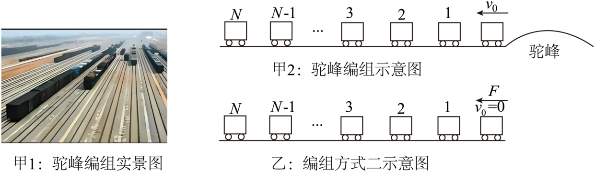

# Physics - 题目 1086

**ID**: dae058f2949c4f76a9d20846fe20cb9c
**年级**: Grade 12
**难度**: Medium-Hard
**题型**: Calculation

## 题目
为了统一调度以充分发挥铁路的运输能力，提高运输效率，需要把全路分散的列车按不同去向、不同用途科学分组，将同一组车厢排列在同一轨道上，这就是列车编组。​​​​​​​‌编组后还需要使各节车厢与车头挂接在一起，加上列车标志，就形成完整的列车。目前我国采用的列车挂接方式主要有两种：一种方式是目前比较流行的“驼峰”编组，如图甲所示，在地面修筑适当坡度的犹如驼峰峰背的小山丘，上面铺设铁路，利用车头重力和“驼峰”坡度产生的重力势能进行溜放，使车头冲向车厢，碰撞后通过特制“铁手挂钩”紧紧连接在一起，再一起去撞击下一节车厢，直到所有车厢完成挂接；另一种方式是让火车头提供牵引力，冲向车厢，釆取与第一种相似的方式依次挂接所有车厢，当车厢数目较多时，往往釆用这种方式。火车研发科研人员在进行列车编组实验时所用车头质量为4m，所有货车车厢均满载，质量相等且均为4m，各节车厢之间相隔距离d依次停放在编组场同一轨道上。不计一切阻力，不计挂钩的长度和车厢之间碰撞所需时间，试分析回答以下问题：（1）若第一次实验按题干方式设置15节车厢，采用“驼峰”编组方式，车头无动力冲下“驼峰”，以速度 $v{{}_{0}}$ 驶向第一节车厢，求15节车厢全部挂接后列车速度，以及从车头与第一节车厢碰撞到完成整个挂接所需时间；（2）若第二次实验按题干方式设置N节车厢，车头在水平轨道上从距离第一节车厢也为d处启动，车头发动机牵引力恒定为F，如图乙所示，求第N节车厢完成挂接时车头的速度及列车从启动到N节车厢完成挂接所需的时间；（3）若第三次实验在（2）的情况下将所有车厢变为空载，所有车厢质量相等且均为m，其余条件不变，求车头所能达到的最大速度。

## 解答

1. （1）设15节车厢全部挂好以后的速度为 $v^{′}{{}_{15}}$ ，根据动量守恒定律有
2. $4mv{{}_{0}}=(15+1)\times 4mv^{′}{{}_{15}}$
3. 解得
4. $v^{′}{{}_{15}}=\frac {v{{}_{0}}}{16}$
5. 用 $v^{′}{{}_{i}}$ 表示第i节车厢被挂接后车头及已挂车厢的速度，根据动量守恒定律有
6. $4mv{{}_{0}}=\left ({i+1}\right )\times 4mv^{′}{{}_{i}}$
7. 解得
8. $v^{′}{{}_{i}}=\frac {v{{}_{0}}}{i+1}$
9. 由于每次挂接时通过车厢之间间隙的运动均可视为匀速运动，所以车头及前i节车厢通过间隙与第（i+1）节挂接所经历的时间为
10. $t{{}_{i}}=\frac {d}{v^{′}{{}_{i}}}=\frac {\left ({i+1}\right )d}{v{{}_{0}}}$
11. 所以挂接的总时间为
12. $t{{}_{总}}=t{{}_{1}}+t{{}_{2}}+t{{}_{3}}+\ldots \ldots +t{{}_{14}}=\frac {d(2+3+4+\ldots \ldots +15)}{v{{}_{0}}}=\frac {119d}{v{{}_{0}}}$
13. （2）设vi表示第i节车厢被碰撞前车头与前（ $i-1$ ）车厢的速度， $v^{′}{{}_{i}}$ 表示第i节车厢被碰撞后整体的速度，ai表示车头与前（ $i-1$ ）节车厢共同运动时的加速度，由牛顿第二定律有
14. $a{{}_{1}}=\frac {F}{4m}$
15. 利用匀变速直线运动公式
16. $v{{}_{1}^{2}}=2a{{}_{1}}d$
17. 根据动量守恒定律有
18. $2\times 4mv^{′}{{}_{1}}=4mv{{}_{1}}$
19. 联立可以求得
20. $v{{}_{1}}=\sqrt {\frac {2Fd}{4m}}$ ， $v^{′}{{}_{1}}=\sqrt {\frac {Fd}{2\times 4m}}$
21. 同理有
22. $a{{}_{2}}=\frac {F}{2\times 4m}$
23. $v{{}_{2}^{2}}-v^{′}{{}_{1}}{{}^{2}}=2a{{}_{2}}d$
24. $3\times 4mv^{′}{{}_{2}}=2\times 4mv{{}_{2}}$
25. 联立可以求得
26. $v{{}_{2}}=\sqrt {\frac {3Fd}{2\times 4m}}$ ， $v^{′}{{}_{2}}=\sqrt {\frac {2Fd}{3\times 4m}}$
27. 继续列式，有
28. $a{{}_{3}}=\frac {F}{3\times 4m}$
29. $v{{}_{3}^{2}}-v^{′}{{}_{2}}{{}^{2}}=2a{{}_{3}}d$
30. $4\times 4mv^{′}{{}_{3}}=3\times 4mv{{}_{3}}$
31. 解得
32. $v{{}_{3}}=\sqrt {\frac {4Fd}{3\times 4m}}$ ， $v^{′}{{}_{3}}=\sqrt {\frac {3Fd}{4\times 4m}}$
33. 以此类推
34. $v{{}_{N}}=\sqrt {\frac {Fd}{4m}}\cdot \sqrt {\frac {N+1}{N}}$ ， $v^{′}{{}_{N}}=\sqrt {\frac {Fd}{4m}}\cdot \sqrt {\frac {N}{N+1}}$
35. 由运动学公式，车头及前（i-1）节车厢通过间隙与第i节挂接所经历的时间为
36. $t{{}_{i}}=\frac {v{{}_{i}}-v^{′}{{}_{i-1}}}{a{{}_{i}}}=\frac {4m}{F}\left ({iv{{}_{i}}-iv^{′}{{}_{i-1}}}\right )=\frac {4m}{F}\left [iv{{}_{i}}-\left ({i-1}\right )v{{}_{i-1}}\right ]$
37. $t{{}_{总}}=t{{}_{N}}+t{{}_{N-1}}+\cdots t{{}_{2}}+t{{}_{1}}=$  $\frac {4m}{F}\left [Nv{{}_{N}}-\left ({N-1}\right )v{{}_{N-1}}+\left ({N-1}\right )v{{}_{N-1}}-\left ({N-2}\right )v{{}_{N-2}}+\cdots +2v{{}_{2}}-v{{}_{1}}+v{{}_{1}}-0\right ]$
38. 利用前面 $v{{}_{{\rm{N}}}}$ 的表达式，可求得
39. $t{{}_{总}}=\frac {4m}{F}Nv{{}_{N}}=2\sqrt {\frac {N\left ({N+1}\right )md}{F}}$
40. （3）仍用vi表示第i节车厢被碰撞前车头与前（i-1）节车厢的速度， $v^{′}{{}_{i}}$ 表示第i节车厢被碰撞后整体的速度，ai表示车头与前（ $i-1$ ）节车厢共同运动时的加速度，同（2）的解题思路，有
41. $a{{}_{i}}=\frac {F}{\left ({4+i-1}\right )m}$
42. $v{{}_{i}^{2}}-v^{′}{{}_{i-1}}{{}^{2}}=2a{{}_{i}}d$
43. $\left ({4+i-1}\right )mv^{′}{{}_{i-1}}=\left ({4+i-2}\right )mv{{}_{i-1}}$
44. 可以解得
45. $v{{}_{i}^{2}}=\frac {2Fd}{\left ({4+i-1}\right )m}+\frac {\left ({4+i-2}\right ){{}^{2}}}{\left ({4+i-1}\right ){{}^{2}}}v{{}_{i-1}^{2}}$
46. 根据此递推关系
47. $v{{}_{i}^{2}}=\frac {2Fd}{\left ({4+i-1}\right )m}+\frac {\left ({4+i-2}\right ){{}^{2}}}{\left ({4+i-1}\right ){{}^{2}}}\times \left [\frac {2Fd}{\left ({4+i-2}\right )m}+\frac {\left ({4+i-3}\right ){{}^{2}}}{\left ({4+i-2}\right ){{}^{2}}}v{{}_{i-2}^{2}}\right ]=\cdots $
48. 最终可得
49. $v{{}_{i}^{2}}=\frac {\left ({4+i-1}\right )+\left ({4+i-2}\right )+\cdots +\left ({4+1}\right )}{\left ({4+i-1}\right ){{}^{2}}}\frac {2Fd}{m}+\frac {4{{}^{2}}}{\left ({4+i-1}\right ){{}^{2}}}v{{}_{1}^{2}}$
50. 由前述可得
51. $v{{}_{1}}=\sqrt {\frac {Fd}{2m}}$
52. 代入上式，有
53. $v{{}_{i}^{2}}=\frac {\left ({4+i-1}\right )+\left ({4+i-2}\right )+\cdots +\left ({4+1}\right )+4}{\left ({4+i-1}\right ){{}^{2}}}\frac {2Fd}{m}$
54. 化简后得
55. $v{{}_{i}^{2}}=\frac {i{{}^{2}}+7i}{\left ({i+3}\right ){{}^{2}}}\frac {Fd}{m}$
56. 将上式变形
57. $v{{}_{i}^{2}}=\frac {\left ({i+3}\right ){{}^{2}}+\left ({i+3}\right )-12}{\left ({i+3}\right ){{}^{2}}}\frac {Fd}{m}=\left [-12\left ({\frac {1}{i+3}-\frac {1}{24}}\right ){{}^{2}}+\frac {49}{48}\right ]\frac {Fd}{m}$
58. 由此可得，当 $i=21$ 时， $v{{}_{i}}$ 最大，其最大值为
59. $v{{}_{\max }}=\sqrt {\frac {49Fd}{48m}}$

## 知识点

**中文**:
  - 动量与牛顿定律的综合考查
  - 动量守恒中的多次碰撞问题

**English**:
  - Integration of Momentum and Newton's Laws
  - Multiple Collisions in Momentum Conservation

---
