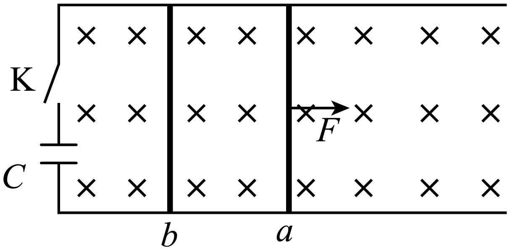

# Physics - 题目 2876

**ID**: db32d3fceece463890360b2f1e2a7fe1
**年级**: Grade 12
**难度**: Medium-Hard
**题型**: Calculation

## 题目
如图所示，间距d=1m的平行光滑的金属导轨固定在绝缘水平面上，水平导轨足够长，整个空间存在垂直导轨竖直向下的匀强磁场，磁感应强度B=2T，长度均为d=1m的人工智能金属棒a、b。​​​​​​​‌其电学属性可以自由切换，质量分别为 $m{{}_{1}}=0.5{\rm{k}}{\rm{g}}$ 、 $m{{}_{2}}=1{\rm{k}}{\rm{g}}$ ，初始时a、b均静止，电容为C=0.25F的电容器未充电。现对a棒施加垂直于棒的水平外力F=6N。不计导轨电阻。（1）开关K处于断开状态时，若金属棒a、b电阻分别为 $R{{}_{1}}=2{\rm{Ω}}$ 、 $R{{}_{2}}=1{\rm{Ω}}$ ，求最终电流稳定时两棒的速度差为多大？（2）开关K一直处于闭合状态时，若将b棒的电阻切换为很大（可认为它与导轨间始终处于绝缘状态而静止不动），a棒电阻仍为 $R{{}_{1}}=2{\rm{Ω}}{\rm ，\mathit{a}}$ 棒在F=6N作用下做匀加速运动，求其加速度大小？（3）开关K一直处于断开状态时，若将a棒的电阻切换为零；b棒切换为直流电阻为零的纯电感状态，其自感系数L=2H，将b棒锁定不动。a棒在F=6N作用下开始运动，已知b棒产生的自感电动势大小为 $e=L\frac {\Delta i}{\Delta t}$ 。求a棒的最大动能。

## 解答

1. （1）回路电流稳定时，此时a、b加速度相同，根据牛顿第二定律，对a有 $F-BId=m{{}_{1}}a{{}_{1}}$
2. 对b有 $BId=m{{}_{2}}a{{}_{1}}$
3. 因为 $I=\frac {Bdv{{}_{a}}-Bdv{{}_{b}}}{R{{}_{1}}+R{{}_{2}}}$
4. 速度差 $Δv=v{{}_{a}}-v{{}_{b}}$
5. 代入题中数据，联立解得 $Δv={{3}}{\rm{m}}{\rm{/}}{\rm{s}}$
6. （2）设电路中电流为 $I{{}_{C}}$ ，根据电路特点有 $U{{}_{C}}=Bdv{{}_{a}}-I{{}_{C}}R{{}_{1}}$
7. 根据电流定义有 $I{{}_{C}}=\frac {ΔQ{{}_{C}}}{Δt}=\frac {CΔU}{Δt}$
8. 联立解得 $I{{}_{C}}=\frac {C\left ({BdΔv{{}_{a}}-ΔI{{}_{C}}R{{}_{1}}}\right )}{Δt}=CBda^{′}-\frac {ΔI{{}_{C}}}{Δt}CR{{}_{1}}$
9. 回路电流稳定时 $\frac {ΔI{{}_{C}}}{Δt}=0$
10. 对a，根据牛顿第二定律有 $F-I{{}_{C}}Bd=m{{}_{1}}a^{′}$
11. 联立解得 $a^{′}=4{\rm{m}}{\rm{/}}{\rm{s}}{^{2}}$
12. （3）设导体棒a的位移为x时，速度为v，产生的动生电动势为e，加速度为a，电流为i，有 $e=Bdv=L\frac {\Delta i}{\Delta t}$
13. 整理得 $Bdv\Delta t=L\Delta i$
14. 两边求和得 $Bdx=Li$
15. 据牛顿第二定律有 $F-iBd=ma$
16. 联立解得 $a=\left ({12-4x}\right ){\rm{m}}{\rm{/}}{\rm{s}}{^{2}}$
17. 由 $a-x$ 图像，通过求图线与坐标轴围成的面积可求出最大速度为 $v=6{\rm{m}}{\rm{/}}{\rm{s}}$
18. 所以最大动能 $E{{}_{{\rm{k}}}}=\frac {1}{2}m{{}_{1}}v{^{2}}=9{\rm{J}}$

## 知识点

**中文**:
  - 双杆模型
  - 导体切割磁感线产生感应电动势（电流）的分析与计算

**English**:
  - Double Rod Model
  - Analysis and Calculation of Cutting Magnetic Field Lines

---
