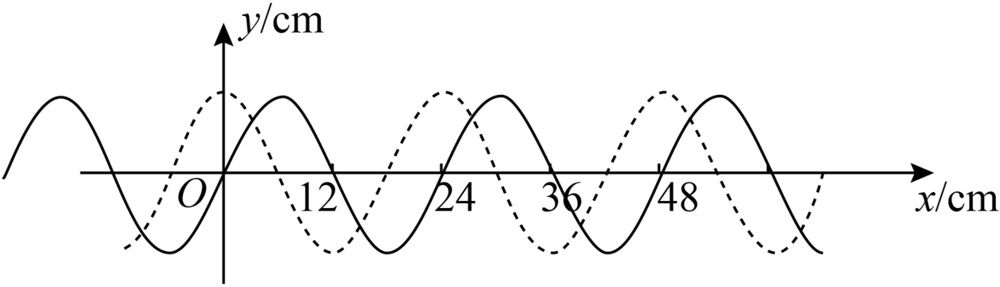

# Physics - 题目 1545

**ID**: dbd350e2b5b14071b1fa9dea7899fafc
**年级**: Grade 12
**难度**: Medium-Hard
**题型**: Calculation

## 题目
图中的实线是一列正弦波在某一时刻的波形曲线。​​​​​​​‌经过0.5s后，其波形如图中虚线所示。（1）波的波长是多少？（2）如果波是沿x轴正方向传播的，波的周期是多大？（3）如果波是沿x轴负方向传播的，波的速度是多大？

## 解答

1. （1）由波形图可知波的波长是λ=24cm；
2. （2）如果波是沿x轴正方向传播的，则：
3. $nT+\frac {3}{4}T=0.5{\rm{s}}$
4. 则
5. $T=\frac {2}{4n+3}{\rm{s}}$  （n=0，1，2，3……）
6. （3）如果波是沿x轴负方向传播的，则
7. $nT+\frac {T}{4}=0.5{\rm{s}}$
8. 则
9. $T=\frac {2}{4n+1}{\rm{s}}$
10. 波的速度
11. $v=\frac {λ}{T}=(0.48n+0.12){\rm{m}}{\rm{/}}{\rm{s}}$  （n=0，1，2，3……）

## 知识点

**中文**:
  - 波的多解问题

**English**:
  - Multi-solution Problems in Waves

---
