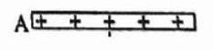
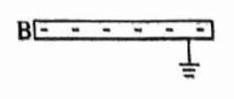

# Physics - 题目 1928

**ID**: dbf1496f3b8b47d9a1ebc472a3a80e5d
**年级**: Grade 12
**难度**: Medium-Hard
**题型**: Calculation

## 题目
如1图所示，平行板电容器的两个极板极板接地。​​​​​​​‌两板间为 $5{\rm{c}}{\rm{m}}$ ，一带电量为q=1×10^{﹣}^{9}C的点电荷沿电场线从 $C$ 点运动到 $D$ 点，电场力做功为间距离为3×10^{﹣}^{9}J间距离为 ${\rm{c}}{\rm{m}}$ ，不计重力。求：（1） $CD$ 两点间电势差 $U{{}_{CD}}$ ;（2）A板电势 $φ{{}_{1}}$ ;（3）仅将A板移动到 $C$ 处后，A板的电势 $φ{{}_{2}}$ 。

## 解答

1. （1）由电场力做功与电势差的关系 $W{{}_{CD}}=qU{{}_{CD}}$
2. 得， $CD$ 两点间电势差为 $U{{}_{CD}}=\frac {W{{}_{CD}}}{q}=\frac {3\times 10{^{-9}}}{1\times 10{^{-9}}}{\rm{V}}=3{\rm{V}}$
3. （2）由场强公式 $E=\frac {U}{d}$
4. 得，两极板间的场强大小为 $E=\frac {U{{}_{CD}}}{d{{}_{CD}}}=\frac {3}{0.03}{\rm{V}}/{\rm{m}}=100{\rm{V}}/{\rm{m}}$
5. 所以， $AB$ 两极板间的电势差为 $U{{}_{{\rm{A}}{\rm{B}}}}=Ed{{}_{{\rm{A}}{\rm{B}}}}=100\times 0.05{\rm{V}}=5{\rm{V}}$
6. 因为 $U{{}_{{\rm{A}}{\rm{B}}}}=φ{{}_{1}}-φ{{}_{B}}$
7. 其中， $B$ 板的电势为 $φ{{}_{B}}=0$
8. 所以， $A$ 板电势为 $φ{{}_{1}}=5V$
9. （3）仅将 $A$ 板移动到 $C$ 处后，两极板间距离 $d$ 减小，由电容的决定式 $C=\frac {εS}{4πkd}.$
10. 可得，电容 $C$ 变大，由因为两板电荷量 $Q$ 保持不变，由电容的定义式 $C=\frac {Q}{U}$
11. 可得，两极板间的电势差 $U$ 变小，由公式 $E=\frac {4πkQ}{εs}$
12. 可得，两极板间的场强 $E$ 不变，所以仅将 ${\mathbf{A}}$ 板移动到 $C$ 处后， $A$ 板的电萝 $φ{{}_{2}}=φ{{}_{2}}-φ{{}_{B}}=Ed{{}_{AB}^{\prime }}=100\times 0.04V=4V$

## 知识点

**中文**:
  - 电势差与电场强度的关系

**English**:
  - Relationship between Potential Difference and Field Strength

---
