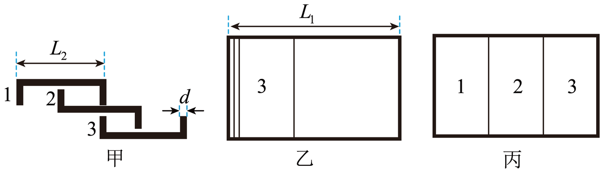

# Physics - 题目 1334

**ID**: dd0484320ed7468bb9c103b3be79cb2d
**年级**: Grade 12
**难度**: Medium-Hard
**题型**: Calculation

## 题目
有一款三轨推拉门，门框内部宽为 $L{{}_{1}}=2.75{\rm{m}}$ 。​​​​​​​‌三扇门板俯视图如图甲所示，宽均为 $L{{}_{2}}=1{\rm{m}}$ ，质量均为 $m{{}_{0}}=18{\rm{k}}{\rm{g}}$ ，与轨道的摩擦系数均为 $μ=0.01$ 。每扇门板边缘凸起部位厚度均为 $d=0.05{\rm{m}}$ 。门板凸起部位间的碰撞均为完全非弹性碰撞（不黏连），门板和门框的碰撞为弹性碰撞。刚开始，三扇门板静止在各自能到达的最左侧（如图乙），用恒力F水平向右拉3号门板，经过位移为 $s=0.45{\rm{m}}$ 后撤去F，一段时间后3号门板左侧凸起部位与2号门板右侧凸起部位发生碰撞，碰撞后3号门板向右运动恰好到达门框最右侧（如图丙）。重力加速度取 $g=10{\rm{m}}{\rm{/}}{\rm{s}}{^{2}}$ 。求：（1）3号门板与2号门板碰撞后瞬间的速度大小；（2）恒力F的大小；（3）若力F大小可调，但每次作用过程中F保持恒定且F作用的位移均为s，要保证2号门板不与1号门板发生碰撞，请写出3号门板经过的路程x与F之间的关系式。

## 解答

1. （1）3号门板与2号门板碰撞后相对静止一起向右做匀减速直线运动，
2. 位移为 $s{{}_{1}}=\left ({L{{}_{1}}-L{{}_{2}}}\right )-\left ({L{{}_{2}}-d}\right )$ ，
3. 解得 $s{{}_{1}}=0.8{\rm{m}}$ ，
4. 根据功能关系可得 $μ\cdot 2m{{}_{0}}gs{{}_{1}}=\frac {1}{2}\cdot 2m{{}_{0}}v{{}_{1}^{2}}$ ，
5. 解得 $v{{}_{1}}=0.4{\rm{m}}{\rm{/}}{\rm{s}}$ 。
6. （2）3号门板与2号门板碰撞，根据动量守恒定律可得 $m{{}_{0}}v{{}_{0}}=2m{{}_{0}}v{{}_{1}}$ ，
7. 解得 $v{{}_{0}}=0.8{\rm{m}}{\rm{/}}{\rm{s}}$ ，
8. 3号门板从开始运动到与2号门板碰撞，位移为 $s{{}_{0}}=L{{}_{2}}-3d$ ，
9. 解得 $s{{}_{0}}=0.85{\rm{m}}$ ，
10. 根据动能定理可得 $Fs-{\rm μm}{{}_{0}}gs{{}_{0}}=\frac {1}{2}m{{}_{0}}v{{}_{0}^{2}}$ ，
11. 解得 $F=16.2{\rm{N}}$ 。
12. （3）①若 $F⩽{\rm μm}{{}_{0}}g=1.8{\rm{N}}{\rm ，3}$ 号门保持静止，
13. ②若3号门板还未与2号门板碰撞，即 $x<L{{}_{2}}-3d=0.85{\rm{m}}$ ，
14. 由 $Fs-{\rm μm}{{}_{0}}gx=0$ ，
15. 解得 $x=0.25F({\rm{m}})$ ，
16. 此时 $0.45{\rm{m}}<x<0.85{\rm{m}}$ ， $1.8{\rm{N}}<F⩽3.4{\rm{N}}$ ；
17. ③若3号门板与2号门板碰撞，但2号门板还未与1号门板碰撞，
18. 则有 $L{{}_{2}}-3d<x<L{{}_{1}}-L{{}_{2}}-d$ ，
19. 即 $0.85{\rm{m}}<x<1.7{\rm{m}}$ ，
20. 3号门板与2号门板碰撞前有 $Fs-{\rm μm}{{}_{0}}g\left ({L{{}_{2}}-3d}\right )=\frac {1}{2}m{{}_{0}}v{{}_{2}^{2}}$ ，
21. 3号门板与2号门板发生完全非弹性碰撞，由动量守恒定律得 $m{{}_{0}}v{{}_{2}}=2m{{}_{0}}v{{}_{3}}$ ，
22. 3号门板与门框发生弹性碰撞，机械能不损失，因此碰撞后2、3号门板机械能全部转化为摩擦产热，则有 $\frac {1}{2}\times 2m{{}_{0}}v{{}_{3}^{2}}=μ\cdot 2m{{}_{0}}g\left [x-\left ({L{{}_{2}}-3d}\right )\right ]$ ，
23. 解得 $x=\frac {5F+51}{80}({\rm{m}})$ ，
24. 由 $0.85{\rm{m}}<x<1.7{\rm{m}}$ ，可得此时恒力的取值范围为 $ 3.4{\rm{N}}<F<17{\rm{N}}$ ，
25. 由几何关系可知，3号门板反弹后不会再次与2号门板碰撞。

## 知识点

**中文**:
  - 求解非弹性碰撞问题

**English**:
  - Solving Inelastic Collision Problems

---
