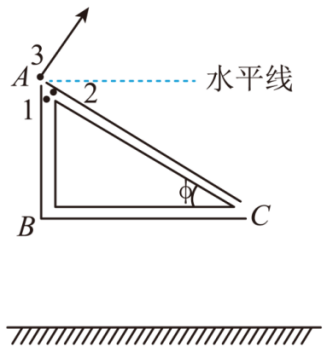

# Physics - 题目 1211

**ID**: df6ea59aa5bd486392eaf604901d17e1
**年级**: Grade 12
**难度**: Medium-Hard
**题型**: Calculation

## 题目
如图所示，水平地面上某竖直平面内有一固定的内壁光滑的直角三角形管道ABC，直角边AB竖直向下，直角边BC水平朝右，C端开口，取3个小球，t=0时刻三个球1，2静止释放，3斜向抛出，1号球在拐角处可使速度大小不变方向变为向右，三者在C端相遇但不碰撞，继续运动到达地面。​​​​​​​‌三个小球从释放到落到地面所经历的时间分别为T_{1}，T_{2}，T_{3}。已知直角边BC距地面的高度和AB边长相同。求：（1）三角形C处的角度 $φ$ 为多少；（2）T_{1}∶T_{2}∶T_{3}。

## 解答

1. （1）由题意，设AB的长度和直角边BC距地面的高度为H，对1号球，在AB段做自由落体运动，有 $H=\frac {1}{2}gt{{}_{1}^{2}}$ ，在BC段做匀速运动，有 $\frac {H{\cos}φ}{\sin φ}{\rm{=}}\left ({gt{{}_{1}}}\right )t{{}_{2}}$ ，可得 $2H+H\frac {{\cos}φ}{\sin φ}=gt{{}_{1}}\left ({t{{}_{1}}+t{{}_{2}}}\right )$ ，根据机械能守恒定律，可知1号球和2号球到达C点速度大小一样，所以对2号球有 ${\rm \mathit{gt}_{1}=\mathit{g}sin}φ{\rm （\mathit{t}\mathit{_{1}}+\mathit{t}\mathit{_{2}}）}$ ，所以 $t{{}_{1}}+t{{}_{2}}=\frac {t{{}_{1}}}{\sin φ}$ ，可得 $2H+H\frac {{\cos}φ}{\sin φ}=\frac {gt{{}_{1}^{2}}}{\sin φ}$ ，其中 $gt{{}_{1}^{2}}=2H$ ， $2\sin φ+{\cos}φ=2$ ，解得 $\sin φ=\frac {3}{5}$ ， ${\cos}φ=\frac {4}{5}$ ，即 $φ=37{^{\circ }}$ 。
2. （2）因为1、2、3号球到达C端时间相同，对2号球分析有 $\frac {H}{\sin φ}=\frac {1}{2}g\sin φ{\left({Δt{{}_{2}}}\right)^{2}}$ ，结合（1）的结果可得 $Δt{{}_{1}}=Δt{{}_{2}}=Δt{{}_{3}}=\frac {5}{3}\sqrt {\frac {2H}{g}}$ ，到达C端后的运动，对1号球 $H=\frac {1}{2}g{\left({Δt^{′}{{{}_{1}}}}\right)^{2}}$ ，解得 $Δt^{′}{{{}_{1}}}=\sqrt {\frac {2H}{g}}$ ，对2号球 $H{\rm{=}}v{{}_{2y}}Δt^{′}{{{}_{2}}}+\frac {1}{2}g{\left({Δt^{′}{{{}_{2}}}}\right)^{2}}$ ， $v{{}_{2y}}{~}=v{{}_{2}}\sin φ=\frac {3}{5}\sqrt {2gH}$ ，解得 $Δt^{′}{{{}_{2}}}=\frac {1}{5}\left ({\sqrt {34}-3}\right )\sqrt {\frac {2H}{g}}$ ，对3号球 $v{{}_{3y}}=-\left ({v{{}_{0y}}-{\rm g}Δt{{}_{3}}}\right )$ ， $-H=v{{}_{0y}}Δt{{}_{3}}-\frac {1}{2}gΔt{{}_{3}^{2}}$ ，解得 $v{{}_{3y}}=\frac {17}{15}\sqrt {2gH}$ ，又因为 $H{\rm{=}}v{{}_{3y}}Δt^{′}{{{}_{3}}}+\frac {1}{2}g{\left({Δt^{′}{{{}_{3}}}}\right)^{2}}$ ，解得 $Δt^{′}{{{}_{3}}}=\frac {1}{15}\left ({\sqrt {514}-17}\right )\sqrt {\frac {2H}{g}}$ ，所以有， $T{{}_{1}}=Δt{{}_{1}}+Δt^{′}{{{}_{1}}}=\frac {8}{3}\sqrt {\frac {2H}{g}}$ ， $T{{}_{2}}=Δt{{}_{2}}+Δt^{′}{{{}_{2}}}=\frac {1}{15}\left ({8+\sqrt {514}}\right )\sqrt {\frac {2H}{g}}$ ， $T{{}_{3}}=Δt{{}_{3}}+Δt^{′}{{{}_{3}}}=\frac {1}{15}\left ({8+\sqrt {514}}\right )\sqrt {\frac {2H}{g}}$ ，所以联立可得T_{1}∶T_{2}∶T_{3}=1∶0.837∶0.767。

## 知识点

**中文**:
  - 自由落体运动和竖直上抛运动的相遇问题

**English**:
  - Encounter Problems: Free Fall and Vertical Throw

---
