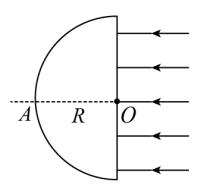

# Physics - 题目 2003

**ID**: df8bdd084b4148f88d4f1c55c511597f
**年级**: Grade 12
**难度**: Medium-Hard
**题型**: Calculation

## 题目
如图所示是一个半径为R的半球形透明物体的侧视图，该物体的折射率为 $n=\sqrt {3}$ ，现在有一束截面为圆形的光柱垂直照射到半球体的底面上，光柱中心线与OA重合，光柱的截面半径大小可调，不考忠光线在透明物体内部的反射。​​​​​​​‌（1）光柱的半径由极小逐渐调大过程中发现当半径超过一定值时，透明体左侧透光面积将不再变化，求此时光柱的半径；（2）将光柱半径调为极小且平移到距O点 $\frac {R}{2}$ 处入射，求出射光线与OA轴线的交点到O点的距离。

## 解答

1. (1)如图甲所示
2. 
3. 设光柱的边界光束由C处水平射入，在B处发生全反射， $\angle OBC$ 为临界角，由
4. ${\sin}\angle OBC=\frac {1}{n}$
5. 由几何关系得
6. $OC=R{\sin}\angle OBC$
7. 解得光柱的半径
8. $r=OC=\frac {\sqrt {3}}{3}R$
9. ②如图乙所示，
10. 
11. 光束由D点水平射入，在E点发生折射，入射角为 $∠OED=α$ ，折射角为 $\angle NEF=β$ ，折射率
12. $n=\frac {{\sin}β}{{\sin}α}=\sqrt {3}$
13. 根据几何关系
14. ${\sin}α=\frac {\frac {1}{2}R}{R}=\frac {1}{2}$
15. 解得
16. ${\sin}β=\frac {\sqrt {3}}{2}$
17. 即
18. $β=60{}^\circ $
19. $α=30{}^\circ $
20. 由几何关系可知
21. $\angle FOE=α=30{}^\circ $
22. $\angle OFE=β-α=30{}^\circ $
23. 则出射光线与OA轴线的交点F与O点的距离为
24. $OF=2R{\cos}30{}^\circ $
25. 联立解得
26. $OF=\sqrt {3}R$

## 知识点

**中文**:
  - 光的折射定律及其应用
  - 全反射与折射的综合应用

**English**:
  - Law of Refraction and Applications
  - Comprehensive Application of Total Reflection and Refraction

---
