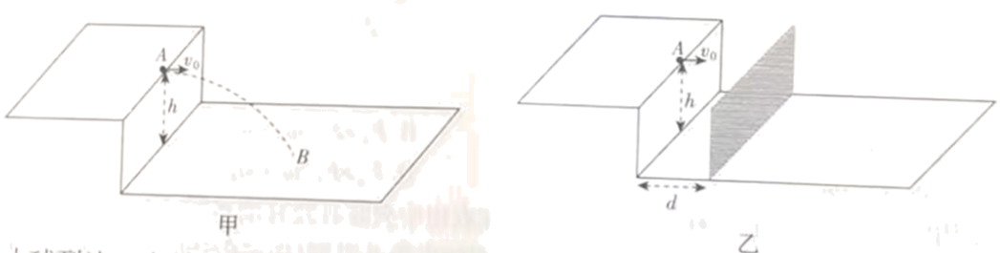

# Physics - 题目 1140

**ID**: dfa438239e22439ba50aec05a7a0a8b8
**年级**: Grade 12
**难度**: Medium-Hard
**题型**: Calculation

## 题目
如图甲，一质量为m的小球（视为质点）从高度为h的水平平台的边缘A点以初速度 $v{{}_{0}}$ 垂直平台侧面水平飞出，最终落在地面上B点。​​​​​​​‌重力加速度大小为g，不计一切摩擦和空气阻力，求：（1）小球到达B点时的速度 $v{{}_{B}}$ 的大小及A、B两点间的水平距离 $x{{}_{AB}}$ ；（2）如图乙，若将一足够高的竖直挡板平行于平台侧面放置，与平台侧面的水平距离为d。小球从平台水平飞出后，与竖直挡板或平台侧面碰撞前后水平方向速度大小不变、方向反向，竖直方向速度不变，要使小球和竖直挡板只发生1次碰撞后落在平台侧面与竖直挡板的正中间，则d的可能值为多少？

## 解答

1. （1）小球从高度为h的水平平台的边缘A点飞出后，做平抛运动，竖直方向有 $h=\frac {1}{2}gt{^{2}}$
2. 小球到达B点时的竖直速度为 $v{{}_{B}}{{}_{y}}=gt$
3. 小球到达B点时的速度 $v{{}_{B}}=\sqrt {v{{}_{0}}{^{2}}+v{{}_{By}}{^{2}}}$
4. 水平方向有 $x{{}_{AB}}=v{{}_{0}}t$
5. 解得A、B两点间的水平距离 $x{{}_{AB}}=v{{}_{0}}\sqrt {\frac {2h}{g}}$
6. （2）小球和竖直挡板只发生1次碰撞后落在平台侧面与竖直挡板的正中间，当小球与平台侧面没有碰撞时，如图所示
7. 
8. 小球竖直方向做自由落体运动，有 $h=\frac {1}{2}gt{^{2}}$
9. 水平方向有 $d+\frac {d}{2}=v{{}_{0}}t$
10. 解得 $d=v{{}_{0}}\sqrt {\frac {8h}{9g}}=\frac {2v{{}_{0}}}{3}\sqrt {\frac {2h}{g}}$
11. 当小球与平台侧面碰撞一次时，如图所示
12. 
13. 水平方向有 $2d+\frac {d}{2}=v{{}_{0}}t$
14. 解得 $d=v{{}_{0}}\sqrt {\frac {8h}{25g}}=\frac {2v{{}_{0}}}{5}\sqrt {\frac {2h}{g}}$
15. 综上d的可能值为 $\frac {2v{{}_{0}}}{3}\sqrt {\frac {2h}{g}}$ 或 $\frac {2v{{}_{0}}}{5}\sqrt {\frac {2h}{g}}$

## 知识点

**中文**:
  - 求解平抛运动、类平抛运动问题

**English**:
  - Solving Horizontal and Quasi-Horizontal Projectile Problems

---
