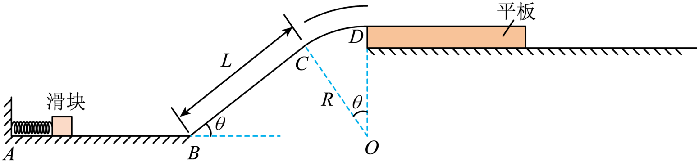

# Physics - 题目 211

**ID**: e036bd9dfbe944d497261d80ca078d7e
**年级**: Grade 12
**难度**: Medium-Hard
**题型**: Calculation

## 题目
一固定装置由表面均光滑的水平直轨道AB、倾角为 $θ$ 的直轨道BC、圆弧管道（圆心角为 $θ$ ）CD组成，轨道间平滑连接，其竖直截面如图所示（未按比例作图）。​​​​​​​‌BC的长度L=2.0m，圆弧管道半径R=1.0m（忽略管道内径大小），D和圆心O在同一竖直线上。轨道ABCD末端D的右侧紧靠着水平面上质量 $m{{}_{1}}{\rm =0.1kg}$ 的平板，其上表面与轨道末端D所在的水平面齐平。质量 $m{{}_{2}}{\rm =0.1kg}$ 、可视为质点的滑块从A端弹射获得 $E{{}_{{\rm{k}}}}{\rm =3.2J}$ 的动能后，经轨道ABCD水平滑上平板，并带动平板一起运动。平板上表面与滑块间的动摩擦因数 $μ{{}_{1}}{\rm =0.6}$ 、下表面与水平面间的动摩擦因数为 $μ{{}_{2}}$ 。不计空气阻力，最大静摩擦力等于滑动摩擦力，重力加速度g取10m/ ${\rm s^{2}，}\sin θ=0.6$ ， ${\cos}θ=0.8$ 。(1)求滑块到达轨道ABCD末端D时的速度大小；(2)若 $μ{{}_{2}}=0$ ，滑块未脱离平板，求平板加速至与滑块共速过程系统损失的机械能；(3)若 $μ{{}_{2}}=0.1$ ，平板至少多长才能使滑块不脱离平板。

## 解答

1. （1）根据动能定理有
2. $-m{{}_{2}}g\left ({L\sin θ+R-R{\cos}θ}\right )=\frac {1}{2}m{{}_{2}}v{{}_{D}^{2}}-E{{}_{{\rm{k}}}}$
3. 解得
4. $v{{}_{D}}=6{\rm{m}}{\rm{/}}{\rm{s}}$
5. （2）若 $μ{{}_{2}}=0$ ，滑块未脱离平板，根据动量守恒定律有
6. $m{{}_{2}}v{{}_{D}}=\left ({m{{}_{1}}+m{{}_{2}}}\right )v{{}_{1}}$
7. 根据能量守恒定律有
8. $E{{}_{损}}=\frac {1}{2}m{{}_{2}}v{{}_{D}^{2}}-\frac {1}{2}\left ({m{{}_{1}}+m{{}_{2}}}\right )v{{}_{1}^{2}}$
9. 解得
10. $E{{}_{损}}=0.9{\rm{J}}$
11. （3）若 $μ{{}_{2}}=0.1$ ，对滑块进行分析，根据牛顿第二定律有
12. $μ{{}_{1}}m{{}_{2}}g=m{{}_{2}}a{{}_{1}}$
13. 解得
14. $a{{}_{1}}=6{\rm{m}}{\rm{/}}{\rm{s}}{^{2}}$
15. 滑块向右做匀减速直线运动，对木板进行分析，根据牛顿第二定律有
16. $μ{{}_{1}}m{{}_{2}}g-μ{{}_{2}}\left ({m{{}_{1}}+m{{}_{2}}}\right )g=m{{}_{1}}a{{}_{2}}$
17. 解得
18. $a{{}_{2}}=4{\rm{m}}{\rm{/}}{\rm{s}}{^{2}}$
19. 木板向右做匀加速直线运动，当两者达到相等速度后保持相对静止向右做匀减速直线运动，则有
20. $v{{}_{2}}=v{{}_{D}}-a{{}_{1}}t=a{{}_{2}}t$
21. 两者的相对位移大小等于木板长度的最小值，则有
22. $L{{}_{{\rm \min }}}=\frac {v{{}_{D}}+v{{}_{2}}}{2}t-\frac {v{{}_{2}}}{2}t$
23. 解得
24. $L{{}_{{\rm \min }}}=1.8{\rm{m}}$

## 知识点

**中文**:
  - 动量守恒与板块模型相结合

**English**:
  - Momentum Conservation with Plate Models

---
