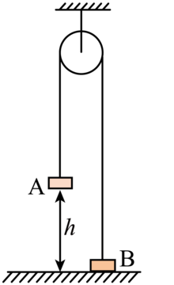

# Physics - 题目 1185

**ID**: e0b80bc1fd79458184650cde68aa0b1f
**年级**: Grade 12
**难度**: Medium-Hard
**题型**: Calculation

## 题目
如图所示，质量分别为2m和m的两个物体A、B通过跨在光滑定滑轮上的轻质刚性细线连接，初始时刻，A在距地面h高处，B静置于水平地面上，细线恰好伸直。​​​​​​​‌现将A由静止释放，此后A、B与地面碰撞后速度立即变为零；细线再次绷紧后A、B速度大小瞬间相同、整个运动过程中A、B不会与滑轮相碰。重力加速度为g，求：（1）B运动中能够达到的最大高度 $H{{}_{{\rm{m}}}}$ ；（2）A与地面发生第一次碰撞后到再次到达最高点的过程中，细线对A的冲量；（3）整个过程中A运动的总路程。

## 解答

1. （1）对A、B系统，从释放到第一次A落地前瞬间，由机械能守恒定律，则有 $2mgh=\frac {1}{2}2mv{{}_{1}^{2}}+\frac {1}{2}mv{{}_{1}^{2}}+mgh$
2. 解得 $v{{}_{1}}=\sqrt {\frac {2}{3}gh}$
3. 当A与地面碰撞后立即静止，B将继续向上运动，细线松弛，B做竖直上抛运动，由运动学公式有 $v{{}_{1}^{2}}=2gh^{′}$
4. B运动中能够达到的最大高度 $H{{}_{{\rm{m}}}}=h+h^{′}=\frac {4}{3}h$
5. （2）B竖直上抛返回至细线再次绷紧，细线绷紧瞬间，线中的张力远大于重力，故重力的冲量可忽略不计，此过程等效为系统动量守恒，则有 $mv{{}_{1}}=(m+2m)v{{}_{2}}$
6. 对AB，由牛顿第二定律有 $2mg-mg=3ma$
7. 从细线绷紧到A上升至最高点所用时间为t，则有 $v{{}_{2}}=at$
8. 对A，从细线绷紧到再次到达最高点的过程中，由动量定理有 $I-2mgt=0-0$
9. 联立以上各式，解得 $I=\frac {2}{3}m\sqrt {6gh}$ ，方向竖直向上。
10. （3）对A，再次上升至最高点时，距地面的高度为 $h{{}_{2}}=\frac {v{{}_{2}^{2}}}{2a}=\frac {h}{9}$
11. 之后AB重复之前的运动，下一次上升至最高点时，距地面的高度为 $h{{}_{3}}=\frac {1}{9}h{{}_{2}}={\left({\frac {1}{9}}\right)^{2}}h$
12. 故A运动的总路程为 $x=h+2h{{}_{2}}+2h{{}_{3}}+\cdots =\frac {5}{4}h$

## 知识点

**中文**:
  - 其他连接体问题中机械能守恒定律的应用
  - 动量定理及其应用
  - 动量守恒的判定与应用

**English**:
  - Other Connected Body Problems
  - Applications of Impulse-Momentum Theorem
  - Judgment and Application of Momentum Conservation

---
