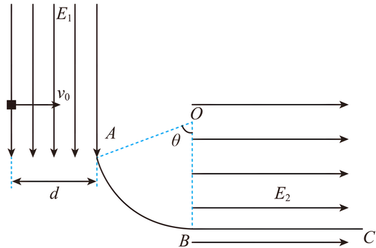

# Physics - 题目 1624

**ID**: e21ec0acaa0c43afbd22de9ce052a41c
**年级**: Grade 12
**难度**: Medium-Hard
**题型**: Calculation

## 题目
图所示，竖直平面内有一段绝缘的圆弧轨道AB和绝缘的水平轨道BC相切于B，其中AB圆弧轨道的圆心为 ${\rm \mathit{O}，}R=\frac {5}{8}{\rm{m}}$ ，圆心角 $θ=53{}\degree $ ，圆弧轨道光滑，BC轨道粗糙且足够长，滑块与轨道间的动摩擦因数 $μ=0.5$ ，轨道AB左侧 $d=0.{{6}}{\rm{m}}$ 的区域存在一竖直向下匀强电场 $E{{}_{1}}{\rm ，\mathit{BC}}$ 轨道区域存在水平向右的匀强电场 $E{{}_{2}}$ ，一质量为 $m=0.{{2}}{\rm{k}}{\rm{g}}$ ，电量 $\left |{q}\right |=1.0\times 10{^{-4}}{\rm{C}}$ 的滑块以一定的初速度从电场 $E{{}_{1}}$ 的左边界水平射入，滑块恰好能做直线运动，假定最大静摩擦力等于滑动摩擦力， $g=10{\rm{m}}/{\rm{s}}{^{{{2}}}}$ ， $\sin 53{}\degree =0.8$ ， ${\cos}53{}\degree =0.6$ 。​​​​​​​‌求：（1）滑块的电性和 $E{{}_{1}}$ 的大小；（2）若电场 $E{{}_{1}}$ 大小不变，方向反向，要使滑块恰好能从A点沿切线滑入轨道，求滑块水平射入电场 $E{{}_{1}}$ 时的初速度，以及进入A点时的速度；（3）在第（2）问的条件下，若电场 $E{{}_{2}}$ 的大小可在一定范围内调节，保证滑块始终未脱离轨道ABC，当 $E{{}_{2}}$ 取不同值时，求滑块最终因摩擦而产生的热量。（Q可用 $E{{}_{2}}$ 表示）

## 解答

1. （1）滑块在电场 $E{{}_{1}}$ 中恰能做直线运动，根据受力平衡可知，电场力竖直向上，与场强方向相反，则滑块带负电；根据平衡条件可得 $mg=\left |{q}\right |E{{}_{1}}$
2. 解得 $E{{}_{1}}=2.0\times 10{^{4}}{\rm{N}}{\rm{/}}{\rm{C}}$
3. （2）若电场 $E{{}_{1}}$ 大小不变，方向反向，由牛顿第二定律可得 $mg+\left |{q}\right |E{{}_{1}}=ma$
4. 解得 $a=20{\rm{m}}{\rm{/}}{\rm{s}}{^{2}}$
5. 滑块做类平抛运动，则有 $d=v{{}_{0}}t$ ， $v{{}_{y}}=at$
6. 使滑块恰好能从A点沿切线滑入轨道，则有 ${\tan}θ=\frac {v{{}_{y}}}{v{{}_{0}}}$
7. 联立解得滑块水平射入电场 $E{{}_{1}}$ 时的初速度为 $v{{}_{0}}=3{\rm{m}}{\rm{/}}{\rm{s}}$
8. 进入A点时的速度为 $v{{}_{A}}=\frac {v{{}_{0}}}{{\cos}θ}=5{\rm{m}}{\rm{/}}{\rm{s}}$
9. （3）若滑块始终未脱离轨道，滑块滑到B点时，有 $mgR(1-{\cos}θ)=\frac {1}{2}mv{{}_{B}^{2}}-\frac {1}{2}mv{{}_{A}^{2}}$
10. 解得 $v{{}_{B}}=\sqrt {30}{\rm{m}}{\rm{/}}{\rm{s}}$
11. 滑块向右运动到速度为0时，由动能定理得 $-(\left |{q}\right |E{{}_{2}}+{\rm μm}g)x=0+\frac {1}{2}mv{{}_{B}^{2}}$
12. 解得 $x=\frac {3}{1\times 10{^{-4}}E{{}_{2}}+1}{\rm{m}}$
13. 第一个临界值，当满足 $\left |{q}\right |E{{}_{2}}={\rm μm}g$
14. 可得 $E{{}_{2}}=1.0\times 10{^{4}}{\rm{N}}{\rm{/}}{\rm{C}}$
15. 第二个临界值，当滑块回到A点时，速度刚好减为0，有 $\frac {1}{2}mv{{}_{A}^{2}}=2{\rm μm}gx$ ， $\frac {1}{2}mv{{}_{A}^{2}}+mgR(1-{\cos}θ)=\left |{q}\right |E{{}_{2}}x+{\rm μm}gx$
16. 解得 $E{{}_{2}}=1.4\times 10{^{4}}{\rm{N}}{\rm{/}}{\rm{C}}$
17. 综上分析可知，当 $E{{}_{2}}⩽1.0\times 10{^{4}}{\rm{N}}{\rm{/}}{\rm{C}}$ 时，滑块最终因摩擦而产生的热量为 $Q{{}_{1}}={\rm μm}gx=\frac {3}{1\times 10{^{-4}}E{{}_{2}}+1}{\rm{J}}$
18. 当 $1.0\times 10{^{4}}{\rm{N}}{\rm{/}}{\rm{C}}<E{{}_{2}}⩽1.4\times 10{^{4}}{\rm{N}}{\rm{/}}{\rm{C}}$ 时，滑块最终停在B点，根据能量守恒可得 $Q{{}_{2}}=\frac {1}{2}mv{{}_{B}^{2}}=3{\rm{J}}$
19. 当 $E{{}_{2}}>1.4\times 10{^{4}}{\rm{N}}{\rm{/}}{\rm{C}}$ 时，滑块将从A点飞离轨道，不符合题意。

## 知识点

**中文**:
  - 匀强电场
  - 应用动能定理求解多阶段、多过程问题

**English**:
  - Uniform Electric Field
  - Multi-stage/Multi-process Problems

---
