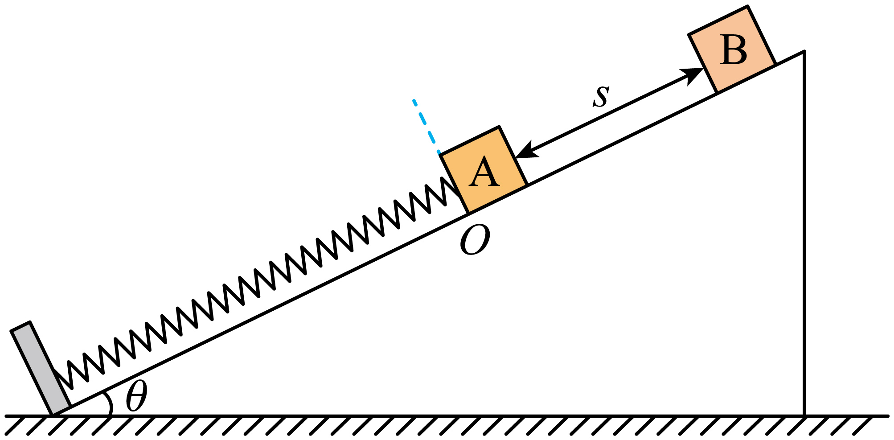

# Physics - 题目 426

**ID**: e280bc31d31c486ba4e5d0ea14b30aaf
**年级**: Grade 12
**难度**: Medium-Hard
**题型**: Calculation

## 题目
如图所示，在倾角 $θ=30{}\degree $ 的固定斜面上，足够长的轻质弹簧一端与物块A相连，另一端连接斜面底端处的挡板。​​​​​​​‌初始时刻物块A静止于弹簧原长O点处，底部光滑而侧面有粘性的物块B从距离O点s=3.6 m处静止释放，B与A发生完全非弹性碰撞并粘合成一个整体（碰后A和B与斜面依然保持良好接触）继续运动。已知A和B质量均为m=0.2 kg，弹簧劲度系数k=100 N/m且始终处在弹性限度内，弹性势能 $E{{}_{{\rm{p}}}}=\frac {1}{2}kx{^{2}}$ （x为弹簧形变量）。物块A与斜面O点上方区域的动摩擦因数为 $μ{{}_{1}}$ ，与斜面O点下方区域的动摩擦因数为 $μ{{}_{2}}$ ，最大静摩擦力等于滑动摩擦力，A和B均可视为质点，不计空气阻力，重力加速度大小为g=10 m/s^{2}。（1）求A和B碰撞过程中系统损失的机械能 $E{{}_{损}}$ ；（2）若 $μ{{}_{1}}=\frac {\sqrt {3}}{3}$ ， $μ{{}_{2}}=0$ ，求A和B碰撞后整体一起在O点上方区域运动的总路程 $s{{}_{0}}$ ；（3）若 $μ{{}_{1}}=μ{{}_{2}}=\frac {\sqrt {3}}{3}$ ，求A和B碰撞后到最终静止的过程，A与斜面摩擦产生的热量Q。

## 解答

1. （1）B下滑过程中，根据动能定理有 $mgs\sin θ=\frac {1}{2}mv{{}_{0}^{2}}$ ，
2. B和A碰撞过程，根据动量守恒定律有 $mv{{}_{0}}=2mv{{}_{1}}$ ，
3. 根据能量守恒定律有 $E{{}_{损}}=\frac {1}{2}mv{{}_{0}^{2}}-\frac {1}{2}\cdot 2mv{{}_{1}^{2}}$ ，
4. 解得 $E{{}_{损}}=1.8{\rm{\;}}{\rm{J}}$ 。
5. （2）A和B组成的整体质量为2m，其将在斜面上做往复运动直至到达O点时速度为零，之后将在O点下方区域做简谐振动。系统减少的动能转化为在O点上方区域摩擦产生的热量，根据能量守恒定律有 $\frac {1}{2}\times 2mv{{}_{1}^{2}}=Q$ ， $Q=μ{{}_{1}}mg{\cos}θs{{}_{0}}$ ，
6. 解得 $s{{}_{0}}=1.8{\rm{\;}}{\rm{m}}$ 。
7. （3）由分析可知整体第一次向下运动的最大位移等于弹簧的最大形变量，A和B从碰后到第一次运动至最低点的过程，根据能量守恒定律有 $2mg\sin θx{{}_{{\rm \max }}}+\frac {1}{2}\cdot 2mv{{}_{1}^{2}}=μ{{}_{2}}mg{\cos}θx{{}_{{\rm \max }}}+\frac {1}{2}kx{{}_{{\rm \max }}}{^{2}}$ ，
8. 解得 $x{{}_{{\rm \max }}}=0.2{\rm{\;}}{\rm{m}}$ ，
9. A和B整体向下运动至平衡位置 $O{{}_{1}}$ 点时，回复力为零，此时弹簧形变量为 $x{{}_{1}}$ ，则有 $kx{{}_{1}}+μ{{}_{2}}mg{\cos}θ=2mg\sin θ$ ，
10. 解得 $x{{}_{1}}=0.01{\rm{\;}}{\rm{m}}$ ，
11. 设A和B整体经平衡位置 $O{{}_{1}}$ 点向下运动一小段距离后，偏离平衡位置的位移为 $Δx$ ，弹簧形变量为x，则有 $x=x{{}_{1}}+\Delta x$ ，
12. 当形变量为x时，回复力的大小为 $F{{}_{回}}=kx+μ{{}_{2}}mg{\cos}θ-2mg\sin θ=k\Delta x$ ，
13. 又因为回复力方向和位移 $Δx$ 的方向相反，证得A和B整体向下的运动为单方向简谐运动。则A和B整体向下运动的振幅为 $A{{}_{0}}=x{{}_{{\rm \max }}}-x{{}_{1}}=0.19{\rm{\;}}{\rm{m}}$ ，
14. 在最低点时，整体所受弹簧弹力为 $kx{{}_{{\rm \max }}}=20{\rm{\;}}{\rm{N}}>2mg\sin θ+μ{{}_{2}}mg{\cos}θ=3{\rm{\;}}{\rm{N}}$ ，
15. 此后将向上运动，同理可证整体向上的运动也是单方向简谐振动，平衡位置为 $O{{}_{2}}$ 点，此时弹簧形变量设为 $x{{}_{2}}$ ，平衡位置回复力为零，则有 $kx{{}_{2}}-μ{{}_{2}}mg{\cos}θ=2mg\sin θ$ ，
16. 解得 $x{{}_{2}}=0.03{\rm{\;}}{\rm{m}}$ ，
17. 若记本次为第1次单方向简谐振动，运动的振幅为 $A{{}_{1}}=x{{}_{{\rm \max }}}-x{{}_{2}}=A{{}_{0}}-0.02{\rm{\;}}{\rm{m}}=0.17{\rm{\;}}{\rm{m}}$ ，
18. 向上运动到达最高点之后整体将向下做第2次单方向简谐振动，平衡位置又变成 $O{{}_{1}}$ 点，振幅为 $A{{}_{2}}=A{{}_{1}}-0.02{\rm{\;}}{\rm{m}}=0.15{\rm{\;}}{\rm{m}}$ ，
19. 向下运动到达最低点之后整体将向上做第3次单方向简谐振动，平衡位置又变成 $O{{}_{2}}$ 点，振幅为 $A{{}_{3}}=A{{}_{2}}-0.02{\rm{\;}}{\rm{m}}=0.13{\rm{\;}}{\rm{m}}$ ，
20. 由上述分析发现整体振幅的变化将依次递减0.02 m，则第n次振动的振幅为 $A{{}_{n}}=A{{}_{0}}-0.02n({\rm{m}})$ ，
21. 考虑整体最后停止的位置一定位于弹簧压缩状态，设停止时弹簧压缩量为 $x^{′}$ ，则由整体静止条件可得 $\left |{kx^{′}-2mg\sin θ}\right |⩽μ{{}_{2}}mg{\cos}θ$ ，
22. 解得 $0.01{\rm{\;}}{\rm{m}}⩽x^{′}{⩽}0.03{\rm{\;}}{\rm{m}}$ ，
23. 因为当整体向上运动以 $O{{}_{2}}$ 点为平衡位置做第9次单方向简谐振动的振幅 $A{{}_{9}}=0.01{\rm{\;}}{\rm{m}}$ ，
24. 可知，当整体从最低点往上运动 $2A{{}_{9}}$ ，之后速度会变为零，此时弹簧形变量为 $x^{′}=0.02{\rm{\;}}{\rm{m}}$ ，
25. 整体将停止运动。综合上述可知，A和B整体运动的总路程为 $s{{}_{1}}=x{{}_{1}}+A{{}_{0}}+2(A{{}_{1}}+A{{}_{2}}+\cdots \cdots +A{{}_{9}})=1.82{\rm{\;}}{\rm{m}}$ ，
26. 则A与斜面摩擦产生的热量为 $Q=μ{{}_{1}}mg{\cos}θs{{}_{1}}$ ，
27. 解得Q=1.82 J。
28. 第（3）问第二种解法：
29. 如上分析可知，最终A将静止于O点下方，离O点的距离为 $x^{′}=0.02{\rm{\;}}{\rm{m}}$ ，
30. A和B整体从碰后到第一次运动至最终静止过程中，由能量守恒定律可得 $\frac {1}{2}\times 2mv{{}_{1}^{2}}+2mgx^{′}{{\rm s}}{\rm in}θ=Q+\frac {1}{2}kx^{′}{{^{2}}}$ ，
31. 解得Q=1.82 J。

## 知识点

**中文**:
  - 动量守恒中的多次碰撞问题

**English**:
  - Multiple Collisions in Momentum Conservation

---
