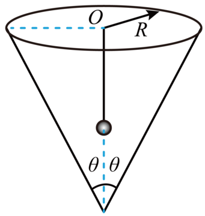

# Physics - 题目 1582

**ID**: e295d67df12b45748d18af3ad0ee7780
**年级**: Grade 12
**难度**: Medium-Hard
**题型**: Calculation

## 题目
如图所示，顶角为2θ=60°的圆锥筒，圆锥的轴线竖直，底面半径为R，在底面圆心O处，系一根轻质细线，长也为R，细线的另一端连一个小球，小球直径远小于R。​​​​​​​‌已知重力加速度为g，不计空气阻力，最终结果可保留π和根号。求：（1）将绳偏离竖直方向很小的角度静止释放，第一次运动到最低点需要的时间；（2）小球做圆周运动不碰到圆锥筒时，线速度的最大值；（3）某时刻小球在圆锥筒内做半径为 $\frac {2}{3}R$ 的圆周运动，由于圆锥筒内壁微弱的摩擦力作用，小球运动半径变化直至稳定，此过程中摩擦力做的功。

## 解答

1. （1）将绳偏离竖直方向很小的角度静止释放，可视为单摆运动，单摆周期公式得 $T=2π\sqrt {\frac {R}{g}}$
2. 时间为单摆周期的四分之一，即 $t=\frac {π}{2}\sqrt {\frac {R}{g}}$
3. （2）临界状态为小球恰好与筒壁接触，但与筒壁无作用力，由牛顿定律得 $T{{}_{1}}\sin θ=\frac {mv{^{2}}}{R\sin θ}$ ， $T{{}_{1}}{\cos}θ=mg$
4. 解得 $v=\sqrt {\frac {\sqrt {3}gR}{6}}$
5. 即小球速度 $v{{}_{1}}⩽\sqrt {\frac {\sqrt {3}gR}{6}}$ 时不会碰到筒壁。
6. （3）由牛顿第二定律得 $\frac {mg}{{\tan}θ}=\frac {mv{{}_{2}}{^{2}}}{\frac {2}{3}R}$
7. 末状态为刚好脱离圆锥面，之后没有摩擦力，不再有能量损失，根据几何关系，小球下降的高度为 $\frac {\sqrt {3}}{6}R$ ，根据动能定理有 $mg\frac {\sqrt {3}}{6}R+W{{}_{{\rm{f}}}}=\frac {1}{2}mv{^{2}}-\frac {1}{2}mv{{}_{2}^{2}}$
8. 解得 $W{{}_{{\rm{f}}}}=-\frac {5\sqrt {3}mgR}{12}$

## 知识点

**中文**:
  - 单摆周期公式及其应用
  - 应用动能定理求解变力做功问题

**English**:
  - Pendulum Period Formula and Applications
  - Solving Work Done by Variable Force

---
