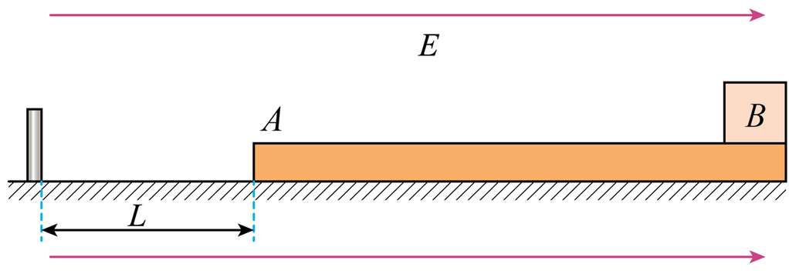

# Physics - 题目 1842

**ID**: e32897105ad740939ae8b5fccbe860ed
**年级**: Grade 12
**难度**: Medium-Hard
**题型**: Calculation

## 题目
如图所示，绝缘长板A静置于水平面上，绝缘长板A左端到固定竖直挡板的距离 $L=4{\rm{m}}$ ，带负电且电荷量 $q=1\times 10{^{-2}}{\rm{C}}$ 的物块B（可视为质点）置于绝缘长板A的右端，绝缘长板A上表面水平，整个装置处于水平向右的匀强电场中，场强大小 $E=200{\rm{\;}}{\rm{N}}/{\rm{C}}$ 。​​​​​​​‌已知A、B的质量均为 $m=1{\rm{k}}{\rm{g}}{\rm ，\mathit{A}}$ 与水平面间的动摩擦因数 $μ{{}_{1}}=0.05{\rm ，\mathit{A}}$ 与B间的动摩擦因数 $μ{{}_{2}}=0.3$ ，最大静摩擦力均等于滑动摩擦力，绝缘长板A与挡板间的碰撞为弹性碰撞，碰撞时间很短可不计，绝缘长板A足够长，物块B始终未离开绝缘长板A，重力加速度g取 $10{\rm{m}}/{\rm{s}}{^{2}}$ 。现将物块B从静止开始无初速度释放，不计空气阻力，求：（1）绝缘长板A第一次与固定竖直挡板碰撞前瞬时速度大小；（2）从物块B静止释放开始，到绝缘长板A第二次与固定竖直挡板碰撞前瞬时，A、B相对位移大小。

## 解答

1. （1）物体B受到电场力为 $F{{}_{电}}=qE=1\times 10{^{-2}}\times 200{\rm{\;}}{\rm{N}}=2{\rm{\;}}{\rm{N}}$ ，设AB视作一个整体，设整体的加速度为a，则对整体列牛顿第二定律 $F{{}_{电}}-μ{{}_{1}}\cdot 2mg=2ma$ ，解得a=0.5 m/s^{2}，对B，由牛顿第二定律得 $F{{}_{电}}-f=ma$ ，解得 $f=1.5{\rm{\;}}{\rm{N}}{\rm ，\mathit{AB}}$ 之间的最大静摩擦力为 $f{{}_{{\rm \max }}}=μ{{}_{2}}mg=3{\rm{N}}>f$ ，则假设成立，AB一起向左运动，设绝缘长板A第一次与固定竖直挡板碰撞前瞬时速度 $v{{}_{1}}$ ，则有 $v{{}_{1}^{2}}=2aL$ ，解得 $v{{}_{1}}=2{\rm{\;}}{\rm{m}}{\rm{/}}{\rm{s}}$ 。
2. （2）设第一次碰撞之后长板A的加速度大小为 $a{{}_{1}}$ ，物块B的加速度大小为 $a{{}_{2}}$ ，则对长木板A，由牛顿第二定律得 $μ{{}_{1}}\cdot 2mg+μ{{}_{2}}mg=ma{{}_{1}}$ ，解得 $a{{}_{1}}=4{\rm{\;}}{\rm{m}}{\rm{/}}{\rm{s}}{^{2}}$ ，对物块B，由牛顿第二定律得 $\left |{F{{}_{电}}-μ{{}_{2}}mg}\right |=ma{{}_{2}}$ ，解得 $a{{}_{2}}=1{\rm{\;}}{\rm{m}}{\rm{/}}{\rm{s}}{^{2}}$ ，第一次碰撞之后，设时间 $t{{}_{1}}$ 后长木板A减速为0，则 $t{{}_{1}}=\frac {v{{}_{1}}}{a{{}_{1}}}=0.5{\rm{\;}}{\rm{s}}$ ，物块B减速到速度 $v{{}_{2}}=v{{}_{1}}-a{{}_{2}}t{{}_{1}}=1.5{\rm{\;}}{\rm{m}}{\rm{/}}{\rm{s}}$ ，时间 $t{{}_{1}}$ 内相对位移 $\Delta x{{}_{1}}=\frac {v{{}_{1}}}{2}t{{}_{1}}+\frac {v{{}_{1}}+v{{}_{2}}}{2}t{{}_{1}}=1.375{\rm{\;}}{\rm{m}}$ ，之后设经 $t{{}_{2}}$ 时间共速，对长木板A，由牛顿第二定律得 $μ{{}_{2}}mg-μ{{}_{1}}\cdot 2mg=ma{{}_{3}}$ ，解得 $a{{}_{3}}=2{\rm{\;}}{\rm{m}}{\rm{/}}{\rm{s}}{^{2}}$ ，则有 $v=a{{}_{3}}t{{}_{2}}=v{{}_{2}}-a{{}_{2}}t{{}_{2}}$ ，解得 $t{{}_{2}}=0.5{\rm{\;}}{\rm{s}}$ ， $v=1{\rm{\;}}{\rm{m}}{\rm{/}}{\rm{s}}$ ，时间 $t{{}_{2}}$ 内相对位移 $\Delta x{{}_{2}}=\frac {v{{}_{2}}+v}{2}t{{}_{2}}-\frac {v}{2}t{{}_{2}}=0.375{\rm{\;}}{\rm{m}}$ ，故A、B相对位移大小 $\Delta x=\Delta x{{}_{1}}+\Delta x{{}_{2}}=1.75{\rm{m}}$ ，之后再一起做减速运动到绝缘长板A第二次与固定竖直挡板碰撞。

## 知识点

**中文**:
  - 板块模型

**English**:
  - Plate Model

---
