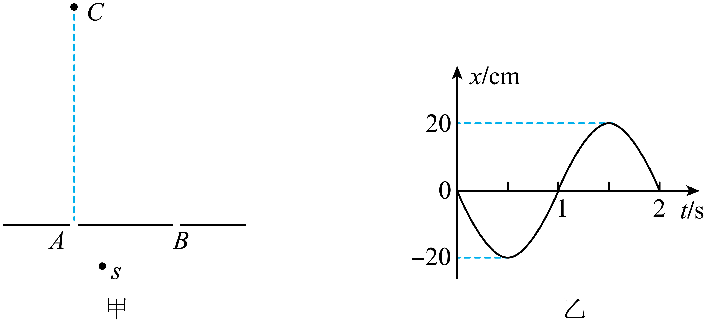

# Physics - 题目 2957

**ID**: e417e52fee164c1d9cd3a2722d3d8107
**年级**: Grade 12
**难度**: Medium-Hard
**题型**: Calculation

## 题目
如图甲所示水槽中放有一个挡板，挡板上开有小孔A、B，A、B两点距波源 $s$ 的距离分别为3m、4m，波源 $s$ 的振动图像如图乙所示。​​​​​​​‌我们可以把水波简化看作简谐波，已知水波的波长 $λ=2{\rm{m}}$ 。求：（1）从波源振动开始计时，在 $t=10{\rm{s}}$ 时间内，小孔A处的质点通过的路程；（2）在挡板前方 $x=15{\rm{m}}$ 处的水面上有一点 $C$ ，直线 $AC$ 与挡板垂直，请计算说明 $AC$ 线段上振动加强点（除A外）的个数。

## 解答

1. （1）通过图像可知，水波的振动周期为 $T=2{\rm{s}}$ ，可知水波的波速为
2. $v=\frac {λ}{T}=1{\rm{m}}{\rm{/}}{\rm{s}}$
3. 则水波从波源传播到A点所需时间为
4. $t{{}_{1}}=\frac {x{{}_{sA}}}{v}=3{\rm{s}}$
5. 故在 $t=10{\rm{s}}$ 时间内，小孔A处的质点通过的路程
6. $s{{}_{A}}=\frac {\left ({t-t{{}_{1}}}\right )}{T}\cdot 4A=280{\rm{c}}{\rm{m}}=2.8{\rm{m}}$
7. （2）设 $AC$ 线段上P点为振动加强点，则满足
8. $\left ({sB+BP}\right )-\left ({sA+AP}\right )=2n\cdot \frac {λ}{2}$
9. 整理得
10. $BP-AP=nλ{\rm{+}}\frac {λ}{2}=\left ({2n+1}\right ){\rm{m}}\left ({n=0,1,2…}\right )$
11. 根据几何关系可知
12. $BP-AP<AB$
13. 根据几何关系可知
14. $\left ({SB-SA}\right )<AB<\left ({SB+SA}\right )$
15. 即
16. $1{\rm{m}}<AB<7{\rm{m}}$
17. 因为 $AB$ 的距离未知，需要讨论：
18. ①当 $1{\rm{m}}<AB\leqslant 3{\rm{m}}$ ，则存在
19. $BP-AP=\left ({2n+1}\right ){\rm{m}}<3{\rm{m}}$
20. 解得，n唯一解
21. $n=0$
22. 只有一个加强点，对应该点AP满足几何关系
23. ${\left({AP+1}\right)^{2}}-AP{^{2}}=AB{^{2}}$
24. 代入 $1{\rm{m}}<AB\leqslant 3{\rm{m}}$ ，得
25. $1<{\left({AP+1}\right)^{2}}-AP{^{2}}\leqslant 9$
26. 解得
27. $AP<4<AC$
28. 故有一个加强点；
29. ②当 $3{\rm{m}}{\rm{<}}AB\leqslant 5{\rm{m}}$ ，则
30. $BP-AP=\left ({2n+1}\right ){\rm{m}}<5{\rm{m}}$
31. 解得n存在两个解
32. $n=0$ 或 $n=1$
33. 由几何关系可知，AC上的点，越靠近C点，波程差越小，故分析最靠近C点的加强点是否满足距离关系即可，设较远点为 $P^{′}$ ，对应 $n=0$ ，则同理满足
34. $9<{\left({AP^{′}+1}\right)^{2}}-AP^{′}{^{2}}\leqslant 25$
35. 解得
36. $4<AP^{′}<12<AC$
37. 故有两个加强点；
38. ③当 $5{\rm{m}}{\rm{<}}AB<7{\rm{m}}$ ，则
39. $BP-AP=\left ({2n+1}\right ){\rm{m}}<7{\rm{m}}$
40. 解得n存在三个解
41. $n=0$ 、 $n=1$ 、 $n=2$
42. 设最远点为 $P^{′′}$ ，对应 $n=0$ ，则同理满足
43. $25<{\left({AP^{′′}+1}\right)^{2}}-AP^{′′}{^{2}}<49$
44. 解得
45. $12<AP^{′′}<24$
46. 而AC的距离为15m，故有可能有两个加强点，最多有3个加强点。
47. 综上所述， $AC$ 线段上至少有1个振动加强点，最多有3个振动加强点。

## 知识点

**中文**:
  - 波的加强点与减弱点相关问题

**English**:
  - Constructive and Destructive Interference Points

---
