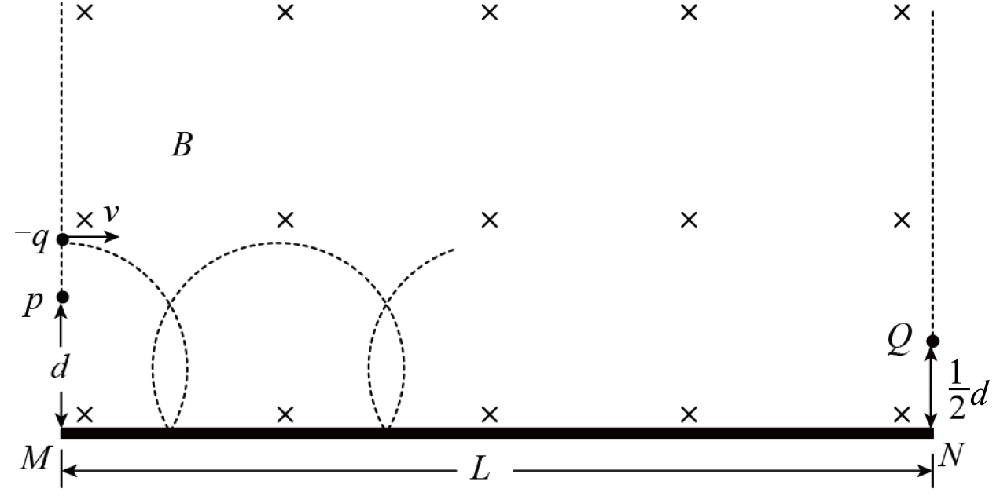

# Physics - 题目 656

**ID**: e61dc71fce864fbf99ee519e95d36257
**年级**: Grade 12
**难度**: Medium-Hard
**题型**: Calculation

## 题目
如图所示，匀强磁场的磁感应强度大小为B．磁场中的水平绝缘薄板与磁场的左、右边界分别垂直相交于M、N，MN=L，粒子打到板上时会被反弹（碰撞时间极短），反弹前后水平分速度不变，竖直分速度大小不变、方向相反．质量为m、电荷量为-q的粒子速度一定，可以从左边界的不同位置水平射入磁场，在磁场中做圆周运动的半径为d，且d<L，粒子重力不计，电荷量保持不变．（1）求粒子运动速度的大小v；​​​​​​​‌（2）欲使粒子从磁场右边界射出，求入射点到M的最大距离d_{m}；（3）从P点射入的粒子最终从Q点射出磁场， ${\rm \mathit{PM}=\mathit{d}，\mathit{QN}=}\frac {d}{2}$ ，求粒子从P到Q的运动时间t．

## 解答

1. （1）粒子在磁场中做匀速圆周运动由洛伦兹力提供向心力有：
2. $qvB=m\frac {v{^{2}}}{R}$ ，解得： $R=\frac {mv}{qB}$
3. 由题可得： $R=d$
4. 解得 $v=\frac {qBd}{m}$ ；
5. （2）如图所示，粒子碰撞后的运动轨迹恰好与磁场左边界相切
6. 
7. 由几何关系得d_{m}=d（1+sin60°）
8. 解得 $d{{}_{{\rm{m}}}}=\frac {2+\sqrt {3}}{2}d$
9. （3）粒子的运动周期 $T=\frac {2{\rm{π}}m}{qB}$
10. 设粒子最后一次碰撞到射出磁场的时间为t'，则
11. $t=n\frac {T}{4}+t^{′}(n=1,3,5,\cdots \cdots )$ 当 $L=nd+（1-\frac {\sqrt {3}}{2}）d$ 时，粒子斜向上射出磁场
12. $t^{′}=\frac {1}{12}T$ 解得 $t=（\frac {L}{d}+\frac {3\sqrt {3}-4}{6}）\frac {{\rm{π}}m}{2qB}$ 当 $L=nd+（1{{+}}\frac {\sqrt {3}}{2}）d$ 时，粒子斜向下射出磁场
13. $t^{′}=\frac {5}{12}T$ 解得 $t=（\frac {L}{d}-\frac {3\sqrt {3}-4}{6}）\frac {{\rm{π}}m}{2qB}$ 。

## 知识点

**中文**:
  - 带电粒子在磁场中做圆周运动的多解问题

**English**:
  - Multi-solution Problems of Circular Motion in Magnetic Fields

---
