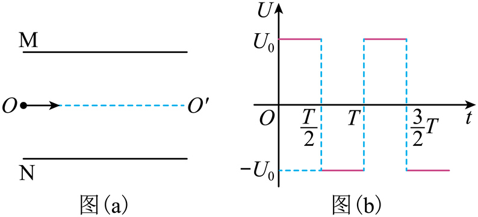

# Physics - 题目 2136

**ID**: e811cafaa61348cda5498657af13f0fe
**年级**: Grade 12
**难度**: Medium-Hard
**题型**: Calculation

## 题目
图（a）的平行金属板M、N间加有图（b）所示的交变电压，OO′是M、N板间的中线，当电压稳定时，板间可认为是匀强电场。​​​​​​​‌ $\frac {1}{4}T$ 时，比荷为k的带电粒子甲从O点沿OO′方向、以v_{0}的速率进入板间， $\frac {3}{2}T$ 时飞离电场，这期间恰好不与极板相碰。若在 $\frac {3}{8}T$ 时刻，带电粒子乙以2v_{0}的速率沿OO′从O点进入板间，已知乙粒子在运动过程中也恰好不与极板碰撞，不计粒子受到的重力，也不考虑粒子甲和乙间的作用力，求：(1)乙粒子离开电场的时刻；(2)乙粒子的比荷。

## 解答

1. （1）设金属板长为L，粒子甲带负电，则粒子甲的运动时间为
2. $t=\frac {L}{v{{}_{0}}}=\frac {3}{2}T-\frac {1}{4}T=\frac {5}{4}T$
3. 粒子乙因入射速度为甲的两倍，则运动时间为
4. $t^{′}=\frac {L}{2v{{}_{0}}}=\frac {5}{8}T$
5. 因粒子乙在 $\frac {3}{8}T$ 时刻进入板间，则在T时刻飞出板间；
6. （2）设两板间距离为d，则有
7. $a{{}_{甲}}=\frac {U{{}_{0}}q}{md}=\frac {U{{}_{0}}k}{d}$
8. 为定值，则粒子甲在竖直方向做初速度为零的匀加速直线运动，根据竖直方向速度和时间关系，可得
9. $v{{}_{y}}=a{{}_{甲}}t$
10. 作出竖直方向上速度与时间图像，如图所示
11. 
12. 图线与时间轴围成的面积代表竖直方向上的位移，若恰好不与极板碰撞，则表示粒子甲在电场中竖直方向的最大位移刚好为 $\frac {d}{2}$ ，根据图像可知在 $\frac {3}{4}T$ 时刻粒子甲恰好不碰到极板，此刻竖直方向达到最大位移， $\frac {5}{4}T$ 时刻回到中线上，而在 $\frac {3}{2}T$ 时刻，粒子出电场，此时竖直位移为 $\frac {d}{4}$ ；同理，粒子乙的 $v{{}_{y}}-t$ 图线为 $A^{′}B^{′}C^{′}D^{′}$ 的形状，因粒子乙在运动过程中也恰好不与极板碰撞，根据图像可知粒子乙在 $T$ 时刻恰好不与极板相撞，此时粒子乙刚好飞出磁场，即粒子乙在竖直方向上的位移为 $\frac {d}{2}$ ，则甲、乙两粒子通过电场偏转的位移大小之比为
13. $\frac {y{{}_{甲}}}{y{{}_{乙}}}=\frac {\frac {d}{4}}{\frac {d}{2}}=\frac {1}{2}$
14. 对乙有
15. $y{{}_{乙}}=\frac {1}{2}a{{}_{乙}}{\left({T-\frac {5}{8}T}\right)^{2}}-2\times \frac {1}{2}a{{}_{乙}}\times {\left({\frac {T}{2}-\frac {3}{8}T}\right)^{2}}=\frac {7a{{}_{乙}}T{^{2}}}{128}$
16. 对甲有
17. $y{{}_{甲}}=\frac {1}{2}a{{}_{甲}}{\left({\frac {3}{2}T-\frac {5}{4}T}\right)^{2}}=\frac {a{{}_{甲}}T{^{2}}}{32}$
18. $\frac {y{{}_{甲}}}{y{{}_{乙}}}=\frac {1}{2}$
19. 则有
20. $\frac {\frac {a{{}_{甲}}T{^{2}}}{32}}{\frac {7a{{}_{乙}}T{^{2}}}{128}}=\frac {1}{2}$
21. 可得
22. $\frac {a{{}_{乙}}}{a{{}_{甲}}}=\frac {8}{7}$
23. 根据牛顿第二定律有
24. $a{{}_{甲}}=\frac {U{{}_{0}}q}{md}=\frac {U{{}_{0}}k}{d}$
25. $a{{}_{乙}}=\frac {U{{}_{0}}q^{′}}{m^{′}d}$
26. 可得
27. $\frac {q^{′}}{m^{′}}=\frac {8k}{7}$

## 知识点

**中文**:
  - 带电粒子在交变电场中的运动

**English**:
  - Motion in Alternating Electric Field

---
