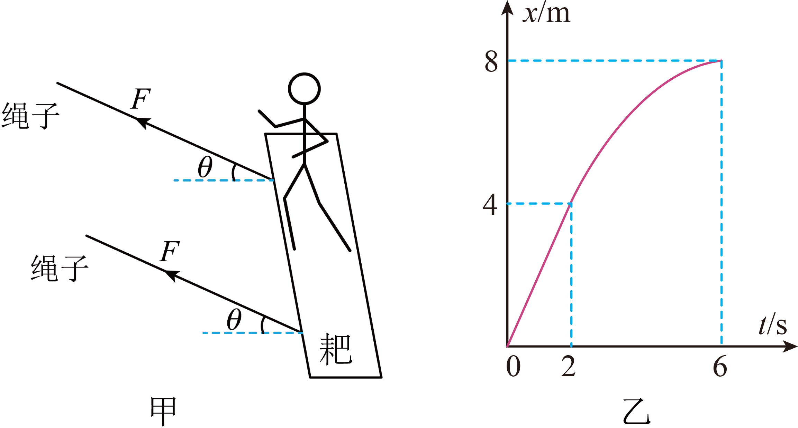

# Physics - 题目 785

**ID**: e908956c48a54febadb6528a9d6cc9db
**年级**: Grade 12
**难度**: Medium-Hard
**题型**: Calculation

## 题目
拖拉机拉耙整理田地的场景可简化为如图甲所示的模型，人站立在耙的中间位置，耙与水平地面平行，两条绳子相互平行且垂直于耙边缘，绳子与水平地面夹角均为 $θ=37{}\degree $ 。​​​​​​​‌某次整理田地过程中，人与耙沿直线运动的 $x-t$ 图像如图所示，其中 $0\sim 2{\rm{s}}$ 段为直线， $2\sim 6{\rm{s}}$ 段为抛物线的一部分。已知人与耙的总质量为 ${{8}}{{0}}{\rm{k}}{\rm{g}}$ ，耙与地面之间的动摩擦因数为 $\frac {3}{4}$ ，重力加速度大小取 $g=10{\rm{m}}/{\rm{s}}{^{2}}$ ， $\sin 37\mathrm{°}=0.6$ ， ${\cos}37\mathrm{°}=0.8$ ，求 $t=4{\rm{s}}$ 时；（1）耙速度的大小；（2）每条绳中拉力的大小。

## 解答

1. （1）由图像知 ${{2}}{\rm{s}}$ 末耙的速度 $v{{}_{2}}=2{\rm{m}}/{\rm{s}}$ ， $2-6{\rm{s}}$ 内耙的位移 $x=8{\rm{m}}-4{\rm{m}}=4{\rm{m}}$
2. $x-t$ 图像的斜率表示速度，可知 $t{{}_{2}}=2{\rm{s}}$ 后耙做匀减速运动，故 $2-6{\rm{s}}$ 内位移 $x=v{{}_{2}}Δt-\frac {1}{2}aΔt{^{2}}$
3. 解得 $a=0.5{\rm{m}}/{\rm{s}}{^{2}}$
4. $t=4{\rm{s}}$ 时耙速度的大小 $v{{}_{4}}=v{{}_{2}}-a\left ({t-t{{}_{2}}}\right )$
5. 解得 $v{{}_{4}}=1{\rm{m}}/{\rm{s}}$
6. （2）竖直方向 $F{{}_{{\rm{N}}}}+2F\sin θ=mg$
7. 水平方向 $f-2F{\cos}θ=ma$
8. 又 $f=μF{{}_{{\rm{N}}}}$
9. 联立解得绳中拉力 $F=224{\rm{N}}$

## 知识点

**中文**:
  - 匀变速直线运动的位移—时间公式及其应用
  - 牛顿运动定律与图像结合问题

**English**:
  - Displacement-Time Formula and Applications
  - Newton's Laws and Graphs

---
