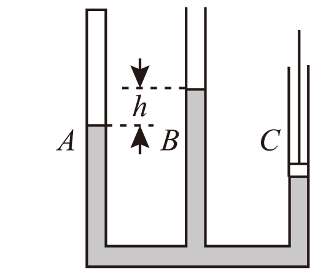

# Physics - 题目 638

**ID**: e99ef84a8a48494394dfa66b23dce677
**年级**: Grade 12
**难度**: Medium-Hard
**题型**: Calculation

## 题目
如图所示，一粗细均匀的“山”形管竖直放置，A管上端封闭，B管上端与大气相通，C管内装有带柄的活塞，活塞下方直接与水银接触。​​​​​​​‌A管上方用水银封有长度L=10 cm的空气柱，温度t_{1}=27℃；B管水银面比A管中高出h=4 cm。已知大气压强p_{0}=76 cmHg。为了使A、B管中的水银面等高，可以用以下两种方法：（1）固定C管中的活塞，改变A管中气体的温度，使A、B管中的水银面等高，求此时A管中气体的热力学温度T_{2}；（2）在温度不变的条件下，向上抽动活塞，使A、B管中的水银面等高，求活塞上移的距离 $ΔL$ 。（结果保留一位小数）

## 解答

1. （1）设U形管的横截面积为S，对A部分气体，初态有
2. P_{1}＝P_{0}+ 4cmHg＝ 76cmHg+ 4cmHg＝ 80cmHg
3. 末态有
4. P_{2}= 76cmHg
5. 气柱长度为
6. L=10cm
7. L'＝ 8cm
8. 根据理想气体状态方程
9. $\frac {P{{}_{1}}V{{}_{1}}}{T{{}_{1}}}=\frac {P{{}_{2}}V{{}_{2}}}{T{{}_{2}}}$
10. 故有
11. $\frac {P{{}_{1}}LS}{T{{}_{1}}}=\frac {P{{}_{2}}L{^{\prime }}S}{T{{}_{2}}}$
12. 解得
13. T_{2}＝ 228K
14. （2） 由于T不变，则根据玻意耳定律可得
15. $P{{}_{1}}V{{}_{1}}=P{{}_{3}}V{{}_{3}}$
16. 即有
17. $P{{}_{1}}LS=P{{}_{0}}L{{}_{3}}S$
18. 解得
19. L_{ 3}=10.526cm
20. 所以C管中水银长度的增加量为
21. $ΔL{\rm ＝}$  4cm +0.526cm + 0.526cm≈5.1cm
22. 即活塞上移的距离为5.1cm

## 知识点

**中文**:
  - 一定质量的气体多过程状态变化问题
  - 理想气体与理想气体状态方程

**English**:
  - Multi-process State Changes of Fixed Mass Gas
  - Ideal Gas and Ideal Gas Law

---
