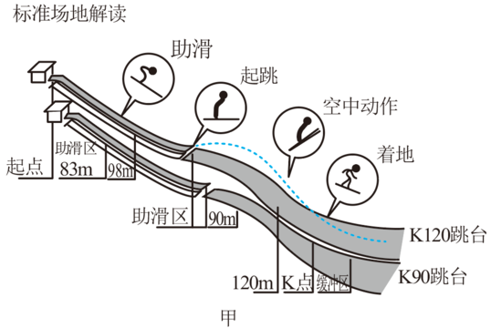
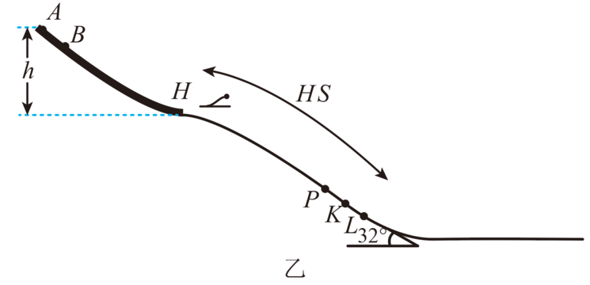

# Physics - 题目 1003

**ID**: e9d5dd0c6138497582746a7f65c7485c
**年级**: Grade 12
**难度**: Medium-Hard
**题型**: Calculation

## 题目
2022年北京冬奥会跳台滑雪项目比赛在国家跳台滑雪中心“雪如意”如期举行。​​​​​​​‌图甲为跳台的K120米（起跳点到K点距离120米）级别标准场地解读图。此类比赛并不是只以距离论输赢，而是要以“姿势分”和“距离分”的综合来计算成绩。距离分要由距K点的距离确定，运动员正好落在K点时记为60分，未到K点，将所差距离乘以每米的分值，从60分中减去；超过K点，将所超距离乘以每米的分值，然后加上60分。如图乙所示为简化的跳台滑雪的K120米雪道示意图，AB段为起滑段，H点为起跳点，HS段为坡体总长度（忽略H点到坡体的高度，坡体近似可以看做倾角为32°的斜面，H点为顶点），PL段为着陆区，K为“K点”。（1）若总质量（加装备）为60kg的运动员，从A点自由滑下到达半径10m的圆弧末端H点（切线水平），已知A点和H点的竖直高度h＝45m，忽略阻力，求运动员在H点对轨道的压力大小。（2）运动员从H点飞出（忽略空气阻力）做平抛运动最后落到PL段，若每米的分值为1.8，请计算滑雪运动员距离分。（已知sin32°＝0.53，cos32°＝0.848，tan32°＝0.625，g=10m/s^{2}）

## 解答

1. （1）对人从A到H，由动能定理得
2. $mgh=\frac {1}{2}mv_{0}^{2}$
3. 可得
4. $v_{0}=\sqrt {2gh}=30{\rm{m}}/{\rm{s}}$
5. 在H点处
6. $F_{{\rm{N}}}-mg=\frac {mv_{0}^{2}}{R}$
7. 得
8. $F_{{\rm{N}}}=6000{\rm{N}}$
9. 由牛顿第三定律得，对轨道的压力为 $6000{\rm{N}}$ ，方向竖直向下
10. （2） $HS$ 段坡体视为倾角为 $32{}^\circ $ 的斜面，运动员最终落到斜面上，易得
11. 水平位移为
12. $x=v_{0}t$
13. 竖直位移为
14. $y=\frac {1}{2}gt^{2}$
15. ${\tan}32{}^\circ =\frac {\frac {1}{2}gt^{2}}{v_{0}t}$
16. 可得
17. $t=3.75{\rm{s}}$
18. 运动员在 $HS$ 段长度
19. $x=\frac {v_{0}t}{{\cos}32{}^\circ }=132.7{\rm{m}}$
20. 运动员所得距离分为
21. $60+(132.7-120)\times 1.8{\rm{m}}=82.86{\rm{m}}$

## 知识点

**中文**:
  - 平抛运动
  - 平抛运动与斜面、圆轨道相结合问题
  - 竖直面内圆周运动问题

**English**:
  - Horizontal Projectile Motion
  - Horizontal Projectile on Inclined Planes and Circular Tracks
  - Circular Motion in Vertical Plane

---
