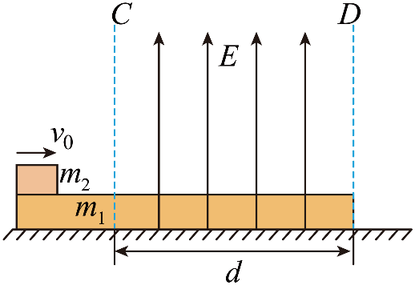

# Physics - 题目 1456

**ID**: ea0da4ac879348fea630621d250ba798
**年级**: Grade 12
**难度**: Medium-Hard
**题型**: Calculation

## 题目
如图所示，光滑水平地面上方 $CD$ 处存在宽度 $d=4{\rm{m}}$ 、方向竖直向上，大小 $E=1\times 10{^{5}}{\rm{N}}{\rm{/}}{\rm{C}}$ 匀强电场区域。​​​​​​​‌质量 $m{{}_{1}}=1{\rm{k}}{\rm{g}}$ 、长为 $l=6{\rm{m}}$ 的水平绝缘长木板静置于该水平面，且长木板最右侧与电场边界D重合。某时刻质量 $m{{}_{2}}=0.5{\rm{k}}{\rm{g}}$ 、带电量 $q=+3\times 10{^{-5}}{\rm{C}}$ 的可视为质点的滑块以初速度 $v{{}_{0}}=6{\rm{m}}/{\rm{s}}$ 从长木板左端水平滑入，一段时间后，滑块离开电场区域。已知长木板与滑块的动摩擦因数 $μ=0.5$ ，重力加速度大小为 $10{\rm{m}}/{\rm{s}}{^{2}}$ 。求：(1)滑块刚进电场时，长木板的速度大小；(2)滑块在电场中的运动时间，及全过程的摩擦生热。

## 解答

1. （1）滑块刚进电场前，对长木板根据牛顿第二定律可得 ${\rm μm}{{}_{2}}g=m{{}_{1}}a{{}_{1}}$
2. 解得加速度大小为 $a{{}_{1}}=2.5{\rm{m}}{\rm{/}}{\rm{s}}{^{2}}$
3. 对滑块根据牛顿第二定律可得 ${\rm μm}{{}_{2}}g=m{{}_{2}}a{{}_{2}}$
4. 解得加速度大小为 $a{{}_{2}}=5{\rm{m}}{\rm{/}}{\rm{s}}{^{2}}$
5. 滑块进入电场前，对滑块有 $v{{}_{2}^{2}}-v{{}_{0}^{2}}=-2a{{}_{2}}(l-d)$ ， $v{{}_{2}}=v{{}_{0}}-a{{}_{2}}t{{}_{1}}$
6. 解得滑块进入电场时的速度、滑行时间分别为 $v{{}_{2}}=4{\rm{m}}{\rm{/}}{\rm{s}}$ ， $t{{}_{1}}=0.4{\rm{s}}$
7. 在时间 $t=0.4{\rm{s}}$ 内，对木板有 $v{{}_{1}}=a{{}_{1}}t{{}_{1}}=1{\rm{m}}{\rm{/}}{\rm{s}}$
8. 所以滑块刚进电场时，长木板的速度大小为 $1{\rm{m}}{\rm{/}}{\rm{s}}$ 。
9. （2）滑块进入电场后经过时间 $t{{}_{2}}$ 滑块与木板同速，设共同速度为v，滑块与木板组成的系统动量守恒，则有 $m{{}_{2}}v{{}_{0}}=(m{{}_{1}}+m{{}_{2}})v$
10. 解得 $v=2{\rm{m}}{\rm{/}}{\rm{s}}$
11. 对滑块分析，由动量定理可得 $-μ(m{{}_{2}}g-qE)t{{}_{2}}=m{{}_{2}}v-m{{}_{2}}v{{}_{2}}$
12. 解得 $t{{}_{2}}=1{\rm{s}}$
13. 在时间 $t{{}_{1}}$ 和 $t{{}_{2}}$ 内滑块的总位移为 $x=l-d+\frac {1}{2}(v{{}_{2}}+v)t{{}_{2}}=5{\rm{m}}$
14. 滑块与木板同速后一起匀速运动，滑块在电场中匀速运动的时间为 $t{{}_{3}}=\frac {l-x}{v}=0.{{5}}{\rm{s}}$
15. 所以滑块在电场中的运动时间为 $t=t{{}_{2}}+t{{}_{3}}=1.{{5}}{\rm{s}}$
16. 由能量守恒定律得，全过程中摩擦产生的热量为 $Q=\frac {1}{2}m{{}_{2}}v{{}_{0}^{2}}-\frac {1}{2}(m{{}_{1}}+m{{}_{2}})v{^{2}}={{6}}{\rm{J}}$

## 知识点

**中文**:
  - 动量守恒与板块模型相结合

**English**:
  - Momentum Conservation with Plate Models

---
