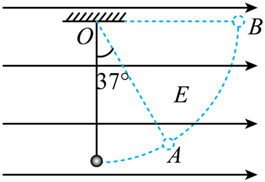

# Physics - 题目 1464

**ID**: eac4545ec24a4a5486b5acc65d485ba8
**年级**: Grade 12
**难度**: Medium-Hard
**题型**: Calculation

## 题目
如图所示，长度为l的绝缘轻绳上端固定在O点，下端系一质量为m，电荷量为＋q的小球。​​​​​​​‌现加一水平向右的匀强电场，当绝缘轻绳处于与竖直方向成 $37{}^\circ $ 角的位置A处时，小球刚好处于静止状态（已知重力加速度为g， ${\sin}37{}^\circ =0.6$ ， ${\cos}37{}^\circ =0.8$ ，不计小球受到的空气阻力）。求：（1）匀强电场的电场强度大小E；（2）若轻绳被剪断，则绳剪断瞬间小球的加速度a；（3）现把小球置于图中位置B处，使OB沿着水平方向，轻绳处于拉直状态。小球从位置B无初速度释放，求小球通过最低点时的速度大小v。

## 解答

1. （1）小球处于静止状态，受重力G，电场力F，轻绳拉力T，如图
2. 
3. 由共点力平衡条件可知
4. ${\tan}37{}^\circ =\frac {F}{G}=\frac {qE}{mg}$
5. 解得匀强电场的电场强度大小
6. $E=\frac {3mg}{4q}$
7. （2）轻绳被剪断，小球重力G、电场力F作用，小球受到的合力
8. $F{{}_{合}}=\sqrt {G{{}^{2}}+F{{}^{2}}}=\frac {5}{4}mg$
9. 由牛顿第二定律得
10. $F{{}_{合}}=ma$
11. 则绳剪断瞬间小球的加速度
12. $a=1.25g$
13. （3）小球从位置B无初速度释放到最低点的过程中，根据动能定理得
14. $mgl-qEl=\frac {1}{2}mv{{}^{2}}-0$
15. 解得小球通过最低点时的速度大小
16. $v=\sqrt {\frac {gl}{2}}$

## 知识点

**中文**:
  - 匀强电场
  - 应用动能定理求解连接体问题

**English**:
  - Uniform Electric Field
  - Solving Connected Body Problems

---
