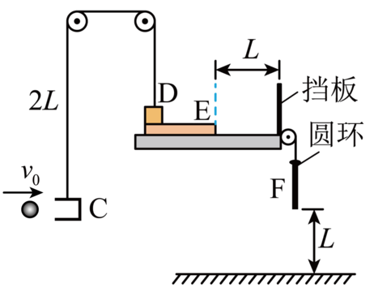

# Physics - 题目 1154

**ID**: ebbc5acd64814a14a8baa9f5559eb417
**年级**: Grade 12
**难度**: Medium-Hard
**题型**: Calculation

## 题目
“鲁布·戈德堡机械”是用连锁机械反应完成一些简单动作的装置。​​​​​​​‌质量为m的“”形小盒C的右侧与质量为3m的物块D通过光滑定滑轮用轻绳相连，左侧滑轮与C之间的绳长为2L；物块D压在质量为m的木板E左端，E上表面光滑、下表面与水平桌面间动摩擦因数 $μ=0.5{\rm ，E}$ 右端到固定挡板（厚度不计）的距离为L；质量为m且粗细均匀的细杆F通过光滑定滑轮用轻绳与E相连，E与定滑轮间轻绳水平，细杆F下端与地面距离为L；质量为m的圆环套在F上端，环与杆之间的滑动摩擦力为 $\frac {7}{2}mg$ 。初始所有装置均静止，一质量为m的小球以 $v{{}_{0}}=2\sqrt {gL}$ 的速度水平弹入C并刚好被卡住，带动后面的装置运动，木板E与挡板相撞、细杆F与地面相撞后均以原速率反弹，最终圆环刚好到达细杆底部。小球A、小盒C、物块D、圆环均可视为质点，认为最大静摩擦力等于滑动摩擦力，不计空气阻力，重力加速度为g，求：（1）小球弹入小盒C后，装置启动瞬间，绳子上的拉力大小；（2）木板E与挡板第一次相撞瞬间的速度大小；（3）细杆F的长度以及木板E运动的总路程。

## 解答

1. （1）设小球弹入C后的瞬间速度为v，与小盒C相连的绳子上的拉力大小为T。小球弹入C瞬间，二者组成的系统动量守恒，由动量守恒定律得 $mv{{}_{0}}=\left ({m+m}\right )v$
2. 对小球和C组成的系统，由圆周运动公式可知，与小盒C相连的绳子上的拉力大小 $T-2mg=2m\frac {v{^{2}}}{2L}$
3. 解得： $T=3mg$
4. （2）由（1）知，当小球刚被小盒C卡住时，物块D对木板E压力为零，此时桌面对木板E的最大静摩擦力 $f={\rm μm}g$
5. 由 $f<\left ({m+m}\right )g$ 知，木板E将向右运动；木板E向右运动与挡板相撞前，将木板E、圆环和细杆F视为一个整体，设加速度大小为a。由牛二定律 $\left ({m+m}\right )g-{\rm μm}g=\left ({m+m+m}\right )a$
6. 解得 $a=\frac {1}{2}g$
7. 对圆环，由牛顿第二定律，可知圆环所受摩擦力 $f^{′}=\frac {1}{2}mg<f{{}_{滑}}=\frac {7}{2}mg$
8. 所以木板E向右运动与挡板相撞前，圆环与细杆F之间未发生相对滑动，假设第一次相撞的速度大小为 $v{{}_{1}}$ ，则 $v{{}_{1}^{2}}=2aL$
9. 解得 $v{{}_{1}}=\sqrt {gL}$
10. （3）由分析知，第一次相撞后细杆F与圆环发生相对滑动，设相撞后圆环向下做匀减速直线运动的加速度大小为 $a{{}_{1}}$ ，木板E向左、细杆F向上做匀减速直线运动的加速度大小为 $a{{}_{2}}$ ，则对圆环由牛顿第二定律 $\frac {7}{2}mg-mg=ma{{}_{1}}$
11. 对木板E、细杆F整体由牛顿第二定律 $\frac {7}{2}mg+mg+{\rm μm}g=\left ({m+m}\right )a{{}_{2}}$
12. 解得 $a{{}_{1}}=\frac {5}{2}g$ ， $a{{}_{2}}=\frac {5}{2}g$
13. 因为 $a{{}_{1}}$ ， $a{{}_{2}}$ 大小相等，则圆环与木板E、细杆F同时减速为零，且圆环与细杆F的位移大小相等，方向相反。设第一次相撞后，木板E向左的最大位移为 $L{{}_{1}}$ ，则由匀变速直线运动推导公式 $v{{}_{1}^{2}}=2aL{{}_{1}}$
14. 解得 $L{{}_{1}}=\frac {1}{5}L$
15. 同理可得：第二次相撞后，木板E向左的最大位移为 $L{{}_{2}}=\frac {1}{5}L{{}_{1}}={\left({\frac {1}{5}}\right)^{2}}L$
16. 第n次碰撞后，木板E向左的最大位移 $L{{}_{n}}={\left({\frac {1}{5}}\right)^{n}}L$
17. 则第一次相撞后，圆环与细杆F的最大相对位移 $Δx{{}_{1}}=2L{{}_{1}}$
18. 同理可得：第二次相撞后﹐圆环与细杆F的最大相对位移 $Δx{{}_{2}}=2L{{}_{2}}$
19. 第n次相撞后﹐圆环与细杆F的最大相对位移 $Δx{{}_{n}}=2L{{}_{n}}$
20. 设细杆F的长度为x，则 $x=Δx{{}_{1}}+Δx{{}_{2}}+Δx{{}_{3}}+\cdots =2\times \frac {\frac {1}{5}}{1-\frac {1}{5}}L=\frac {1}{2}L$
21. 设木板E运动的总路程为 $Δs$ ，由能量守恒 $mgL+mg\left ({x+L}\right )={\rm μm}g{\rm{Δ}}s+\frac {7}{2}mgx$
22. 又 $Δs=L+x$
23. 解得 $Δs=\frac {3}{2}L$

## 知识点

**中文**:
  - 功能原理、能量守恒与曲线运动的综合
  - 连接体问题（整体和隔离法）、临界问题
  - 动量守恒的判定与应用

**English**:
  - Energy Conservation in Curvilinear Motion
  - Connected Bodies Problems (Whole/Isolation Method), Critical Problems
  - Judgment and Application of Momentum Conservation

---
