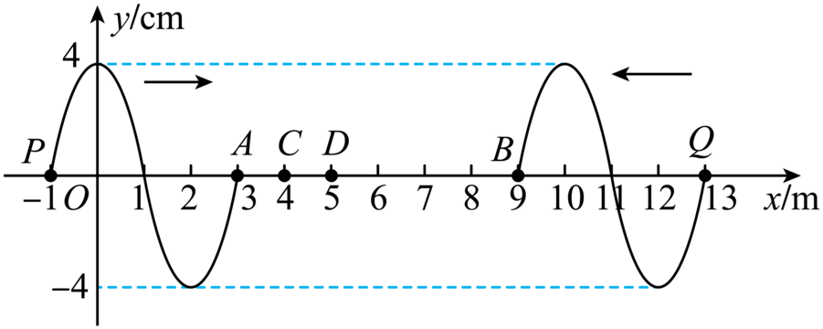

# Physics - 题目 2139

**ID**: eebe535d538c442584a10bfcba6584da
**年级**: Grade 12
**难度**: Medium-Hard
**题型**: Calculation

## 题目
如图所示， $x{{}_{1}}=-1{\rm{m}}$ 和 $x{{}_{2}}=13{\rm{m}}$ 处有两振源 $P$ 、 $Q$ ，两振源在同一介质中分别产生两列沿 $x$ 轴传播的简谐横波，两振源同时起振，经 $t=0.8{\rm{s}}$ 的时间 $x{{}_{3}}=3{\rm{m}}$ 和 $x{{}_{4}}=9{\rm{m}}$ 处的质点 $A$ 、 $B$ 刚好起振， $C$ 、 $D$ 两质点的平衡位置到原点的距离分别为 $4{\rm{m}}$ 、 $5{\rm{m}}$ 。​​​​​​​‌求：（1）两简谐横波在该介质中传播速度的大小；（2）从图示时刻开始计时，4s的时间内质点 $C$ 、 $D$ 通过的路程之比。

## 解答

1. （1）振源 $P$ 产生机械波的传播速度为 $v{{}_{1}}=\frac {x{{}_{1}}}{t}=\frac {4}{0.8}{\rm{m}}/{\rm{s}}=5{\rm{m}}/{\rm{s}}$
2. 振源 $Q$ 产生机械波的传播速度为 $v{{}_{2}}=\frac {x{{}_{2}}}{t}=\frac {4}{0.8}{\rm{m}}/{\rm{s}}=5{\rm{m}}/{\rm{s}}$
3. （2）由图看出，振源 $P$ 产生的机械波的波长 $λ{{}_{1}}=4{\rm{m}}$ ，振幅 $A{{}_{1}}=4cm$
4. 振源 $Q$ 产生机械波的波长 $λ{{}_{2}}=4{\rm{m}}$ ，振幅 $A{{}_{2}}=4cm$
5. 两列机械波的周期 $T{{}_{1}}=\frac {λ{{}_{1}}}{v{{}_{1}}}=0.8{\rm{s}}$ ， $T{{}_{2}}=\frac {λ{{}_{2}}}{v{{}_{2}}}=0.8{\rm{s}}$
6. 两列波传到 $C$ 点的波程差 $Δx{{}_{C}}=x{{}_{2C}}-x{{}_{1C}}=9{\rm{m}}-5{\rm{m}}=4{\rm{m}}$
7. 由于波程差 $Δx{{}_{C}}$ 是波长的整数倍，两波源振动情况相反， $C$ 点是振动减弱点，两列波都传播到 $C$ 点后，质点 $C$ 静止不动。
8. 振源 $P$ 产生的机械波传播到 $C$ 点所用的时间 $t{{}_{1C}}=\frac {x{{}_{1C}}}{v{{}_{1}}}=\frac {5}{5}{\rm{s}}=1{\rm{s}}$
9. 振源 $Q$ 产生的机械波传播到 $C$ 点所用的时间 $t{{}_{2C}}=\frac {x{{}_{2C}}}{v{{}_{2}}}=\frac {9}{5}{\rm{s}}=1.8{\rm{s}}$
10. 所以质点 $C$ 在0~1s内静止，在1s~1.8s内振幅为 $A{{}_{1}}$ ，在1.8s~4s内静止。
11. 质点 $C$ 在4s内通过的路程 $s{{}_{C}}=0+\frac {t{{}_{2C}}-t{{}_{1C}}}{T{{}_{1}}}\times 4A{{}_{1}}+0=16cm$
12. 两列波传到 $D$ 点的波程差 $Δx{{}_{D}}=x{{}_{2D}}-x{{}_{1D}}=8{\rm{m}}-6{\rm{m}}=2{\rm{m}}$
13. 由于波程差 $Δx{{}_{D}}$ 是半波长的奇数倍，两波源振动情况相反， $D$ 点是振动加强点，两列波都传播到 $D$ 点后，质点 $D$ 的振幅为 $A^{′}=A{{}_{1}}+A{{}_{2}}=8cm$
14. 振源 $P$ 产生的机械波传播到 $D$ 点所用的时间 $t{{}_{1D}}=\frac {x{{}_{1D}}}{v{{}_{1}}}=\frac {6}{5}{\rm{s}}=1.2{\rm{s}}$
15. 振源 $Q$ 产生的机械波传播到 $D$ 点所用的时间 $t{{}_{2D}}=\frac {x{{}_{2D}}}{v{{}_{2}}}=\frac {8}{5}{\rm{s}}=1.6{\rm{s}}$
16. 所以质点 $D$ 在0~1.2s内静止，在1.2s~1.6s内振幅为 $A{{}_{1}}$ ，在1.6s~4s内内振幅为 $A^{′}$
17. 质点 $D$ 在4s内通过的路程 $s{{}_{D}}=0+\frac {t{{}_{2D}}-t{{}_{1D}}}{T{{}_{1}}}\times 4A{{}_{1}}+\frac {4{\rm{s}}-t{{}_{2D}}}{T{{}_{1}}}\times 4A^{′}=104cm$
18. 4s的时间内质点 $C$ 、 $D$ 通过的路程之比 $\frac {s{{}_{C}}}{s{{}_{D}}}=\frac {16}{104}=\frac {2}{13}$

## 知识点

**中文**:
  - 振幅、周期、频率、相位和波长及其计算
  - 波的加强点与减弱点相关问题
  - 简谐运动的函数与图像

**English**:
  - Calculation of Amplitude, Period, Frequency, Phase, and Wavelength
  - Constructive and Destructive Interference Points
  - Functions and Graphs of SHM

---
