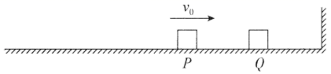

# Physics - 题目 179

**ID**: eecef70b8c6b4ba5a83e6b28f8fc4e2a
**年级**: Grade 12
**难度**: Medium-Hard
**题型**: Calculation

## 题目
如图所示，物块P、Q静止在水平地面上，P的质量为 $m$ ，Q的质量为 $2m$ 。​​​​​​​‌物块与水平面间的滑动摩擦因数 $μ$ 均为0.2，P与Q、Q与竖直墙之间的距离均为 $L=3.5{\rm{m}}$ 。某时刻给物块P瞬时冲量，使其获得水平向右的初速度 $v{{}_{0}}=\sqrt {144}{\rm{m}}{\rm{/}}{\rm{s}}$ ，P、Q碰撞后的机械能为碰前的 $\frac {19}{25}$ ，Q与竖直墙碰撞为弹性碰撞，碰后速度大小不变，方向反向。所有碰撞时间极短可忽略，物块可看成质点，重力加速度 $g$ 取 $10{\rm{m}}{\rm{/}}{\rm{s}}{^{2}}$ 。(1)求P、Q第一次碰后瞬间各自速度的大小；(2)通过计算判断P、Q能否发生二次碰撞，若能发生请计算二次碰撞前瞬间两者的速率；若不能请说明理由。

## 解答

1. (1)从P开始运动到P、Q碰撞前过程，对P，由动能定理得
2. $-{\rm μm}gL{{}_{PQ}}=\frac {1}{2}mv{^{2}}-\frac {1}{2}mv{{}_{0}^{2}}$
3. 代入数据解得
4. $v=10{\rm{m}}{\rm{/}}{\rm{s}}$
5. 碰撞过程系统动量守恒，以向右为正方向，由动量守恒定律得
6. $mv=mv{{}_{P}}+2mv{{}_{Q}}$
7. 由题意可知
8. $\frac {19}{25}\times \frac {1}{2}mv{^{2}}=\frac {1}{2}mv{{}_{P}^{2}}+\frac {1}{2}\centerdot 2mv{{}_{Q}^{2}}$
9. 代入数据解得
10. $v{{}_{P}}=-2{\rm{m}}{\rm{/}}{\rm{s}}$ ， $v{{}_{Q}}=6{\rm{m}}{\rm{/}}{\rm{s}}$
11. 负号表示方向向左。
12. (2)碰撞后P、Q都做减速运动，加速度都为
13. $a=μg=2{\rm{m}}{\rm{/}}{\rm{s}}{^{2}}$
14. P速度变为零需要的时间
15. $t=\frac {v{{}_{P}}}{a}=\frac {2}{2}{\rm{s}}=1{\rm{s}}$
16. 该过程P的位移
17. $x{{}_{P}}=\frac {v{{}_{P}^{2}}}{2a}=1{\rm{m}}$
18. Q与墙壁碰撞后速率不变，加速度大小不变，若 $PQ$ 不发生二次碰撞， $Q$ 在速度为零前运动的路程
19. $s{{}_{Q}}=\frac {v{{}_{Q}^{2}}}{2a}=9{\rm{m}}$
20. 因为 $x{{}_{Q}}>2L+x{{}_{P}}$ ，所以 ${\rm{P}}{\rm{Q}}$ 可发生二次碰撞，根据上述分析可知
21. 碰撞前P的速度为0
22. $s{{}_{Q}}\prime 2L+s{{}_{P}}=\frac {v{{}_{Q}^{2}}-v\prime {{}_{Q}^{2}}}{2a}$
23. 代入数据解得
24. $v{{}_{Q}}\prime =2{\rm{m}}{\rm{/}}{\rm{s}}$
25. 所以二次碰撞前P的速度为 $0$ ，Q的速度为 $2{\rm{m}}{\rm{/}}{\rm{s}}$ 。

## 知识点

**中文**:
  - 动量守恒中的多次碰撞问题

**English**:
  - Multiple Collisions in Momentum Conservation

---
