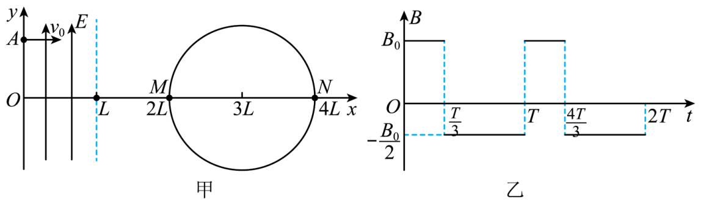

# Physics - 题目 1615

**ID**: ef0fe63b7dfb4efb8813961e76465ee8
**年级**: Grade 12
**难度**: Medium-Hard
**题型**: Calculation

## 题目
如图甲所示，在直角坐标系0≤x≤L区域内有沿y轴正方向的匀强电场，右侧有一个以点（3L，0）为圆心、半径为L的圆形区域，圆形区域与x轴的交点分别为M、N。​​​​​​​‌现有一质量为m、带电量为e的电子，从y轴上的A点以速度v_{0}沿x轴正方向射入电场，飞出电场后从M点进入圆形区域，此时速度方向与x轴正方向的夹角为30°。不考虑电子所受的重力。（1）求电子进入圆形区域时的速度大小和匀强电场场强E的大小；（2）若在圆形区域内加一个垂直纸面向里的匀强磁场，使电子穿出圆形区域时速度方向垂直于x轴．求所加磁场磁感应强度B的大小和电子刚穿出圆形区域时的位置坐标；（3）若在电子刚进入圆形区域时，在圆形区域内加上图乙所示变化的磁场（以垂直于纸面向外为磁场正方向），最后电子从N点处飞出，速度方向与进入磁场时的速度方向相同．请写出磁感应强度B_{0}的大小、磁场变化周期T各应满足的关系表达式。

## 解答

1. （1）电子在电场中作类平抛运动，射出电场时，速度分解图如图1中所示
2. 
3. 由速度关系可得 $\frac {v{{}_{0}}}{v}={\rm{c}}{\rm{o}}{\rm{s}}θ$ ，解得 $v=\frac {2\sqrt {3}}{\hspace{-0.5em}\begin{array}{l}3\end{array}\hspace{-0.5em}}v{{}_{0}}$ ，由速度关系得v_{y}=v_{0}tanθ= $\frac {\sqrt {3}}{3}$v_{0}_{，}在竖直方向 $v{{}_{y}}=at=\frac {Ee}{m}t$ ，而水平方向 $t=\frac {L}{v{{}_{0}}}$ ，解得 $E=\frac {\sqrt {3}mv{{}_{0}}{^{2}}}{3eL}$
4. （2）根据题意作图如图1所示，电子做匀速圆周运动的半径R=L，根据牛顿第二定律 $qvB=\frac {mv{^{2}}}{R}$ ，解得 $B=\frac {2\sqrt {3}mv{{}_{0}}}{3eL}$ ，根据几何关系得电子穿出圆形区域时位置坐标为（ $\frac {5L}{2}$  ，- $\frac {\sqrt {3}}{2}L$ ）
5. （3）电子在磁场中最简单的情景如图2所示
6. 
7. 在磁场变化的前三分之一个周期内，电子的偏转角为60°，设电子运动的轨道半径为r，运动的T_{0}，粒子在x轴方向上的位移恰好等于r_{1}；在磁场变化的后三分之二个周期内，因磁感应强度减半，电子运动周期T′=2T_{0}_{，}粒子的偏转角度仍为60°，电子运动的轨道半径变为2r，粒子在x轴方向上的位移恰好等于2r，综合上述分析，则电子能到达N点且速度符合要求的空间条件是3rn=2L（n=1，2，3…），而 $r=\frac {mv}{B{{}_{0}}e}$ ，解得 $B{{}_{0}}=\frac {n\sqrt {3}mv{{}_{0}}}{\hspace{-0.5em}\begin{array}{l}eL\end{array}\hspace{-0.5em}}$ （n=1，2，3…），应满足的时间条件为 $\frac {1}{6}$  (T_{0}+T′)=T，而 $T{{}_{0}}=\frac {2{\rm{π}}m}{eB{{}_{0}}}$  $T\prime ＝\hspace{-0.5em}\begin{array}{l}\frac {2{\rm{π}}m}{\frac {1}{2}B{{}_{0}}e}\end{array}\hspace{-0.5em}$ ，解得 $T=\frac {\sqrt {3}{\rm{π}}L}{3nv{{}_{0}}}$ （n=1，2，3…）

## 知识点

**中文**:
  - 带电粒子在周期性变化的电磁场中的运动

**English**:
  - Motion in Periodically Varying EM Fields

---
