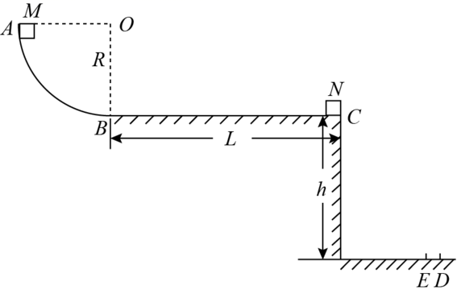

# Physics - 题目 1829

**ID**: ef3a4c6c9274483196db0b5cdfba8256
**年级**: Grade 12
**难度**: Medium-Hard
**题型**: Calculation

## 题目
图所示，AB为光滑的 $\frac {1}{4}$ 圆弧轨道，半径 $R=0.8{\rm{m}}$ ，BC为距地面高 $h=1.25{\rm{m}}$ 的粗糙水平轨道，长 $L=2.0{\rm{m}}$ ，与AB轨道相切于B点。​​​​​​​‌小物块N放在水平轨道末端的C点，将小物块M从圆弧轨道的最高点A由静止释放，经过一段时间后与小物块N发生碰撞，碰撞后小物块N落在水平地面上的D点，小物块M落在E点。已知D点到C点的水平距离 $x{{}_{D}}=0.75{\rm{m}}$ ，D、E两点间的距离 $\vartriangle x=0.125{\rm{m}}$ ，小物块M与水平轨道BC间的动摩擦因数为 $μ=0.3$ ，重力加速度g取 $10{\rm{m}}{\rm{/}}{\rm{s}}{^{{\rm{2}}}}$ ，两小物块均可视为质点，不计空气阻力。求：(1)小物块刚到达B点的压力与重力之比；(2)碰撞前瞬间小物块M的速度大小；(3)小物块M和小物块N的质量之比。

## 解答

1. (1)设小物块M和小物块N的质量为 $m{{}_{1}}$ 和 $m{{}_{2}}$ ，小物块M到达B点时速度为v，受到的支持力为 $F{{}_{{\rm{N}}}}$ ，从A点到B点，由动能定理得
2. $m{{}_{1}}gR=\frac {1}{2}m{{}_{1}}v{^{2}}$
3. 由牛顿第二定律得
4. $F{{}_{{\rm{N}}}}-m{{}_{1}}g=m{{}_{1}}\frac {v{^{2}}}{R}$
5. 解得
6. $F{{}_{{\rm{N}}}}=3m{{}_{1}}g$
7. 由牛顿第三定律可知小物块M对B点的压力为
8. $F{{}_{{\rm{N}}}}^{′}=F{{}_{{\rm{N}}}}=3m{{}_{1}}g$
9. 故小物块刚到达B点的压力与重力之比为
10. $\frac {F{{}_{{\rm{N}}}}^{′}}{m{{}_{1}}g}=3$
11. (2)设碰撞前瞬间小物块M的速度大小为 $v{{}_{0}}$ ，从A点到C点，对小物块M，由动能定理得
12. $m{{}_{1}}gR-{\rm μm}{{}_{1}}gL=\frac {1}{2}m{{}_{1}}v{{}_{0}}{^{2}}$
13. 代入数据解得
14. $v{{}_{0}}=2{\rm{m}}{\rm{/}}{\rm{s}}$
15. (3)设碰撞后小物块M和N的速度大小分别为 $v{{}_{1}}$ 和 $v{{}_{2}}$ ，从碰撞后到落地的时间为t，根据平抛运动知识有
16. $h=\frac {1}{2}gt{^{2}}$
17. 对小物块N有
18. $x{{}_{D}}=v{{}_{2}}t$
19. 对小物块M有
20. $x{{}_{D}}-\vartriangle x=v{{}_{1}}t$
21. 联立以上三式解得
22. $v{{}_{1}}=1.25{\rm{m}}{\rm{/}}{\rm{s}}$ ， $v{{}_{2}}=1.5{\rm{m}}{\rm{/}}{\rm{s}}$
23. 两个小物块相碰过程动量守恒，规定水平向右为正方向，根据动量守恒定有
24. $m{{}_{1}}v{{}_{0}}=m{{}_{1}}v{{}_{1}}+m{{}_{2}}v{{}_{2}}$
25. 代入数据解得
26. $\frac {m{{}_{1}}}{m{{}_{2}}}=2$

## 知识点

**中文**:
  - 动量守恒与曲线运动相结合
  - 求解弹性碰撞问题

**English**:
  - Momentum Conservation with Curvilinear Motion
  - Solving Elastic Collision Problems

---
