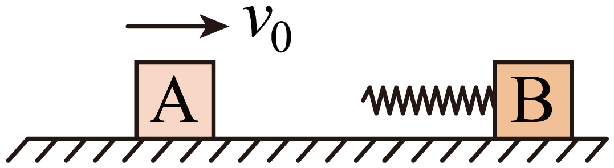

# Physics - 题目 2673

**ID**: ef8909d41ac04134bff80298013e2b50
**年级**: Grade 12
**难度**: Medium-Hard
**题型**: Calculation

## 题目
如图所示，质量为m的物块A与质量为3m的物块B静置于光滑水平面上，物块B与劲度系数为k的水平轻质弹簧连接。​​​​​​​‌现使物块A以初速度水平向右运动，物块A与弹簧发生相互作用，最终与弹簧分离。全过程无机械能损失且弹簧始终处于弹性限度内。弹簧弹性势能的表达式为（x为弹簧形变量）。求：（1）物块B的最大速度；（2）物块A的最大加速度；（3）去掉弹簧，使物块AB带上同种电荷，放在光滑绝缘的水平面上。物块A从较远处（该处库仑力可忽略，AB组成的系统电势能为零），以初速度冲向物块B。在物块B的右侧有一固定挡板（位置未知，图中也未画），物块B与挡板发生弹性碰撞后立即撤去挡板，求此后过程中系统最大电势能的取值范围（物块B与挡板碰撞时间极短，没有电荷转移，全程物块A和B没有接触）。

## 解答

1. （1）当A物块与弹簧分离时，B物块速度最大，根据动量守恒定律和能量守恒定律有
2. 
3. 
4. 解得
5. 
6. 
7. （2）当两物块共速时，弹簧压缩量最大，根据动量守恒
8. 
9. 得
10. 
11. A物块有最大加速度，根据能量守恒
12. 
13. 解得
14. 
15. 又
16. 
17. 
18. 物块A的最大加速度
19. 
20. （3）设B物块与挡板碰撞前瞬间的速度大小为，此时A的速度为v_{A}，根据动量守恒
21. ①
22. B与挡板碰后，以向左运动，当A、B速度相同（设为）时，弹簧势能最大，为E_{m}，则
23. ②
24. ③
25. 由①②两式得
26. 
27. 代入③式化简得
28. ④
29. B与挡板相碰时速度最大，有最大值，则
30. 
31. 
32. 联立以上两式得
33. 
34. 即v_{B}的取值范围为
35. 
36. 结合④式可得：当时，E_{m}有最大值为
37. 
38. 当学时，E_{m}有最小值为
39. E_{m2}=0
40. 所以系统最大电势能的取值范围为
41. 

## 知识点

**中文**:
  - 动量守恒与弹簧相结合

**English**:
  - Momentum Conservation with Springs

---
