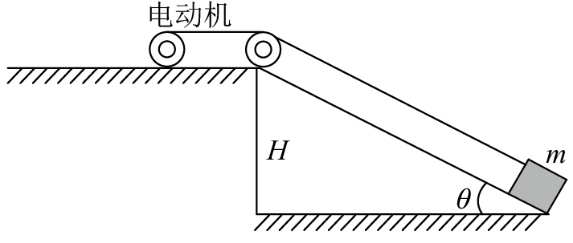

# Physics - 题目 1321

**ID**: efcd7f5142dc48de88548a1d59a0c82f
**年级**: Grade 12
**难度**: Medium-Hard
**题型**: Calculation

## 题目
如图所示，电动机通过一轻绳牵引放在倾角为 $θ=30{}^\circ $ 的斜面底部一质量为 $m=80.0{\rm{k}}{\rm{g}}$ 的静止物体，绳能承受的最大拉力为 $F{{}_{{\rm{m}}}}=1200{\rm{N}}$ ，斜面的高度为 $H=45.0{\rm{m}}$ ，物体与斜面间的动摩擦因数为 $μ=\frac {\sqrt {3}}{3}$ ，电动机的最大输出功率为 $12000{\rm{W}}$ ，要将此物体由静止以最快的方式牵引到斜面顶端（已知此物体在接近斜面顶端时，已达到能达到的最大速度，物体所受拉力方向一直与斜面平行），最大静摩擦力等于滑动摩擦力，重力加速度 $g=10{\rm{m}}/{\rm{s}}{^{2}}$ 。​​​​​​​‌求：(1)物体的最大加速度；(2)物体速度的最大值；(3)物体运动到斜面顶端所需的时间。

## 解答

1. (1)分析可知，初始时以轻绳所能承受的最大拉力拉物体，使物体以最大加速度匀加速上升，当电动机达到最大输出功率后，以最大功率运行，物体到达斜面顶端所用时间最短，物体运动过程中的最大加速度，即匀加速运动过程中加速度
2. $a=\frac {F{{}_{{\rm{m}}}}-(mg{\sin}θ+{\rm μm}g{\cos}θ)}{m}=5{\rm{m}}/{\rm{s}}{^{2}}$
3. (2)当电动机输出功率达到最大值时，物体做变加速运动，当物体受力平衡时，速度达到最大值，有
4. $v{{}_{{\rm{m}}}}=\frac {P}{mg{\sin}θ+{\rm μm}g{\cos}θ}=15{\rm{m}}/{\rm{s}}$
5. (3)物体做匀加速运动能达到的最大速度为
6. $v{{}_{1}}=\frac {P}{F{{}_{{\rm{m}}}}}=10{\rm{m}}/{\rm{s}}$
7. 所用时间为
8. $t{{}_{1}}=\frac {v{{}_{1}}}{a}$
9. 上升高度为
10. $h=\frac {1}{2}at{{}_{1}^{2}}\cdot {\sin}θ$
11. 之后的运动过程中，对物体有
12. $Pt{{}_{2}}-mg(H-h)-{\rm μm}g\frac {H-h}{{\tan}θ}=\frac {1}{2}mv{{}_{{\rm{m}}}^{2}}-\frac {1}{2}mv{{}_{1}^{2}}$
13. 可得
14. $t{{}_{总}}=t{{}_{1}}+t{{}_{2}}=7.75{\rm{s}}$

## 知识点

**中文**:
  - 应用动能定理求解变力做功问题

**English**:
  - Solving Work Done by Variable Force

---
