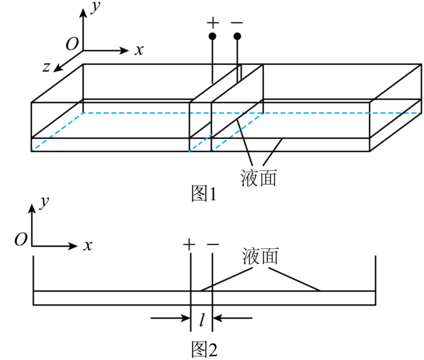

# Physics - 题目 2608

**ID**: f02e3f4329ad463b8702bf4b974ba7c5
**年级**: Grade 12
**难度**: Medium-Hard
**题型**: 计算题（本大题共3小题，共48分）

## 题目
直流电磁泵是利用安培力推动导电液体运动的一种设备，可用图1所示的模型讨论其原理，图2为图1的正视图。​​​​​​​‌将两块相同的矩形导电平板竖直正对固定在长方体绝缘容器中，平板与容器等宽，两板间距为 $l$ ，容器中装有导电液体，平板底端与容器底部留有高度可忽略的空隙，导电液体仅能从空隙进入两板间。初始时两板间接有直流电源，电源极性如图所示。若想实现两板间液面上升，可在两板间加垂直于 $Oxy$ 面的匀强磁场，磁感应强度的大小为 $B$ ，两板间液面上升时两板外的液面高度变化可忽略不计。已知导电液体的密度为 $ρ{{}_{0}}$ 、电阻率为 $ρ$ ，重力加速度为 $g$ 。（1）试判断所加磁场的方向；（2）求两板间液面稳定在初始液面高度2倍时的电压 $U{{}_{0}}$ ；（3）假定平板与容器足够高，求电压 $U$ 满足什么条件时两板间液面能够持续上升。

## 解答

1. （1）根据电源极性可知电流方向为沿 $x$ 轴正方向，
2. 需要所受安培力沿 $y$ 轴正方向，
3. 根据左手定则可判断出磁场方向为沿 $z$ 轴负方向；
4. （2）设平板宽度为 $b$ ，两板间液面的初始高度为 $h$ ，
5. 由题意，当液面高度为 $2h$ 时，两板间液体的电阻 $R=$  $ρ\frac {l}{2hb}$ ，
6. 当两极板所加电压为 $U{{}_{0}}$ 时，设此时流过导电液体的电流为 $I$ ，
7. 由欧姆定律得 $I=\frac {U{{}_{0}}}{R}$ ，
8. 设此时液体所受的安培力大小为F，有 $F=IlB$ ，
9. 设此时两板间高出板外液面的液体质量为 $m$ ，有 $m=$  $ρ{{}_{0}}V=ρ{{}_{0}}b(2h-h)l$ ，
10. 此时安培力与重力平衡，有 $F=mg$ ，
11. 联立解得 $U{{}_{0}}=\frac {ρ{{}_{0}}ρgl}{2B}$ 。
12. （3）两板间液面持续上升前，设两板间液面的总高度为 $h^{′}$ ，
13. 由（2）的分析，同理可得 $\frac {U}{ρ\frac {l}{h^{′}b}}lB=ρ{{}_{0}}b\left ({h^{′}-h}\right )\lg $ ，
14. 整理得 $h^{′}{\left ({ρ{{}_{0}}g-\frac {BU}{ρl}}\right )}=ρ{{}_{0}}gh$ ，
15. 若想实现两板间液面持续上升，应满足 $ρ{{}_{0}}g-\frac {BU}{ρl}\mathrm{⩽}0$ ，
16. 即 $U\mathrm{⩾}\frac {ρ{{}_{0}}ρgl}{B}$ 。

## 知识点

**中文**:
  - 安培力作用下的平衡问题
  - 安培力作用下的运动问题

**English**:
  - Equilibrium under Ampere Force
  - Motion under Ampere Force

---
