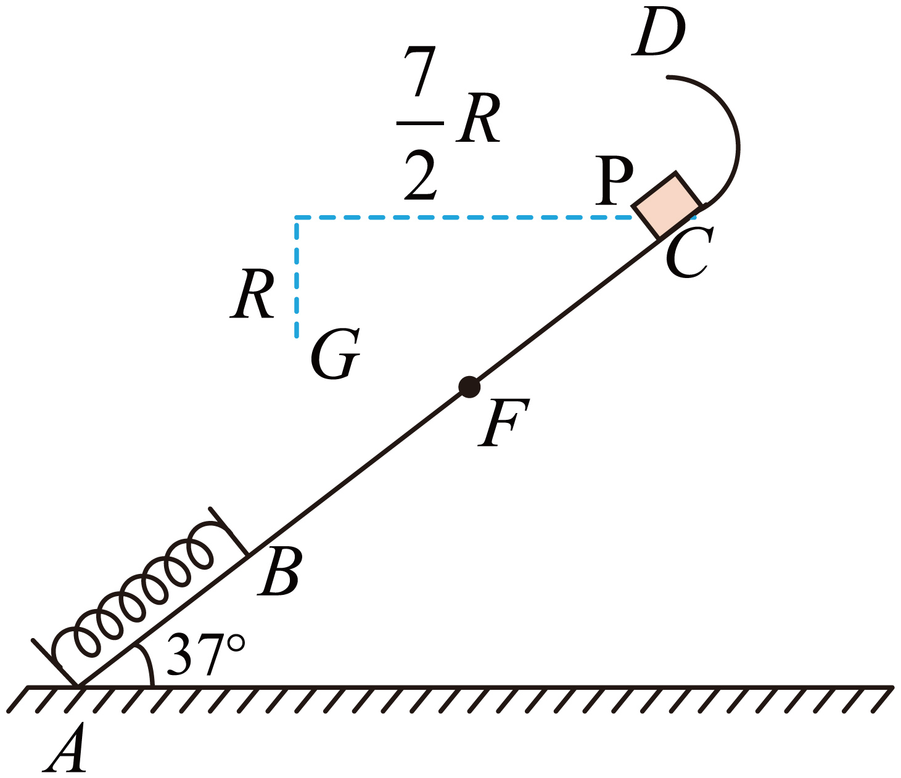

# Physics - 题目 2716

**ID**: f10d4b0d6d10448fba8f5e62c825ec8d
**年级**: Grade 12
**难度**: Medium-Hard
**题型**: Calculation

## 题目
如图，一轻弹簧原长为2R，其一端固定在倾角为37°的固定直轨道AC的底端A处，另一端位于直轨道上B处，弹簧处于自然状态，直轨道与一半径为 $\frac {5}{6}R$ 的光滑圆弧轨道相切于C点，AC=7R，A、B、C、D均在同一竖直面内。​​​​​​​‌质量为m的小物块P自C点由静止开始下滑，最低到达E点（未画出），随后P沿轨道被弹回，最高点到达F点，AF=4R，已知P与直轨道间的动摩擦因数 $μ=\frac {1}{4}$ ，重力加速度大小为g。（取 ${\rm{s}}{\rm{i}}{\rm{n}}37{^{\circ }}=\frac {3}{5}$ ， ${\rm{c}}{\rm{o}}{\rm{s}}37{^{\circ }}=\frac {4}{5}$ ）（1）求P第一次运动到B点时速度的大小；（2）求P运动到E点时弹簧的弹性势能；（3）改变物块P的质量，将P推至E点，从静止开始释放。已知P自圆弧轨道的最高点D处水平飞出后，恰好通过G点。G点在C点左下方，与C点水平相距 $\frac {7}{2}R$ 、竖直相距R，求P运动到D点时速度的大小和改变后P的质量。

## 解答

1. （1）根据题意知，B、C之间的距离l为l=7R–2R
2. 设P到达B点时的速度为vB，由动能定理得 $mgl\sin θ-{\rm μm}gl{\cos}θ=\frac {1}{2}mv{{}_{B}^{2}}$
3. 式中θ=37°，联立以上两式并由题给条件得 $v{{}_{B}}=2\sqrt {gR}$
4. （2）设BE=x，P到达E点时速度是零，设此时弹簧的弹性势能为E_{P}，由B点运动到E点的过程中，由动能定理有
5. $mgx\sin θ-{\rm μm}gx{\cos}θ-E{{}_{{\rm{p}}}}=0-\frac {1}{2}mv{{}_{B}^{2}}$E、F之间的距离l_{1}为l_{1}=4R–2R+x
6. P到达E点后反弹，从E点运动到F点的过程中，由动能定理有 $E{{}_{{\rm{p}}}}-mgl{{}_{1}}\sin θ-{\rm μm}gl{{}_{1}}{\cos}θ=0$
7. 联立以上三式并由题给条件得 ${\rm \mathit{x}=\mathit{R}，}E{{}_{{\rm{p}}}}=\frac {12}{5}mgR$
8. （3）设改变后P的质量为m_{1}。D点与G点的水平距离x_{1}和竖直距离y_{1}分别为 $x{{}_{1}}=\frac {7}{2}R-\frac {5}{6}R\sin θ$ ， $y{{}_{1}}=R+\frac {5}{6}R+\frac {5}{6}R{\cos}θ$
9. 式中，已应用了过C点的圆轨道半径与竖直方向夹角仍为θ的事实。设P在D点的速度为vD，由D点运动到G点的时间为t。由平抛运动公式有 $y{{}_{1}}=\frac {1}{2}gt{^{2}}{\rm ，\mathit{x}_{1}=\mathit{vDt}}$
10. 联立解得 $v{{}_{D}}=\frac {3}{5}\sqrt {5gR}$
11. 设P在C点速度的大小为vC。在P由C运动到D的过程中机械能守恒，有 $\frac {1}{2}m{{}_{1}}v{{}_{C}^{2}}=\frac {1}{2}m{{}_{1}}v{{}_{D}^{2}}+m{{}_{1}}g\left ({\frac {5}{6}R+\frac {5}{6}R{\cos}θ}\right )$
12. P由E点运动到C点的过程中，同理，由动能定理有 $E{{}_{{\rm{p}}}}-m{{}_{1}}g\left ({x+5R}\right )\sin θ-{\rm μm}{{}_{1}}g\left ({x+5R}\right ){\cos}θ=\frac {1}{2}m{{}_{1}}v{{}_{C}^{2}}$
13. 联立解得 $m{{}_{1}}=\frac {1}{3}m$
14. 考点：动能定理、平抛运动、弹性势能。

## 知识点

**中文**:
  - 功能关系与能量守恒定律的综合应用

**English**:
  - Comprehensive Applications of Work-Energy Relation and Energy Conservation

---
