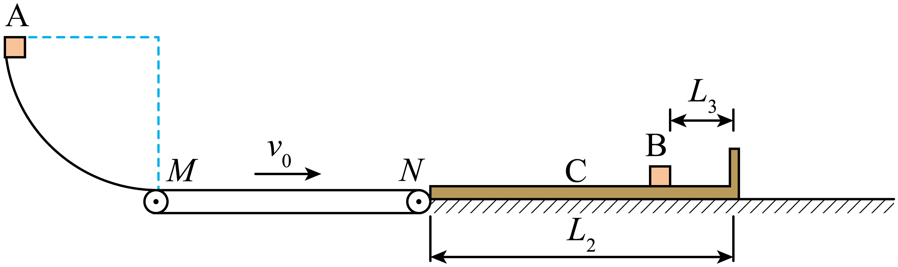

# Physics - 题目 400

**ID**: f1f16d644c3b4cd181f5b87c9c41c841
**年级**: Grade 12
**难度**: Medium-Hard
**题型**: Calculation

## 题目
如图所示， $MN$ 是一长为 $L{{}_{1}}=2.0{\rm{m}}$ 的水平传送带，以 $v{{}_{0}}=4{\rm{m}}/{\rm{s}}$ 顺时针匀速转动，传送带左端 $M$ 与半径 $r=1.25{\rm{m}}$ 的 $\frac {1}{4}$ 光滑圆轨道相切，右端 $N$ 与放在光滑水平桌面上的长木板 ${\rm{C}}$ 上表面平齐。​​​​​​​‌木板长为 $L{{}_{2}}=2.5{\rm{m}}$ ， ${\rm{C}}$ 的右端带有挡板，在 ${\rm{C}}$ 上放有小物块 ${\rm{B}}$ ，开始时 ${\rm{B}}$ 和 ${\rm{C}}$ 静止， ${\rm{B}}$ 到挡板的距离为 $L{{}_{3}}=\frac {7}{8}{\rm{m}}$ 。现将小物块 ${\rm{A}}$ 从圆弧轨道最高点由静止释放，小物块 ${\rm{A}}$ 与传送带间的动摩擦因数 $μ{{}_{1}}=0.25$ ， ${\rm{A}}$ 、 ${\rm{C}}$ 之间及 ${\rm{B}}$ 、 ${\rm{C}}$ 之间的动摩擦因数均为 $μ{{}_{2}}=0.2$ ，最大静摩擦力等于滑动摩擦力。A、B、C的质量均为 $m=1{\rm{k}}{\rm{g}}$ ，重力加速度为 $g=10{\rm{m}}/{\rm{s}}{^{2}}$ ，所有的碰撞均为弹性正碰。求：(1)A通过传送带过程产生的内能；(2)A滑上C后与B碰撞前，B与C间的摩擦力大小；(3)A滑上C后，经多长时间B与挡板碰撞；

## 解答

1. （1）小物块 ${\rm{A}}$ 由静止运动到圆轨道最低点，由动能定理得 $mgr=\frac {1}{2}mv{{}_{M}^{2}}$ ，
2. 解得 $v{{}_{M}}=5{\rm{m}}/{\rm{s}}$ ，
3. 设经时间 $t{{}_{1}}$ 小物块 ${\rm{A}}$ 与传送带共速，由动量定理得 $-μ{{}_{1}}mgt{{}_{1}}=mv{{}_{0}}-mv{{}_{M}}$ ，
4. 解得 $t{{}_{1}}=0.4{\rm{s}}$ ，
5. 在时间 $t{{}_{1}}$ 内 ${\rm{A}}$ 、传送带发生的位移分别为 $x{{}_{1}}=\frac {v{{}_{M}}+v{{}_{0}}}{2}\cdot t{{}_{1}}=1.8{\rm{m}}<L$ ， $x{{}_{2}}=v{{}_{0}}t{{}_{1}}=1.6{\rm{m}}$ ，
6. 小物块 ${\rm{A}}$ 通过传送带过程产生的内能为 $Q=μ{{}_{1}}mg\left ({x{{}_{1}}-x{{}_{2}}}\right )=0.5\,{\rm{J}}$ 。
7. （2）对物块 ${\rm{B}}$ 和长木板 ${\rm{C}}$ 整体有 $μ{{}_{2}}mg=2ma$ ，
8. 物块 ${\rm{B}}$ 和长木板 ${\rm{C}}$ 整体加速度为 $a=\frac {1}{2}μ{{}_{2}}g$ ，
9. 对物块 ${\rm{B}}$ ，由牛顿第二定律 $f=ma=1{\rm{N}}$ 。
10. （3）设 ${\rm{A}}$ 滑上 ${\rm{C}}$ 后经时间 $t{{}_{2}}$ 物块 ${\rm{A}}$ 与 ${\rm{B}}$ 碰撞，则 $v{{}_{0}}t{{}_{2}}-\frac {1}{2}μ{{}_{2}}gt{{}_{2}^{2}}-\frac {1}{2}\times \left ({\frac {1}{2}μ{{}_{2}}g}\right )t{{}_{2}^{2}}=L{{}_{2}}-L{{}_{3}}$ ，
11. 解得 $t{{}_{2}}=0.5{\rm{s}}$ ，
12. A、B碰撞前速度分别为 $v{{}_{1}}$ 、 $v{{}_{2}}$ ，碰后速度分别为 $v{{}_{3}}$ 、 $v{{}_{4}}$ ，则 $v{{}_{1}}=v{{}_{0}}-μ{{}_{2}}gt{{}_{2}}=3{\rm{m}}/{\rm{s}}$ ， $v{{}_{2}}=\frac {1}{2}μ{{}_{2}}gt{{}_{2}}=0.5{\rm{m}}/{\rm{s}}$ ，
13. A、B碰撞过程，由动量守恒和能量守恒，得 $mv{{}_{1}}+mv{{}_{2}}=mv{{}_{3}}+mv{{}_{4}}$ ， $\frac {1}{2}mv{{}_{1}^{2}}+\frac {1}{2}mv{{}_{2}^{2}}=\frac {1}{2}mv{{}_{3}^{2}}+\frac {1}{2}mv{{}_{4}^{2}}$ ，
14. 解得 $v{{}_{3}}=0.5{\rm{m}}/{\rm{s}}$ ， $v{{}_{4}}=3{\rm{m}}/{\rm{s}}$ ，
15. 设 ${\rm{A}}$ 、 ${\rm{B}}$ 碰后经时间 $t{{}_{3}}$ 物块 ${\rm{B}}$ 与挡板相碰，则有 $v{{}_{4}}t{{}_{3}}-\frac {1}{2}μ{{}_{2}}gt{{}_{3}^{2}}-\left ({v{{}_{3}}t{{}_{3}}+\frac {1}{2}\times \frac {1}{2}μ{{}_{2}}gt{{}_{3}^{2}}}\right )=L{{}_{3}}$ ，
16. 解得 $t{{}_{3}}=0.5{\rm{s}}$ ，
17. A滑上C后， ${\rm{B}}$ 与挡板碰撞的时间 $t=t{{}_{2}}+t{{}_{3}}=1.0{\rm{s}}$ 。

## 知识点

**中文**:
  - 求解弹性碰撞问题

**English**:
  - Solving Elastic Collision Problems

---
