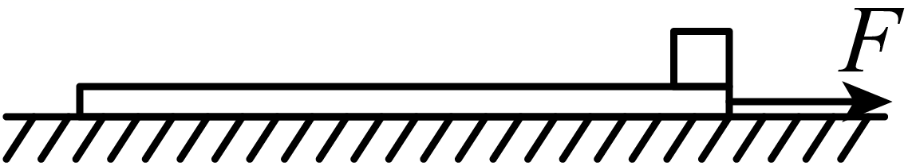

# Physics - 题目 2037

**ID**: f280e01a519f45e1a5d2819f407eba71
**年级**: Grade 12
**难度**: Medium-Hard
**题型**: Calculation

## 题目
如图，在光滑水平面上放着质量M=4.​​​​​​​‌5kg、长度L=4m的薄木板.一质量m=lkg的小物体放在木板的最右端，小物体和木板之间的动摩擦因素μ=0.1，开始时木板和小物体均静止.今对木板施加一水平向右的恒定拉力F，g取10m/s².(1)若要使小物体不从木板上掉下来，求F的最大值.(2)若F=10N，当小物体滑动到木板中点时撤去F，求拉力对木板的冲量大小及撤去F后木板和小物体间因摩擦产生的热量.

## 解答

1. (1)设小物体随木板运动的最大加速度为a，对小物体，有
2. μmg=ma
3. 对整体，有
4. F_{max}=(M+m)a
5. 解得：
6. F_{max}=5.5N
7. (2)因施加的拉力F>5.5N.故小物体相对木板运动.设木板的加速度为a_{1}，由牛顿定律；
8. F-μmg=Ma_{1}
9. 力F作用的时间t，满足
10. $\frac {L}{2}=\frac {1}{2}a{{}_{1}}t{^{2}}-\frac {1}{2}at{^{2}}$
11. 解得：
12. t=2s
13. 故F的冲量大小I=Ft，代入数据解得
14. I=20N·s
15. 没撤去F时，木板和小物体的速度大小v_{1}和v_{2}的分别为
16. v_{1}=a_{1}t，v_{2}=at
17. 得
18. v_{1}=4m/s；v_{2}=2m/s
19. 撤去F后，若两者能够达到共同速度v，由动量守恒定律得：
20. Mv_{1}+mv_{2}=(M+m)v
21. 得
22. v≈3.64 m/s
23. 木板的加速度大小：
24. $a^{′}=\frac {{\rm μm}g}{M}=\frac {2}{9}{\rm{m}}{\rm{/}}{\rm{s}}{^{{\rm{2}}}}$
25. 此时木板的位移
26. $x{{}_{1}}=\frac {v{^{2}}-v{{}_{1}^{2}}}{-2a^{′}}=6.{\rm{1}}{\rm{9}}{\rm{m}}$
27. 小物体的位移
28. $x{{}_{2}}=\frac {v{^{2}}-v{{}_{2}^{2}}}{2a}=4.6{\rm{2}}{\rm{m}}$
29. 相对位移 $x{{}_{1}}-x{{}_{2}}<\frac {L}{2}$  ，小物体没有从木板上掉下来，由能量守恒定律，有：
30. $\frac {1}{2}Mv{{}_{1}^{2}}+\frac {1}{2}mv{{}_{2}^{2}}=\frac {1}{2}\left ({M+m}\right )v{^{2}}+Q$
31. 得
32. Q=1.56J

## 知识点

**中文**:
  - 动量与牛顿定律的综合考查
  - 动量守恒与板块模型相结合
  - 动量和能量的综合应用

**English**:
  - Integration of Momentum and Newton's Laws
  - Momentum Conservation with Plate Models
  - Integration of Momentum and Energy

---
