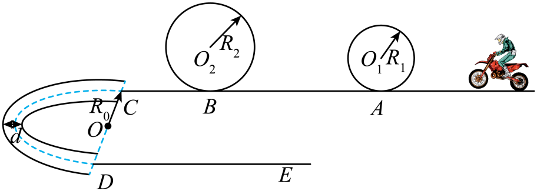

# Physics - 题目 2873

**ID**: f32870c5f2444fa2a17a167cb13cd58a
**年级**: Grade 12
**难度**: Medium-Hard
**题型**: Calculation

## 题目
如图为某种赛车轨道简化示意图，其中AB、BC、DE段为直轨道，CD为半圆形水平弯道，圆心O到弯道中心线半径 $R{{}_{0}}=10{\rm{\;}}{\rm{m}}$ ，两竖直圆轨道半径 $R{{}_{1}}=5{\rm{m}}$ ， $R{{}_{2}}=10{\rm{m}}$ 。​​​​​​​‌AB长度 $L{{}_{AB}}=100{\rm{m}}$ ，若该赛车的质量 $m=100{\rm{k}}{\rm{g}}$ （（包括人），额定功率 $P{{}_{0}}=5.0\times 10{^{3}}{\rm{W}}$ ，赛车在水平直轨道动摩擦因数 $μ=0.1$  $，$ 在半圆形水平弯道所受的最大径向静摩擦力是车重的1.25倍，不计竖直圆轨道的阻力，某次比赛中，赛车恰好过竖直圆轨道 $O{{}_{1}}$ 、 $O{{}_{2}}$ 最高点。已知 $\sin 37{^{\circ }}=0.6$ ， ${\cos}37{^{\circ }}=0.8$ ， $g=10{\rm{m}}/{\rm{s}}{^{2}}$ 。（1）求赛车在竖直圆轨道 $O{{}_{2}}$ 最高点的速度的大小及赛车在B点受到轨道的支持力大小；（2）若赛车在AB段发动机的功率为额定功率，求发动机在额定功率下的工作时间；（3）若某赛车从弯道的C点进入，从同一直径上的D点驶离，有经验的赛车手会利用路面宽度，用最短时间匀速率安全通过弯道。设路宽 $d=10{\rm{m}}$ ，求此最短时间（C、D两点都在轨道的中心线上，计算时赛车视为质点）。

## 解答

1. （1）赛车恰能过竖直圆轨道 $O{{}_{2}}$ 最高点，有 $mg=m\frac {v{{}_{2}^{2}}}{R{{}_{2}}}$ ，解得赛车在竖直圆轨道 $O{{}_{2}}$ 最高点的速度的大小为 $v{{}_{2}}=10{\rm{\;}}{\rm{m}}{\rm{/}}{\rm{s}}$ ，赛车从竖直圆轨道 $O{{}_{2}}$ 最高点运动至B点，根据动能定理有 $\frac {1}{2}mv{{}_{B}^{2}}-\frac {1}{2}mv{{}_{2}^{2}}=2mgR{{}_{2}}$ ，根据牛顿第二定律有 $F{{}_{{\rm{N}}}}-mg=m\frac {v{{}_{B}^{2}}}{R{{}_{2}}}$ ，解得赛车在B点受到轨道的支持力大小为 $F{{}_{{\rm{N}}}}=6000{\rm{N}}$ ；
2. （2）赛车恰能过竖直圆轨道 $O{{}_{1}}$ 最高点，有 $mg=m\frac {v{{}_{1}^{2}}}{R{{}_{1}}}$ ，赛车从竖直圆轨道 $O{{}_{1}}$ 最高点运动至A点，根据动能定理有 $\frac {1}{2}mv{{}_{A}^{2}}-\frac {1}{2}mv{{}_{1}^{2}}=2mgR{{}_{1}}$ ，赛车从A点运动至B点，根据动能定理有 $Pt-{\rm μm}gL{{}_{AB}}=\frac {1}{2}mv{{}_{B}^{2}}-\frac {1}{2}mv{{}_{A}^{2}}$ ，解得发动机在额定功率下的工作时间 $t=4.5{\rm{s}}$ ；
3. （3）根据摩擦力提供向心力 $f{{}_{{\rm{m}}}}=1.25mg=m\frac {v{^{2}}}{r}$ ，可得 $v=\sqrt {1.25gr}$ ，可知用最短时间匀速率安全通过弯道时，赛车的运动半径最大。赛车的运动半径最大时如图所示。
4. 
5. 根据几何关系有 $r^{′}{{^{2}}}=r{{}_{1}^{2}}+[r^{′}-(r{{}_{1}}-\frac {d}{2})]{^{2}}$ ，其中 $r{{}_{1}}=R{{}_{0}}=10{\rm{m}}$ ，联立解得 $r^{′}=12.5{\rm{m}}$ ，赛车的运动速度为 $v^{′}=\sqrt {1.25gr^{′}}=12.5{\rm{m}}{\rm{/}}{\rm{s}}$ ，设运动轨迹的圆心角为 $2θ$ ，根据几何关系有 $\sin θ=\frac {r{{}_{1}}}{r^{′}}=\frac {4}{5}$ ，解得 $θ=53\mathrm{°}$ ，最短时间为 $t=\frac {s}{v^{′}}=\frac {\frac {2\times 53\mathrm{°}}{360\mathrm{°}}\times 2{\rm{π}}r^{′}}{v^{′}}{\rm{s}}=\frac {53{\rm{π}}}{90}{\rm{s}}$ 。

## 知识点

**中文**:
  - 应用动能定理求解变力做功问题
  - 水平路面上车辆转弯问题
  - 竖直面内圆周运动问题

**English**:
  - Solving Work Done by Variable Force
  - Vehicle Turning on Level Roads
  - Circular Motion in Vertical Plane

---
