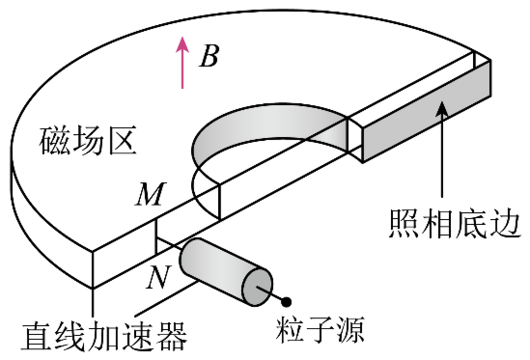

# Physics - 题目 208

**ID**: f3853a0274e54ebd85fd0631af63d3fa
**年级**: Grade 12
**难度**: Medium-Hard
**题型**: Calculation

## 题目
一种质谱仪的结构可简化为如图所示，粒子源释放出初速度可忽略不计的 ${{}_{1}^{1}}{\rm{H}}$ 和 ${{}_{1}^{2}}{\rm{H}}$ ，粒子经直线加速器加速后由通道入口的中缝MN进入磁场区。​​​​​​​‌该通道的上下表面是内半径为R、外半径为3R的半圆环。该通道置于竖直向上的匀强磁场中，正对着通道出口处放置一块照相底片，能记录粒子从出口射出时的位置。当直线加速器的加速电压为 ${\rm \mathit{U}_{0}，}{{}_{1}^{1}}{\rm{H}}$ 沿左侧通道中心线MN射入磁场区，且恰好能击中照相底片的正中间位置，已知 ${{}_{1}^{1}}{\rm{H}}$ 比荷为 $\frac {q}{m}$ ，则（1）匀强磁场的磁感应强度B；（2）照相底片上 ${{}_{1}^{1}}{\rm{H}}$ 和 ${{}_{1}^{2}}{\rm{H}}$ 所击中位置间的距离；（3）考虑加速电压有波动，在（U_{0}-ΔU）到（U_{0}+ΔU）之间变化，若要 ${{}_{1}^{1}}{\rm{H}}$ 和 ${{}_{1}^{2}}{\rm{H}}$ 在底片上没有重叠区域，求ΔU满足的条件。

## 解答

1. （1）由题意可知当质子恰好能击中照相底片的正中间位置时，其运动半径为r=R+R=2R
2. 设质子经过加速后获得的速度大小为v，根据动能定理有 $qU{{}_{0}}=\frac {1}{2}mv{^{2}}$
3. 根据牛顿第二定律有 $qvB=m\frac {v{^{2}}}{r}$
4. 联立解得 $B=\frac {1}{2R}\sqrt {\frac {2mU{{}_{0}}}{q}}$
5. （2）由于 ${{}_{1}^{2}}{\rm{H}}$ 粒子的质量数是 ${{}_{1}^{1}}{\rm{H}}$ 粒子的两倍，则 ${{}_{1}^{2}}{\rm{H}}$ 粒子的比荷为 $\frac {q}{2m}$ ，设 ${{}_{1}^{1}}{\rm{H}}$ 粒子和 ${{}_{1}^{2}}{\rm{H}}$ 粒子经过加速后获得的速度大小分别为v_{1}、v_{2}，根据动能定理有 $qU{{}_{0}}=\frac {1}{2}mv{{}_{1}^{2}}$ ， $qU{{}_{0}}=\frac {1}{2}\times 2mv{{}_{2}^{2}}$
6. 根据牛顿第二定律有 $qv{{}_{1}}B=m\frac {v{{}_{1}^{2}}}{r{{}_{1}}}$ ， $qv{{}_{2}}B=2m\frac {v{{}_{2}^{2}}}{r{{}_{2}}}$
7. 联立解得 ${\rm \mathit{r}_{1}\mathit{=}2\mathit{R}，}r{{}_{2}}=2\sqrt {2}R$
8. 则照相底片上 ${{}_{1}^{1}}{\rm{H}}$ 和 ${{}_{1}^{2}}{\rm{H}}$ 所击中位置间的距离 ${\rm{Δ}}x=2r{{}_{2}}-2r{{}_{1}}=4(\sqrt {2}-1)R$
9. （3）由（2）问可知在相同的电压下 ${{}_{1}^{2}}{\rm{H}}$ 粒子的偏转半径大于 ${{}_{1}^{1}}{\rm{H}}$ 粒子的偏转半径，若要 ${{}_{1}^{1}}{\rm{H}}$ 和 ${{}_{1}^{2}}{\rm{H}}$ 在底片上没有重叠区域，则只需 ${{}_{1}^{2}}{\rm{H}}$ 粒子的最小偏转距离大于 ${{}_{1}^{1}}{\rm{H}}$ 粒子的最大偏转距离即可，则对于 ${{}_{1}^{2}}{\rm{H}}$ 粒子有 $q(U{{}_{0}}-ΔU)=\frac {1}{2}2mv{{}_{2{\rm \min }}^{2}}$ ， $qv{{}_{2{\rm \min }}}B=2m\frac {v{{}_{2{\rm \min }}^{2}}}{r{{}_{2{\rm \min }}}}$
10. 整理有 $r{{}_{2{\rm \min }}}=2\sqrt {2}R\sqrt {\frac {U{{}_{0}}-ΔU}{U{{}_{0}}}}$
11. 对于 ${{}_{1}^{1}}{\rm{H}}$ 粒子有 $q(U{{}_{0}}+ΔU)=\frac {1}{2}mv{{}_{1{\rm \max }}^{2}}$ ， $qv{{}_{1{\rm \max }}}B=m\frac {v{{}_{1{\rm \max }}^{2}}}{r{{}_{1{\rm \max }}}}$
12. 整理有 $r{{}_{1{\rm \max }}}=2R\sqrt {\frac {U{{}_{0}}+ΔU}{U{{}_{0}}}}$
13. 则需要2r_{1max}<2r_{2min}
14. 整理有 $ΔU<\frac {U{{}_{0}}}{3}$

## 知识点

**中文**:
  - 质谱仪

**English**:
  - Mass Spectrometer

---
