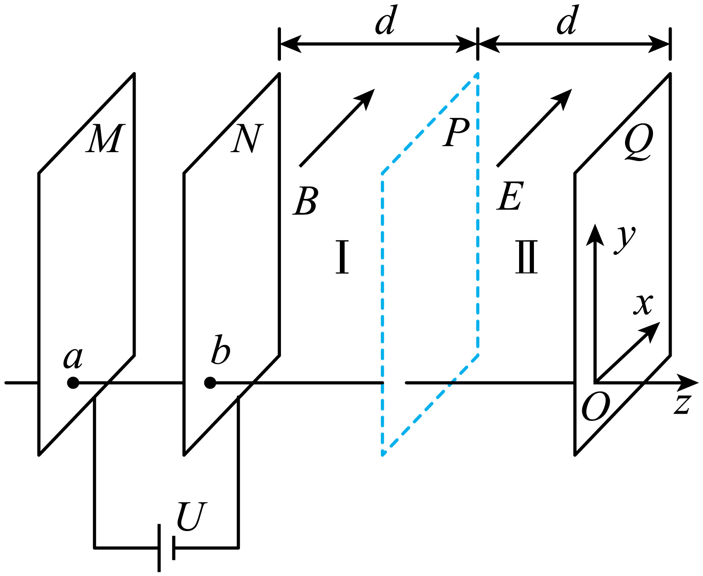

# Physics - 题目 942

**ID**: f38c74c202994dd8b41d429e5a81b821
**年级**: Grade 12
**难度**: Medium-Hard
**题型**: Calculation

## 题目
某型号质谱仪的工作原理如图所示。​​​​​​​‌M、N为竖直放置的两块金属板，两板间电压为U，Q板为记录板，分界面P将N、Q间区域分为宽度均为d（其中d= $\frac {\sqrt {mqU}}{Bq}$ ）的I、Ⅱ两部分，M、N、P、Q所在平面相互平行，a、b为M、N上两正对的小孔。以a、b所在直线为z轴，向右为正方向，取z轴与Q板的交点O为坐标原点，以平行于Q板水平向里为x轴正方向，竖直向上为y轴正方向，建立空间直角坐标系Oxyz。区域I、Ⅱ内分别充满沿x轴正方向的匀强磁场和匀强电场，磁感应强度大小、电场强度大小分别为B和E。一质量为m，电荷量为+q的粒子，从a孔飘入电场（初速度视为零），经b孔进入磁场，过P面上的c点（图中未画出）进入电场，最终打到记录板Q上。不计粒子重力。（1）求粒子在磁场中做圆周运动的半径R；（2）求粒子打到记录板上位置的x坐标（用m、q、B、E表示）；（3）求粒子打到记录板上位置的y坐标（用m、q、B、U表示）；

## 解答

1. （1）设粒子经加速电场到b孔的速度大小为v，粒子在区域I中，做匀速圆周运动对应圆心角为α，在M、N两金属板间，由动能定理得
2. $qU=\frac {1}{2}mv{^{2}}$
3. 在区域I中，粒子做匀速圆周运动，磁场力提供向心力，由牛顿第二定律得
4. $qvB=m\frac {v{^{2}}}{R}$
5. 联立，解得
6. $R=\frac {\sqrt {2mqU}}{qB}$
7. （2）由几何关系得
8. $d{^{2}}+（R-L）{^{2}}=R{^{2}}$ ， ${\cos}α=\frac {\sqrt {R{^{2}}-d{^{2}}}}{R}$ ， ${\sin}α{\rm{=}}\frac {d}{R}$
9. 设区域Ⅱ中粒子沿z轴方向的分速度为vz，沿x轴正方向加速度大小为a，位移大小为x，运动时间为t，由牛顿第二定律得
10. qE=ma
11. 粒子在z轴方向做匀速直线运动，由运动合成与分解的规律得
12. $v{{}_{z}}=v{\cos}α$ ， $d=v{{}_{z}}t$
13. 粒子在x方向做初速度为零的匀加速直线运动，由运动学公式得
14. $x=\frac {1}{2}at{^{2}}$
15. 联立，解得
16. $x=\frac {md{^{2}}E}{4mU-2qd{^{2}}B{^{2}}}$ = $\frac {mE}{2B{^{2}}q}$
17. （3）设粒子沿y方向偏离z轴的距离为y，其中在区域Ⅱ中沿y方向偏离的距离为y'，由运动学公式得
18. y'=vtsinα
19. 又
20. y=L+y'
21. 联立，可得
22. $y=R-\sqrt {R{^{2}}-d{^{2}}}+\frac {d{^{2}}}{\sqrt {R{^{2}}-d{^{2}}}}=\frac {\sqrt {2mqU}}{qB}$

## 知识点

**中文**:
  - 质谱仪

**English**:
  - Mass Spectrometer

---
