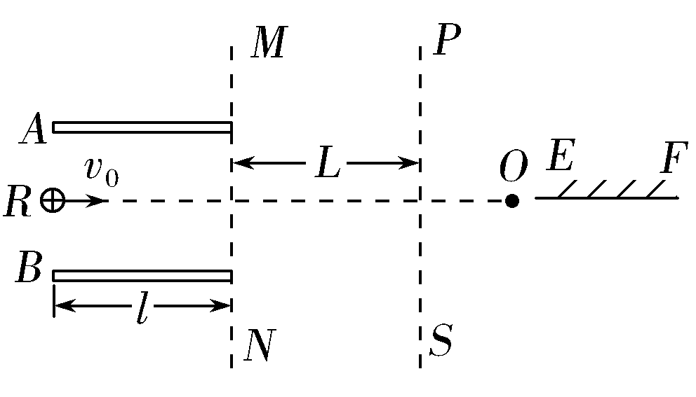

# Physics - 题目 745

**ID**: f59f42ac5e5a481b8f1b2a6199fd62ea
**年级**: Grade 12
**难度**: Medium-Hard
**题型**: Calculation

## 题目
如图所示，两平行金属板A、B长l＝8 cm，两板间距离d＝8 cm，A板比B板电势高300 V，即U_{AB}＝300 V．一带正电的粒子电量为q＝10^{－}^{10}C，质量为m＝10^{－}^{20}kg，从R点沿电场中心线垂直电场线飞入电场，初速度v_{0}＝2×10^{6}m/s，粒子飞出平行板电场后经过界面MN、PS间的无电场区域后，进入固定在中心线上O点的点电荷Q形成的电场区域(设界面PS右边点电荷的电场分布不受界面的影响)．已知两界面MN、PS相距为L＝12 cm，粒子穿过界面PS后被点电荷Q施加的电场力俘获，从而以O点为圆心做匀速圆周运动，最后垂直打在放置于中心线上的荧光屏EF上(静电力常量k＝9×10^{9}N·m^{2}/C^{2}，粒子重力不计，tan 37°＝ $\frac {3}{4}$ ，tan 53°＝ $\frac {4}{3}$ )．求：(1)粒子穿过界面MN时偏离中心线RO的距离h；​​​​​​​‌(2)粒子穿过界面MN时的速度v；(3)粒子穿过界面PS时偏离中心线RO的距离Y；

## 解答

1. (1)设粒子在两极板间运动时加速度为a，运动时间为t，
2. 则：t＝ $\frac {l}{v{{}_{0}}}$  ①
3. h＝ $\frac {1}{2}$at^{2 }②
4. $a=\frac {qE}{m}=\frac {qU{{}_{AB}}}{md}$③
5. 解得：h＝ $\frac {qU{{}_{AB}}}{2md}{\rm{(}}\frac {l}{v{{}_{0}}}{\rm{)}}{^{{\rm{2}}}}$ ＝0.03 m＝3 cm  ④
6. (2)粒子的运动轨迹如图所示
7. 
8. 设粒子从电场中飞出时沿电场方向的速度为v_{y}，则：
9. v_{y}＝at＝ $\frac {qU{{}_{AB}}l}{mdv{{}_{0}}}$ ⑤
10. 解得：v_{y}＝1.5×10^{6}m/s  ⑥
11. 所以粒子从电场中飞出时的速度为：
12. v＝ $\sqrt {v{{}_{0}^{2}}+v{{}_{y}^{2}}}$ ＝2.5×10^{6}m/s   ⑦
13. 设粒子从电场中飞出时的速度方向与水平方向的夹角为θ，则：
14. tanθ＝ $\frac {v{{}_{y}}}{v{{}_{0}}}=\frac {3}{4}$   ⑧
15. 解得：θ＝37°  ⑨
16. (3)带电粒子在离开电场后将做匀速直线运动，由相似三角形知识得：
17. $\frac {h}{Y}=\frac {\frac {l}{2}}{\frac {l}{2}+L}$⑩
18. 解得：Y＝0.12 m＝12 cm   ⑪
19. (4)粒子做匀速圆周运动的半径为：
20. r＝ $\frac {Y}{\cos θ}$ ＝0.15 m   ⑫
21. 又： $\frac {k\left |{Q}\right |q}{r{^{2}}}=m\frac {v{^{2}}}{r}$⑬
22. 解得：|Q|＝1×10^{－}^{8}C   ⑭
23. 故：Q＝－1×10^{－}^{8}C   ⑮
24. 【点睛】
25. 本题考查了求粒子的偏移量、粒子的速度、电荷的电荷量，分析清楚粒子运动过程，应用类平抛运动规律、牛顿第二定律即可正确解题.

## 知识点

**中文**:
  - 带电粒子（物体）在重力场和电场组成的复合场中的运动

**English**:
  - Motion in Gravity and Electric Composite Fields

---
