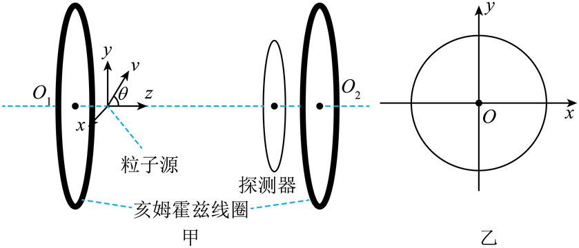

# Physics - 题目 1592

**ID**: f68b882be1ac42b9b2ada2bbaf48651f
**年级**: Grade 12
**难度**: Medium-Hard
**题型**: Calculation

## 题目
如图甲所示为带电粒子三维动量映射分析技术的原理图。​​​​​​​‌系统整体设计采用圆柱对称型结构，对称轴为 $O{{}_{1}}O{{}_{2}}$ ，亥姆霍兹线圈用以形成沿系统轴向的均匀磁场区，可以抑制带电粒子的横向发散，使得系统具有较大的粒子收集效率。位置敏感探测器用以接收带电粒子，记录带电粒子的飞行时间t和粒子撞击探测器的位置 $(x，y)$ 。粒子源和探测器中心均位于对称轴上，建立空间坐标系 $O-xyz{\rm ，\mathit{z}}$ 轴与对称轴重合，y轴竖直向上，探测器的平面坐标系 $O-xy$ 从左向右看如图乙所示。已知粒子源发射质量为m，电荷量为q的带正电荷的粒子，粒子速度v方向与z轴的夹角为 $θ$ ，探测器半径为R，轴向匀强磁场的磁感应强度为B，方向水平向右。不计粒子重力和粒子间相互作用。（1）从左向右看，粒子运动方向是顺时针还是逆时针？（2）若粒子刚好打在探测器的中心O，求粒子源到探测器距离 $L{{}_{1}}$ 需要满足的条件；（3）若粒子发射时速度大小 $v{{}_{1}}=\frac {\sqrt {2}BqR}{m}$ ，速度方向位于zOy平面内，与z轴夹角 $θ{{}_{1}}=45\degree $ ，粒子打在探测器的位置坐标为 $\left ({-\frac {2-\sqrt {2}}{2}R，\frac {\sqrt {2}}{2}R}\right )$ ，求带电粒子的飞行时间 $t{{}_{1}}$ ；（4）若粒子源沿着与z轴夹角 $θ{{}_{2}}=37\degree $ 的各个方向连续发射粒子，粒子速度大小 $v{{}_{2}}=\frac {5BqR}{6m}$ ，粒子源到探测器的距离 $L{{}_{2}}=\frac {38}{9}πR$ ，求粒子打到探测器上的位置坐标所满足的方程。

## 解答

1. （1）从左向右看，根据左手定则可知粒子运动方向是逆时针。
2. （2）带电粒子的轨迹为螺旋曲线，要使粒子刚好打在探测器的中心，则所有时间为周期的整数倍，则有 $t=nT=\frac {2πmn}{Bq}\left ({n=1,2,3...}\right )$
3. 粒子源到探测器的距离为 $L{{}_{1}}=v{\cos}θt$
4. 解得 $L{{}_{1}}=\frac {2πmnv{\cos}θ}{Bq}\left ({n=1,2,3,...}\right )$
5. （3）设粒子做圆周运动的半径为 $r{{}_{1}}$ ，由洛伦兹力提供向心力可得 $qBv{{}_{1}}\sin θ{{}_{1}}=m\frac {{\left({v{{}_{1}}\sin θ{{}_{1}}}\right)^{2}}}{r{{}_{1}}}$
6. 整理并代入数据解得 $r{{}_{1}}=R$
7. 在探测器的位置坐标如图1所示
8. 
9. 根据几何关系可知 $α{{}_{1}}=45{^{\circ }}$
10. 则带电粒子的飞行时间为 $t{{}_{1}}=\left ({k+\frac {1}{8}}\right )T\left ({k=1,2,3...}\right )$
11. 代入周期公式有 $t{{}_{1}}=\left ({k+\frac {1}{8}}\right )\frac {2πm}{Bq}\left ({k=1,2,3...}\right )$
12. （4）设粒子做圆周运动的半径为 $r{{}_{2}}$ ，则有 $r{{}_{2}}=\frac {mv{{}_{2}}\sin θ{{}_{2}}}{Bq}$
13. 解得 $r{{}_{2}}=\frac {R}{2}$
14. 设粒子飞行的时间为 $t{{}_{2}}$ ，则有 $t{{}_{2}}=\frac {L{{}_{2}}}{v{{}_{2}}{\cos}θ{{}_{2}}}$
15. 解得 $t{{}_{2}}=\frac {19πm}{3Bq}=\left ({3+\frac {1}{6}}\right )T$
16. 在探测器的位置坐标如图2所示
17. 
18. 由几何关系可知 $α{{}_{2}}=60{^{\circ }}$
19. 因为粒子沿着与z轴夹角 $θ{{}_{2}}$ 的各个方向连续发射，由粒子在探测器上位置如图2虚线，则位置坐标方程为 $x{^{2}}+y{^{2}}=\frac {R{^{2}}}{4}$

## 知识点

**中文**:
  - 带电粒子在磁场中做圆周运动的多解问题

**English**:
  - Multi-solution Problems of Circular Motion in Magnetic Fields

---
