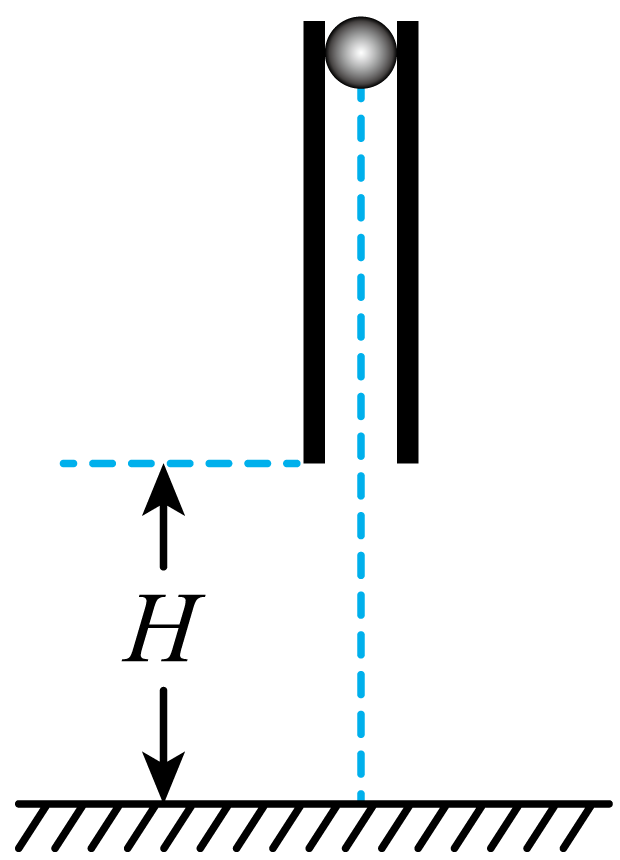

# Physics - 题目 672

**ID**: f799b5bf5f31430e91203e616b883736
**年级**: Grade 12
**难度**: Medium-Hard
**题型**: Calculation

## 题目
如图所示，一竖直圆管质量为M，下端距水平地面的高度为H，顶端塞有一质量为m的小球，圆管由静止自由下落，与地面发生多次弹性碰撞，且每次碰撞时间均极短，小球一直都在管内；在运动过程中，管始终保持竖直。​​​​​​​‌已知M=2m，球和管之间的滑动摩擦力大小为2mg，g为重力加速度的大小，不计空气阻力。(1)求圆管第一次与地面碰撞后的瞬间，圆管和球各自的加速度大小；(2)求圆管第二次与地面碰撞前瞬间的速度；(3)求圆管从开始下落到最终停下全过程运动的路程。

## 解答

1. （1）圆管第一次落地弹起的瞬间，小球仍然向下运动。设此时球的加速度大小为a_{1}，方向向上；圆管的加速度大小为a_{2}，方向向下；由牛顿第二定律得：对球 $f-mg=ma{{}_{1}}$ ，对管 $f+Mg=Ma{{}_{2}}$ ，解得 $a{{}_{1}}=g$ ， $a{{}_{2}}=2g$ 。
2. （2）设圆管和球碰地前瞬间它们的速度大小均为v_{1}，由运动学公式得 $v{{}_{1}^{2}}=2gH$ ，圆管弹起的瞬间，圆管的速度反向，球的速度方向依然向下。
3. 设自弹起时经过时间t_{1}，管与小球的速度v_{1}′刚好相同，取向下为正方向，由运动学公式得 $v^{′}{{{}_{1}}}=v{{}_{1}}-a{{}_{1}}t{{}_{1}}=-v{{}_{1}}+a{{}_{2}}t{{}_{1}}$ ，解得 $t{{}_{1}}=\frac {2v{{}_{1}}}{3g}$ ， $v^{′}{{{}_{1}}}=\frac {v{{}_{1}}}{3}$ ，设此时圆管下端距地面的高度为h_{0}，圆管第二次与地面碰撞前瞬间的速度v_{2}，由运动学公式得 $-h{{}_{0}}=-v{{}_{1}}t{{}_{1}}+\frac {1}{2}a{{}_{2}}t{{}_{1}^{2}}$ ，根据运动学公式 $v{{}_{2}^{2}}-v^{′}{{{}_{1}^{2}}}=2gh{{}_{0}}$ ，解得 $v{{}_{2}}=\frac {\sqrt {10gH}}{3}$ 。
4. （3）根据第（2）问可知 $v{{}_{2}^{2}}=\frac {5}{9}v{{}_{1}^{2}}$ ，由竖直上抛运动 $v{{}_{1}^{2}}=2a{{}_{2}}h{{}_{1}}$ ， $v{{}_{2}^{2}}=2a{{}_{2}}h{{}_{2}}$ ，…， $v{{}_{n}^{2}}=2a{{}_{2}}h{{}_{n}}$ ，根据第（2）问同理可知 $\frac {v{{}_{n}^{2}}}{v{{}_{n-1}^{2}}}=\frac {5}{9}$ ，故 $\frac {h{{}_{n}}}{h{{}_{n-1}}}=\frac {5}{9}$ ，总路程 $S=H+2h{{}_{1}}+2h{{}_{2}}+\cdots +2h{{}_{n}}=H+2h{{}_{1}}\left [1+\frac {5}{9}+{\left({\frac {5}{9}}\right)^{2}}+\cdots +{\left({\frac {5}{9}}\right)^{n}}\right ]$ ，解得 $S=\frac {13}{4}H$ 。

## 知识点

**中文**:
  - 竖直上抛运动及其应用
  - 自由落体运动规律的应用

**English**:
  - Vertical Throw Motion and Applications
  - Applications of Free Fall Laws

---
