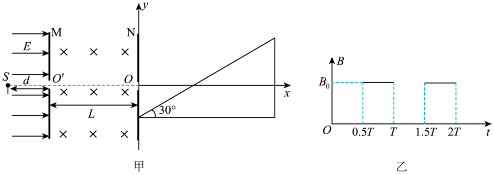

# Physics - 题目 1599

**ID**: f8c069f59b694a94b631ce94f30f12dd
**年级**: Grade 12
**难度**: Medium-Hard
**题型**: Calculation

## 题目
如图所示，在平面直角坐标系 $xOy$ 中，间距为 $L$ 的金属板M、N垂直于 $x$ 轴放置（金属板N与 $y$ 轴重合），金属板M左侧存在着电场强度大小为 $E$ 、方向沿 $x$ 轴正方向的匀强电场，金属板M、N之间存在着垂直于 $xOy$ 平面的磁场，其随时间 $t$ 的变化规律如图乙所示， $y$ 轴右侧有边界为正三角形、磁感应强度大小为 $B{{}_{1}}$ 、方向垂直 $xOy$ 平面向里的匀强磁场区域（未画出），另有一底边与 $x$ 轴平行、倾角为 $30{^{\circ }}$ 的固定斜面。​​​​​​​‌一质量为 $m$ 、电荷量为 $+q$ 的粒子从 $x$ 轴上的 $\mathrm{S}$ 点由静止释放，经过距离 $d$ 从 $O^{′}$ 点射入如图乙所示的变化磁场中（取粒子经过 $O^{′}$ 点为 $t=0$ 时刻，垂直 $xOy$ 平面向里为正方向， $T=$  $\sqrt {\frac {{\rm mL}{^{2}}}{8qEd}}$ ），粒子通过变化磁场后从 $O$ 点进入 $y$ 轴右侧区域，经正三角形磁场区域偏转后垂直打到固定斜面上，不计粒子重力。求：(1)粒子从 $O^{′}$ 点射入变化磁场时的速度大小；(2)粒子在变化磁场区域运动的时间及磁感应强度 $B{{}_{0}}$ 的最小值；(3)正三角形磁场区域的最小面积。

## 解答

1. （1）粒子在电场中做加速运动，根据动能定理得 $qEd=\frac {1}{2}mv{{}_{0}^{2}}-0$
2. 解得 $v{{}_{0}}=\sqrt {\frac {2qEd}{m}}$
3. （2）在变化磁场中， $0\sim 0.5T$ 时间内粒子做匀速直线运动，运动的距离 $x=v{{}_{0}}\cdot \frac {T}{2}$
4. 解得 $x=\frac {L}{4}$
5. 在变化磁场中， $0.5T\sim T$ 时间内粒子做匀速圆周运动，由洛伦兹力提供向心力 $qv{{}_{0}}B{{}_{0}}=m\frac {v{{}_{0}^{2}}}{R}$
6. 为保证粒子从 $O$ 点进入 $y$ 轴右侧区域，在 $0.5T\sim T$ 时间内粒子需转整数圈，粒子做圆周运动的周期 $T{{}_{圆}}=\frac {T}{2n}=\frac {2πR}{v{{}_{0}}}\left ({n=1,2,3\cdots }\right )$
7. 粒子做圆周运动的半径 $R⩽x$ ，才能保证粒子从 $O$ 点进入 $y$ 轴右侧区域，解得变化磁场磁感应强度的最小值 $B{{}_{0}}=$  $\frac {8π}{L}\sqrt {\frac {2Emd}{q}}$
8. 粒子从 $O^{′}$ 点射入变化磁场区域至运动到 $O$ 点的时间 $t=\frac {L}{v{{}_{0}}}+\frac {3T}{2}$
9. 解得 $t=3.5T=\frac {7}{8}\sqrt {\frac {2{\rm mL}{^{2}}}{qEd}}$
10. （3）粒子在正三角形磁场区域中做匀速圆周运动，轨迹如图所示
11. 
12. 由洛伦兹力提供向心力 $qv{{}_{0}}B{{}_{1}}=\frac {mv{{}_{0}^{2}}}{R^{′}}$
13. 等边三角形的高 $h=2R^{′}+R^{′}{{\rm{c}}}{\rm{o}}{\rm{s}}30{^{\circ }}$
14. 等边三角形的边长 $l=\frac {h}{{\rm{c}}{\rm{o}}{\rm{s}}30{^{\circ }}}$
15. 等边三角形的面积 $S=\frac {1}{2}hl$
16. 解得 $S=\frac {\left ({19\sqrt {3}+24}\right )mEd}{6qB{{}_{1}^{2}}}$

## 知识点

**中文**:
  - 带电粒子在周期性变化的电磁场中的运动

**English**:
  - Motion in Periodically Varying EM Fields

---
