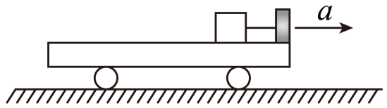

# Physics - 题目 1207

**ID**: f94070645bc742cbb92bd421725c5b67
**年级**: Grade 12
**难度**: Medium-Hard
**题型**: Calculation

## 题目
如图所示，一小滑块通过长度不计的短细绳拴接在小车的板壁上，滑块与小车底板之间无摩擦。​​​​​​​‌小车由静止开始始终向右做匀加速运动，经过 ${{2}}{\rm{s}}$ 细绳断掉，又经过一段时间t滑块从小车尾部掉下来，已知滑块在时间t内的头 ${{3}}{\rm{s}}$ 相对于小车滑行了 ${{4}}{{.}}{{5}}{\rm{m}}$ ，后 ${{3}}{\rm{s}}$ 内相对于小车滑行了 ${{1}}{{0}}{{.}}{{5}}{\rm{m}}$ ，求：（1）小车底板的长度；（2）从小车开始运动到离开车尾掉下，滑块相对于地面移动的距离。

## 解答

1. （1）设车的加速度为a，则 ${{2}}{\rm{s}}$ 末车、物的速度 $v{{}_{0}}=2a$
2. 绳断后，滑块匀速运动、车加速运动．t的头 ${{3}}{\rm{s}}$ ：滑块 $s{{}_{1}}=2a\times 3=6a$
3. 小车 $s{{}_{2}}=2a\times 3+\frac {1}{2}a\times 3{^{2}}=10.5a$
4. 所以 $Δs{{}_{1}}=s{{}_{2}}-s{{}_{1}}=4.5a=4.5$
5. 解得
6. $a=1{\rm{m}}{\rm{/}}{\rm{s}}{^{{{2}}}}{\rm \mathit{t}}$ 的后 ${{3}}{\rm{s}}$ ：滑块 $s{{}_{1}}^{′}=6a$
7. 小车：设初速度为v，则有 $s{{}_{2}^{\prime }}=v\times 3+\frac {1}{2}a\times 3{^{2}}=3v+4.5a$
8. 所以 $Δs{{}_{2}}=s{{}_{2}}\prime -s{{}_{1}}\prime =3v-1.5a=10.5$
9. 解得 $v=4{\rm{m}}{\rm{/}}{\rm{s}}$
10. 则 $t=\frac {4-2}{1}+3=5{\rm{s}}$ ， $L=2\times 5+\frac {1}{2}\times 1\times 5{^{2}}=12.5{\rm{m}}$
11. （2）滑块对地移动的总距离为 $s=\frac {1}{2}\times 1\times 2{^{2}}+2\times 5=12{\rm{m}}$

## 知识点

**中文**:
  - 板块模型

**English**:
  - Plate Model

---
