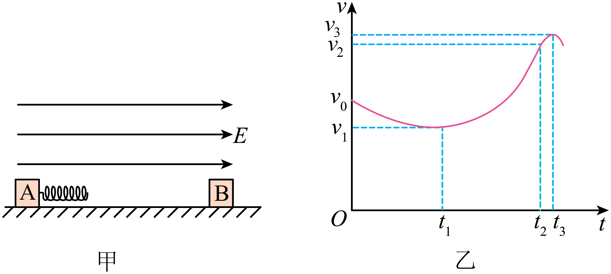

# Physics - 题目 2722

**ID**: ff0f41d4b3d64c9c95c62b98840b9b7f
**年级**: Grade 12
**难度**: Medium-Hard
**题型**: Calculation

## 题目
如图甲，一粗糙、绝缘水平面上有两个质量均为m的小滑块A和B，其电荷量分别为 $q\left ({q>0}\right )$ 和 $-q$ 。​​​​​​​‌A右端固定有轻质绝缘弹簧，弹簧处于原长。整个空间存在水平向右场强大小为E的匀强电场。A、B与水平面间的最大静摩擦力等于滑动摩擦力，其大小均为2qE。 $t=0$ 时，A以初速度 $v{{}_{0}}$ 向右运动，B处于静止状态。滑块A运动的v-t图像如图乙所示，在 $t{{}_{1}}$ 时刻，速度为 $v{{}_{1}}=\frac {4}{5}v{{}_{0}}$ ，并且为图线中速度的最小值，此时弹簧未与B相碰；在 $t{{}_{2}}$ 时刻，A的速度 $v{{}_{2}}=\frac {8}{5}v{{}_{0}}$ ；在 $t{{}_{3}}$ 时刻，A的速度达到最大，此时 $v{{}_{3}}=2v{{}_{0}}$ ，弹簧的弹力大小为3qE， $t{{}_{1}}、t{{}_{2}}、t{{}_{3}}$ 均为未知量。运动过程中，A、B处在同一直线上，A、B的电荷量始终保持不变且可看作点电荷，静电力常量为k；B与弹簧接触瞬间没有机械能损失，弹簧始终在弹性限度内，求：（1）0～ $t{{}_{1}}$ 时间内，合外力对A所做的功；（2） $t{{}_{1}}$ 时刻A与B之间的距离；（3） $t{{}_{2}}$ 时刻B的速度；（4） $t{{}_{1}}\sim t{{}_{3}}$ 时间内，库仑力和弹簧弹力对A和B做的总功。

## 解答

1. （1） $0\sim t{{}_{1}}$ 时间内，根据动能定理可得合外力对A所做的功 $W=\frac {1}{2}mv{{}_{1}^{2}}-\frac {1}{2}mv{{}_{0}^{2}}$ ，解得 $W=-\frac {9}{50}mv{{}_{0}^{2}}$
2. （2）速度—时间图像的斜率表示加速度，则由图乙可知， $t{{}_{1}}$ 时刻A的加速度为0，说明此时A所受合外力为0，设此时A、B相距 $x$ ，则根据平衡条件有 $k\frac {q{^{2}}}{x{^{2}}}+Eq=f$ ，其中 $f=2Eq$ ，联立解得 $x=\sqrt {\frac {kq}{E}}$
3. （3） $t{{}_{1}}$ 时刻B受到电场力与库仑力的合力与摩擦力大小相等，B开始运动， $t{{}_{1}}\sim t{{}_{2}}$ 时间内，A受到向右大小为Eq的电场力、向右的库仑力以及向左大小为2Eq的摩擦力，B受到向左大小为Eq的电场力、向左的库仑力以及向右大小为2Eq的摩擦力，可知A、B组成的系统合外力为0，则由动量守恒定律有 $mv{{}_{1}}=mv{{}_{2}}+mv{{}_{{\rm{B}}}}$ ，解得 $v{{}_{{\rm{B}}}}=-\frac {4}{5}v{{}_{0}}$
4. （4）根据题意，在 $t{{}_{3}}$ 时刻A的速度达到最大，此时A的加速度为0，合外力为0，设此时A、B间的距离为 $x{{}_{1}}$ ，则此时对A有 $F{{}_{弹}}+f=Eq+k\frac {q{^{2}}}{x{{}_{1}^{2}}}$ ，其中 $F{{}_{弹}}=3Eq$ ， $f=2Eq$ ，联立解得 $x{{}_{1}}=\frac {1}{2}\sqrt {\frac {kq}{E}}$  $t{{}_{1}}\sim t{{}_{3}}$ 时间内，对A、B组成的系统由动量守恒定律有 $mv{{}_{1}}=mv{{}_{3}}+mv^{′}{{{}_{{\rm{B}}}}}$ ，解得 $v^{′}{{{}_{{\rm{B}}}}}=-\frac {6}{5}v{{}_{0}}$ ，由动能定理有 $W{{}_{总}}+Eq(x-x{{}_{1}})-2Eq(x-x{{}_{1}})=\frac {1}{2}mv{{}_{3}^{2}}+\frac {1}{2}mv^{′}{{{}_{{\rm{B}}}^{2}}}-\frac {1}{2}mv{{}_{1}^{2}}$ ，解得 $W{{}_{总}}=\frac {q\sqrt {kqE}}{2}+\frac {12mv{{}_{0}^{2}}}{5}$

## 知识点

**中文**:
  - 带电粒子（物体）在重力场和电场组成的复合场中的运动

**English**:
  - Motion in Gravity and Electric Composite Fields

---
