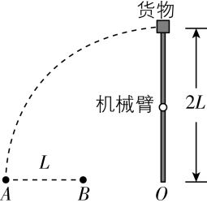
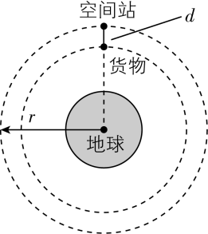

# Physics - 题目 534

**ID**: ffd857f2c9424d38b23dba0829f19a87
**年级**: Grade 12
**难度**: Medium-Hard
**题型**: Calculation

## 题目
(13分)在轨空间站中物体处于完全失重状态，对空间站的影响可忽略。​​​​​​​‌空间站上操控货物的机械臂可简化为两根相连的等长轻质臂杆，每根臂杆长为L。如图1所示，机械臂一端固定在空间站上的O点，另一端抓住质量为m的货物。在机械臂的操控下，货物先绕O点做半径为2L、角速度为ω的匀速圆周运动，运动到A点停下。然后在机械臂操控下，货物从A点由静止开始做匀加速直线运动，经时间t到达B点，A、B间的距离为L。(1)求货物做匀速圆周运动时受到的向心力大小F_{n}；(2)求货物运动到B点时机械臂对其做功的瞬时功率P；(3)在机械臂作用下，货物、空间站和地球的位置如图2所示，它们在同一直线上。货物与空间站同步做匀速圆周运动。已知空间站轨道半径为r，货物与空间站中心的距离为d，忽略空间站对货物的引力，求货物所受的机械臂作用力与所受的地球引力之比F_{1}∶F_{2}。图1    	    	    	图2

## 解答

1. (1)由向心力公式可得F_{n}＝mω^{2}·2L＝2mω^{2}L(2分)
2. (2)设货物到达B点时速度为v，机械臂对货物的作用力为F，由位移公式有 ${\rm \mathit{L}＝}\frac{0+v}{2}{\rm \mathit{t}}$ ，解得 ${\rm \mathit{v}＝}\frac{2L}{t}$     	    	    	    	    	    	    	    	(1分)
3. 由动量定理有Ft＝mv－0，解得 ${\rm \mathit{F}＝}\frac{mv}{t}{\rm ＝}$  $\frac{2{\rm mL}}{{t}^{2}}$     	    	    	    	(1分)
4. 货物到达B点时，机械臂对货物做功的瞬时功率
5. ${\rm \mathit{P}＝\mathit{Fv}＝}\frac{4m{L}^{2}}{{t}^{3}}$     	    	    	    	    	    	    	    	    	(2分)
6. (3)设空间站和货物同步做匀速圆周运动的角速度为ω_{0}，空间站质量为m_{0}，由题中“在轨空间站中物体处于完全失重状态，对空间站的影响可忽略”，
7. 对空间站受力分析有 ${\rm \mathit{G}}\frac{M{m}_{0}}{{r}^{2}}{\rm ＝\mathit{m}_{0}}$  ${\omega }_{0}^{2}{\rm \mathit{r}}$      	    	    	    	    	(2分)
8. 解得 ${\omega }_{0}^{2}{\rm ＝\mathit{G}}$  $\frac{M}{{r}^{3}}$ ，
9. 对货物受力分析有 ${\rm \mathit{F}_{2}－\mathit{F}_{1}＝\mathit{m}}{\omega }_{0}^{2}{\rm (\mathit{r}－\mathit{d})}$     	    	    	    	    	(2分)
10. ${\rm \mathit{F}_{2}＝\mathit{G}}\frac{Mm}{(r-d{)}^{2}}$ ，
11. 解得 ${\rm \mathit{F}_{1}＝\mathit{G}}\frac{Mm}{(r-d{)}^{2}}{\rm －\mathit{G}}$  $\frac{Mm(r-d)}{{r}^{3}}$(1分)
12. 由此可得，货物所受机械臂作用力与所受的地球引力之比 $\frac{{F}_{1}}{{F}_{2}}{\rm ＝1－}$  $\frac{(r-d{)}^{3}}{{r}^{3}}$     	(2分)

## 知识点

**中文**:
  - 非同步卫星问题

**English**:
  - Non-geostationary Satellites

---
